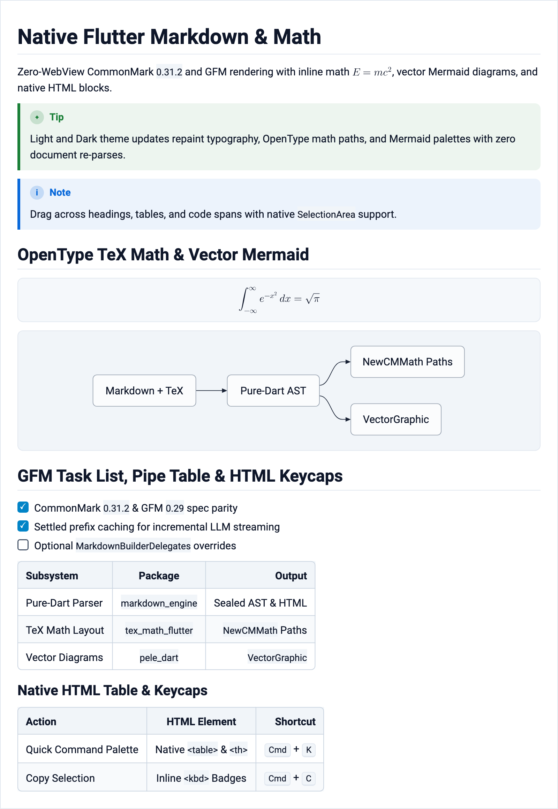
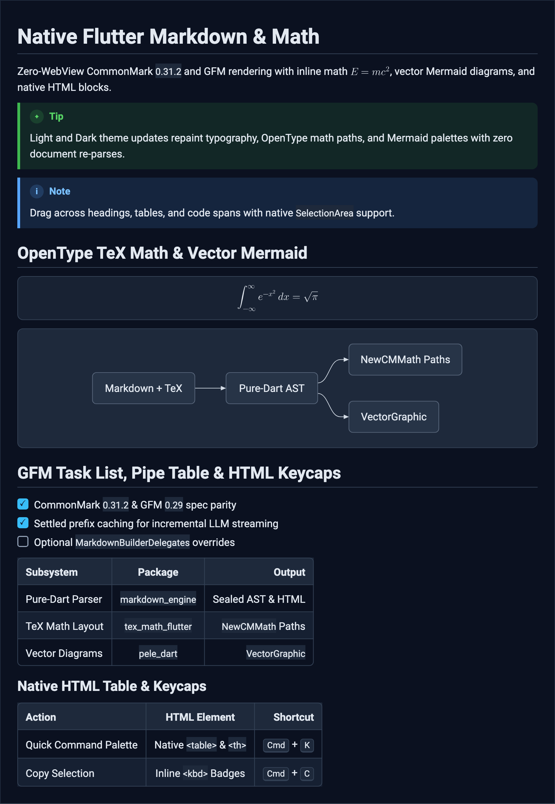

# API Manual

This manual documents the public API exported by **`package:markdown_engine/markdown_engine.dart`** (pure Dart) and **`package:markdown_engine_flutter/markdown_engine_flutter.dart`** (Flutter widgets and theming).

## Contents

* [Installation](#installation)
* [1. Core Engine, Document, and HTML Renderer](#1-core-engine-document-and-html-renderer)
* [2. Configuration](#2-configuration)
* [3. Security and Resource Budgets](#3-security-and-resource-budgets)
* [4. Incremental Editing and Streaming APIs](#4-incremental-editing-and-streaming-apis)
* [5. Sealed AST Reference and Supporting Types](#5-sealed-ast-reference-and-supporting-types)
* [6. Heading Anchor Slugs](#6-heading-anchor-slugs)
* [7. Flutter Package](#7-flutter-package)
  * [7.1 Views, Virtualized Slivers, and Layout-Safe Text](#71-views-virtualized-slivers-and-layout-safe-text)
  * [7.2 Theming](#72-theming)
  * [7.3 Navigation, Reading Position, and Background Isolate Reader](#73-navigation-reading-position-and-background-isolate-reader)
  * [7.4 Built-In Renderers, Pluggable Builders, and Security Delegates](#74-built-in-renderers-pluggable-builders-and-security-delegates)

## Installation

```bash
# Pure Dart (requires Dart ^3.8.0, package:meta only)
dart pub add markdown_engine

# Flutter (requires Dart ^3.13.0 and Flutter >=3.47.0)
flutter pub add markdown_engine_flutter
```

---

## 1. Core Engine, Document, and HTML Renderer

`MarkdownEngine` is a stateless, immutable entry point with zero global mutable state across parses. Parse Markdown strings synchronously into a `MarkdownDocument`, or invoke `renderToHtml` and `toPlainText` directly.

| Symbol | Signature / Key Members | Behavior |
| :--- | :--- | :--- |
| `MarkdownEngine` | `const MarkdownEngine({MarkdownOptions defaultOptions = const MarkdownOptions()})` | Configures default `MarkdownOptions` applied when per-call options are omitted. |
| `MarkdownEngine.parse` | `MarkdownDocument parse(String source, {MarkdownOptions? options})` | Enforces `maxInputLength` (throws `RangeError` if exceeded) and returns an immutable `MarkdownDocument`. |
| `MarkdownEngine.renderToHtml` | `String renderToHtml(String source, {MarkdownOptions? options})` | Parses `source` and serializes directly to CommonMark/GFM HTML. |
| `MarkdownEngine.toPlainText` | `String toPlainText(String source, {MarkdownOptions? options})` | Parses `source` and extracts normalized plain text joined across blocks by `\n\n`. |
| `MarkdownDocument` (content) | `source`, `options`, `blocks`, `isEmpty` | Immutable parsed document holding normalized source text, active options, and frozen AST blocks. |
| `MarkdownDocument` (lazy metadata) | `outline`, `frontmatter`, `footnotes`, `linkDefinitions`, `abbreviations`, `remoteImageAddresses` | Lazy getters computed on first access without penalizing simple parses. |
| `MarkdownDocument` (exporters) | `toHtml()`, `toPlainText()`, `toJson()` | Serializes the parsed document to sanitized HTML, plain text, or JSON metadata. |
| `HtmlRenderer` | `const HtmlRenderer({MarkdownOptions options = const MarkdownOptions()})`, `String render(List<MarkdownBlockNode> blocks)` | Renders `MarkdownBlockNode` lists to HTML while enforcing `gfmTagFilter`, `sanitizeHtml`, `sanitizeUrls`, and `maxHtmlBytes`. |

```dart
import 'package:markdown_engine/markdown_engine.dart';

void main() {
  const MarkdownEngine engine = MarkdownEngine();

  final MarkdownDocument doc = engine.parse('''---
title: Release Notes
---

# Overview

Pure-Dart **CommonMark** and *GFM* with `code`, ~~old~~, and ==highlight==.
''');

  final String html = doc.toHtml();
  final String text = doc.toPlainText();
  final Map<String, Object?> summary = doc.toJson();
  assert(doc.frontmatter?['title'] == 'Release Notes');
  assert(doc.outline.first.slug == 'overview');
  assert(html.isNotEmpty && text.isNotEmpty && summary['blockCount'] == doc.blocks.length);
}
```

---

## 2. Configuration

`MarkdownOptions` provides four constructors for standard presets plus `copyWith(...)` for per-field overrides:

| Preset Constructor | Enabled Feature Set |
| :--- | :--- |
| `const MarkdownOptions(...)` | Enables all 23 extensions by default (each individually opt-out), with `sanitizeUrls: true`, `sanitizeHtml: false`, and `urlPolicy: const MarkdownUrlPolicy.strict()`. |
| `const MarkdownOptions.commonMark(...)` | Strict CommonMark `0.31.2` compliance with all 23 extensions disabled (`false`), `sanitizeUrls: true`, and `urlPolicy: const MarkdownUrlPolicy()`. |
| `const MarkdownOptions.gfm(...)` | Standard GitHub Flavored Markdown (`0.29.0.gfm.13`): fixes the five core GFM flags `true`, defaults `footnotes` and `headingSlugs` to `true`, leaves the remaining 16 extensions opt-in (`false`), and uses `const MarkdownUrlPolicy()`. |
| `const MarkdownOptions.extended(...)` | Named preset matching `const MarkdownOptions()` with all 23 extensions enabled and `urlPolicy: const MarkdownUrlPolicy.strict()`. |

### Complete Option Reference

| Field | Type | Default (`MarkdownOptions()`) | Description |
| :--- | :--- | :--- | :--- |
| `gfmTables` | `bool` | `true` | Parses GFM pipe tables (`TableNode`). |
| `gfmStrikethrough` | `bool` | `true` | Parses GFM strikethrough (`~...~` / `~~...~~` -> `StrikethroughNode`). |
| `gfmTaskLists` | `bool` | `true` | Parses GFM task checkboxes (`- [ ]` / `- [x]` -> `ListItemNode.taskState`). |
| `gfmAutolinks` | `bool` | `true` | Parses GFM extended autolinks (`www.`, `http(s)://`, emails). |
| `gfmTagFilter` | `bool` | `true` | Escapes GFM disallowed raw HTML opening tags (`<script`, `<style`, `<iframe`, etc.). |
| `footnotes` | `bool` | `true` (`false` in `.commonMark()`) | Enables footnote definitions (`[^id]: ...`) and inline citations (`[^id]`). |
| `alerts` | `bool` | `true` (`false` in `.commonMark()` / `.gfm()`) | Enables GitHub-style blockquote alerts (`[!NOTE]`, `[!TIP]`, `[!IMPORTANT]`, `[!WARNING]`, `[!CAUTION]`). |
| `frontmatter` | `bool` | `true` (`false` in `.commonMark()` / `.gfm()`) | Extracts leading YAML (`---`) or TOML (`+++`) frontmatter into `FrontmatterNode` and `MarkdownDocument.frontmatter`. |
| `definitionLists` | `bool` | `true` (`false` in `.commonMark()` / `.gfm()`) | Parses PHP Markdown Extra style definition lists (`DefinitionListNode`). |
| `math` | `bool` | `true` (`false` in `.commonMark()` / `.gfm()`) | Parses inline (`$...$`, `\(...\)`) and display (`$$...$$`, `\[...\]`) LaTeX math into `MathInlineNode` and `MathBlockNode`. |
| `headingSlugs` | `bool` | `true` (`false` in `.commonMark()`) | Populates deduplicated GitHub-style anchor slugs on `HeadingNode.slug` and `MarkdownDocument.outline`. |
| `highlight` | `bool` | `true` (`false` in `.commonMark()` / `.gfm()`) | Parses `==text==` into `HighlightNode` (`<mark>`). |
| `subscript` | `bool` | `true` (`false` in `.commonMark()` / `.gfm()`) | Parses `~text~` into `SubscriptNode` (`<sub>`) without breaking `~~strike~~`. |
| `superscript` | `bool` | `true` (`false` in `.commonMark()` / `.gfm()`) | Parses `^text^` into `SuperscriptNode` (`<sup>`). |
| `emoji` | `bool` | `true` (`false` in `.commonMark()` / `.gfm()`) | Expands common `:shortcode:` emoji tokens (`:rocket:`, `:tada:`, etc.). |
| `smartPunctuation` | `bool` | `true` (`false` in `.commonMark()` / `.gfm()`) | Converts `--`, `---`, `...`, and straight quotes into typographic punctuation. |
| `explicitHeadingIds` | `bool` | `true` (`false` in `.commonMark()` / `.gfm()`) | Parses trailing `{#custom-id}` heading attributes into `HeadingNode.explicitId` and emits `id="..."` in HTML. |
| `detailsBlocks` | `bool` | `true` (`false` in `.commonMark()` / `.gfm()`) | Extracts `<details>` / `<summary>` blocks into structured `DetailsBlockNode`s. |
| `figureBlocks` | `bool` | `true` (`false` in `.commonMark()` / `.gfm()`) | Extracts `<figure>` / `<figcaption>` blocks into structured `FigureBlockNode`s. |
| `alignedBlocks` | `bool` | `true` (`false` in `.commonMark()` / `.gfm()`) | Extracts `<div align="...">` containers into structured `AlignedBlockNode`s. |
| `kbd` | `bool` | `true` (`false` in `.commonMark()` / `.gfm()`) | Parses inline `<kbd>...</kbd>` tags into `KbdInlineNode`s. |
| `abbreviations` | `bool` | `true` (`false` in `.commonMark()` / `.gfm()`) | Extracts `*[ABBR]: Expansion` definitions and wraps matching text in `AbbrInlineNode`. |
| `inlineBreaks` | `bool` | `true` (`false` in `.commonMark()` / `.gfm()`) | Parses inline `<br>` / `<br />` HTML tags into `InlineBreakNode`s. |
| `sanitizeHtml` | `bool` | `false` | Strips dangerous raw HTML elements, `on*` event attributes, `srcdoc`, unsafe CSS styles, and disallowed URI attributes. |
| `sanitizeUrls` | `bool` | `true` | Validates link, image, and `<picture>` destinations against `urlPolicy`. |
| `collapseNestedStrong` | `bool` | `false` | Collapses nested `<strong>` tags during HTML rendering to match `cmark 0.29` output. |
| `maxInputLength` | `int` (getter) | `500000` | Optional override merged into `effectiveBudgets.maxInputLength`. |
| `maxNestingDepth` | `int` (getter) | `64` | Optional override merged into `effectiveBudgets.maxNestingDepth`. |
| `budgets` | `MarkdownBudgets` | `const MarkdownBudgets()` | Full resource and complexity limit bundle (`effectiveBudgets` merges top-level overrides). |
| `urlPolicy` | `MarkdownUrlPolicy` | `const MarkdownUrlPolicy.strict()` | Scheme and host validation policy applied when `sanitizeUrls` is `true` (`.commonMark()` and `.gfm()` default to `const MarkdownUrlPolicy()`). |

---

## 3. Security and Resource Budgets

### `MarkdownBudgets`

Configure deterministic limits on untrusted Markdown inputs via `MarkdownBudgets` (with `copyWith(...)`):

| Field | Default Constant | Default Value | Protected Resource |
| :--- | :--- | ---: | :--- |
| `maxInputLength` | `defaultMaxInputLength` | `500000` | Maximum input UTF-16 code units accepted per parse call. |
| `maxNestingDepth` | `defaultMaxNestingDepth` | `64` | Maximum nested container and inline depth. |
| `maxBlocks` | `defaultMaxBlocks` | `50000` | Maximum AST block nodes emitted per document. |
| `maxTableColumns` | `defaultMaxTableColumns` | `128` | Maximum columns per GFM pipe table. |
| `maxTableRows` | `defaultMaxTableRows` | `10000` | Maximum body rows per GFM pipe table. |
| `maxHtmlBytes` | `defaultMaxHtmlBytes` | `250000` | Cumulative raw HTML emission budget before escaping remaining HTML. |
| `maxTokens` | `defaultMaxTokens` | `500000` | Maximum inline scanner and delimiter-stack work units per document. |
| `maxOutputBytes` | `defaultMaxOutputBytes` | `4194304` | Maximum cumulative rendered HTML output and reference/abbreviation expansion budget. |

### `MarkdownUrlPolicy`

`MarkdownUrlPolicy` validates URI destinations after stripping control, Unicode whitespace, and zero-width characters to neutralize obfuscated schemes, backslashes (`/\`, `\/`, `\\`), and authority userinfo.

| Member | Type / Signature | Default & Behavior |
| :--- | :--- | :--- |
| `MarkdownUrlPolicy(...)` | `const MarkdownUrlPolicy({...})` | Blocklist constructor rejecting `blockedSchemes`, protocol-relative `//`, and userinfo `@` by default. |
| `MarkdownUrlPolicy.strict(...)` | `const MarkdownUrlPolicy.strict({...})` | Strict allowlist constructor permitting `defaultStrictSchemes` (`http`, `https`, `mailto`), plus relative/fragment URLs when enabled. |
| `blockedSchemes` | `Set<String>` | `defaultBlockedSchemes` (`{'javascript', 'vbscript', 'data'}`). |
| `allowedSchemes` | `Set<String>?` | `null` (`defaultStrictSchemes` in `.strict()`, overriding `blockedSchemes` as a strict allowlist). |
| `allowedHosts` | `Set<String>?` | `null` (when non-null, restricts authority hosts case-insensitively after stripping ports and IPv6 brackets). |
| `allowRelative` | `bool` | `true` — permits scheme-less relative paths and empty destinations. |
| `allowFragments` | `bool` | `true` — permits `#section` fragment links. |
| `allowSafeImageDataUrls` | `bool` | `false` — allows base64 `data:image/(png|jpeg|jpg|gif|webp)` URIs while keeping SVG and HTML `data:` URIs blocked. |
| `allowProtocolRelative` | `bool` | `false` — controls whether protocol-relative authority URLs (`//host/path`) are accepted. |
| `allowUserInfo` | `bool` | `false` — controls whether authority userinfo (`user:pass@host`) is accepted. |
| `isAllowed` | `bool isAllowed(String url)` | Returns `true` if `url` satisfies the policy. |
| `sanitize` | `String sanitize(String url, {String fallback = ''})` | Returns `url` if allowed, otherwise returns `fallback`. |

```dart
import 'package:markdown_engine/markdown_engine.dart';

const MarkdownOptions strictUserContent = MarkdownOptions.gfm(
  sanitizeHtml: true,
  sanitizeUrls: true,
  urlPolicy: MarkdownUrlPolicy(
    allowedSchemes: <String>{'https', 'mailto'},
    allowRelative: false,
    allowFragments: true,
  ),
  budgets: MarkdownBudgets(
    maxInputLength: 100000,
    maxNestingDepth: 32,
  ),
);
```

---

## 4. Incremental Editing and Streaming APIs

### `IncrementalMarkdownParser` & `IncrementalParseResult`

Reuse unchanged top-level AST blocks (preserving stable `blockId` values) across live editor edits while shifting suffix spans cleanly:

| Symbol | Signature / Members | Behavior |
| :--- | :--- | :--- |
| `IncrementalMarkdownParser` | `const IncrementalMarkdownParser({MarkdownEngine engine = const MarkdownEngine()})` | Stateless incremental parser wrapping a `MarkdownEngine`. |
| `parseIncremental` | `IncrementalParseResult parseIncremental(String newSource, {MarkdownDocument? previousDocument, IncrementalParseResult? previousResult, int? editStartOffset, int? editOldEndOffset, int? editNewEndOffset, MarkdownOptions? options})` | Diffs `newSource` against the previous document, reuses blank-line-isolated prefix and suffix blocks, parses only the dirty slice, and falls back safely when definitions or frontmatter change. |
| `IncrementalParseResult` | `document`, `reusedBlockCount`, `reparsedBlockCount` | Immutable result pairing the updated `MarkdownDocument` with block reuse counts. |

```dart
import 'package:markdown_engine/markdown_engine.dart';

void editDocument() {
  const IncrementalMarkdownParser parser = IncrementalMarkdownParser(
    engine: MarkdownEngine(defaultOptions: MarkdownOptions.gfm()),
  );

  final IncrementalParseResult v1 = parser.parseIncremental(
    '# Guide\n\nFirst paragraph.\n\nSecond paragraph.\n',
  );
  final IncrementalParseResult v2 = parser.parseIncremental(
    '# Guide\n\nUpdated paragraph.\n\nSecond paragraph.\n',
    previousResult: v1,
    editStartOffset: 9,
    editOldEndOffset: 25,
    editNewEndOffset: 27,
  );
  assert(v2.reusedBlockCount == 2 && v2.reparsedBlockCount == 1);
}
```

### `StreamingMarkdownController`

Accumulate chunked token streams while freezing settled prefix blocks and reparsing only the active trailing slice:

| Member | Type / Signature | Behavior |
| :--- | :--- | :--- |
| Constructor | `StreamingMarkdownController({MarkdownEngine engine = const MarkdownEngine(), MarkdownOptions? options})` | Initializes an empty streaming session. |
| `append` | `MarkdownDocument append(String chunk)` | Enforces `maxInputLength`, updates active tail blocks via fast paths where eligible, freezes settled prefix blocks, notifies listeners, and returns the updated `MarkdownDocument`. |
| `replaceText` | `MarkdownDocument replaceText(String fullText)` | Replaces buffered text while preserving unchanged settled prefix blocks, then notifies listeners. |
| `finish` | `MarkdownDocument finish()` | Finalizes the stream with exact semantic AST and HTML parity against `MarkdownEngine.parse(buffer)` and notifies listeners. |
| `reset` | `void reset()` | Clears buffered text, settled blocks, and active blocks back to an empty state and notifies listeners. |
| `addListener` / `removeListener` / `dispose` | `void addListener(void Function() listener)` | Synchronous pure-Dart push listener registration invoked on `append`, `replaceText`, `finish`, and `reset`. |
| `settledPrefixBlockCount` | `int get` | Exact prefix length of `currentDocument.blocks` whose frozen objects stay identical across active tail chunks (`0` while definitions force full reparses; equals `currentDocument.blocks.length` after `finish()`). |
| State getters | `effectiveOptions`, `buffer`, `currentDocument`, `document`, `settledBlocks`, `activeBlocks`, `settledBlockCount`, `isFinished`, `html` | Inspect current stream state, blocks, and rendered HTML without triggering redundant parses. |

```dart
import 'package:markdown_engine/markdown_engine.dart';

MarkdownDocument consumeStream(Iterable<String> chunks) {
  final StreamingMarkdownController controller = StreamingMarkdownController(
    options: const MarkdownOptions.gfm(),
  );
  for (final String chunk in chunks) {
    final MarkdownDocument partial = controller.append(chunk);
    assert(partial.blocks.length >= controller.settledBlockCount);
  }
  return controller.finish();
}
```

---

## 5. Sealed AST Reference and Supporting Types

### Supporting Metadata & Value Types

| Type | Key Members | Role |
| :--- | :--- | :--- |
| `SourceSpan` | `startOffset`, `endOffset`, `startLine`, `endLine`, `length`, `shift(offsetDelta, lineDelta)`, `SourceSpan.zero` | UTF-16 offset range and 1-based line numbers attached to every block and inline node. |
| `AlertKind` | `note`, `tip`, `important`, `warning`, `caution` | Severity category for GitHub-style `AlertNode` blocks. |
| `TableAlignment` | `none`, `left`, `center`, `right` | Column and container horizontal alignment for `TableNode`, `TableCellNode`, and `AlignedBlockNode`. |
| `TableCellNode` | `children`, `alignment`, `span`, `toPlainText()`, `shiftSpan(...)` | Single header or body cell inside a `TableNode`. |
| `DefinitionGroup` | `term`, `definitions`, `span`, `toPlainText()`, `shiftSpan(...)` | Term (`<dt>`) and block definition list (`<dd>`) entry inside a `DefinitionListNode`. |
| `MarkdownFrontmatter` | `format` (`'yaml'` / `'toml'`), `raw`, `entries`, `operator [](String key)` | Parsed structured document frontmatter exposed on `MarkdownDocument.frontmatter` and `FrontmatterNode`. |
| `MarkdownOutlineItem` | `text`, `level`, `line`, `slug`, `span` | Source-order heading entry exposed via `MarkdownDocument.outline`. |
| `MarkdownLinkDefinition` | `label`, `normalizedLabel`, `destination`, `title`, `span` | Resolved CommonMark link reference definition exposed via `MarkdownDocument.linkDefinitions`. |

### Block AST Nodes (`sealed class MarkdownBlockNode`)

Every `MarkdownBlockNode` exposes `blockId`, `span`, `toPlainText()`, and `shiftSpan(offsetDelta, lineDelta)`:

| Subtype | Specific Members | Markdown Construct |
| :--- | :--- | :--- |
| `FrontmatterNode` | `frontmatter`, `format`, `raw`, `entries` | Leading YAML (`---`) or TOML (`+++`) metadata block. |
| `HeadingNode` | `level` (`1..6`), `text`, `slug`, `explicitId`, `children`, `isSetext` | ATX (`#`) or setext (`===` / `---`) heading. |
| `ParagraphNode` | `children` | Paragraph (`<p>`). |
| `CodeBlockNode` | `literal`, `info`, `language`, `isFenced`, `codeUnitOffset` | Fenced (```` ``` ```` / `~~~`) or 4-space indented code block. |
| `BlockQuoteNode` | `children` | Blockquote container (`>`). |
| `AlertNode` | `kind` (`AlertKind`), `title`, `children` | GitHub callout (`> [!NOTE]`, `> [!WARNING]`, etc.). |
| `ListNode` | `ordered`, `start`, `tight`, `delimiter`, `items` | Bullet (`<ul>`) or ordered (`<ol>`) list. |
| `ListItemNode` | `taskState`, `isChecked`, `isTaskItem`, `children` | List item (`<li>`), optionally carrying a GFM task checkbox state. |
| `TableNode` | `alignments`, `headers`, `rows` | GFM pipe table (`<table>`). |
| `ThematicBreakNode` | *(inherits `blockId`, `span`)* | Horizontal rule (`---`, `***`, `___`). |
| `HtmlBlockNode` | `literal`, `html`, `blockType` (`1..7`) | CommonMark raw HTML block (types 1–7). |
| `DetailsBlockNode` | `summary`, `summaryInlines`, `initiallyOpen`, `children` | Collapsible `<details>` / `<summary>` disclosure block. |
| `AlignedBlockNode` | `alignment` (`TableAlignment`), `children` | Explicitly aligned container (`<div align="...">`). |
| `FigureBlockNode` | `children`, `caption`, `captionInlines` | `<figure>` container with optional `<figcaption>`. |
| `MathBlockNode` | `latex` | Display LaTeX math block (`$$...$$` or `\[...\]`). |
| `DefinitionListNode` | `groups` (`List<DefinitionGroup>`) | PHP Markdown Extra definition list (`<dl>`). |
| `FootnoteDefinitionNode` | `label`, `index`, `referenceCount`, `children` | Individual footnote definition (`[^label]: ...`). |
| `FootnoteSectionNode` | `definitions` (`List<FootnoteDefinitionNode>`) | Appended footnotes footer (`<section class="footnotes">`). |

### Inline AST Nodes (`sealed class MarkdownInlineNode`)

Every `MarkdownInlineNode` exposes `span`, `toPlainText()`, and `shiftSpan(offsetDelta, lineDelta)`:

| Subtype | Specific Members | Markdown Construct |
| :--- | :--- | :--- |
| `TextNode` | `text` | Decoded literal text run. |
| `SoftBreakNode` | *(inherits `span`)* | Soft line break (`\n` inside a paragraph). |
| `HardBreakNode` | *(inherits `span`)* | Hard line break (`  \n` or `\\\n`). |
| `CodeSpanNode` | `literal`, `code` | Backtick-delimited inline code span (`<code>`). |
| `EmphasisNode` | `children`, `delimiter` (`'*'` / `'_'`) | Italic emphasis (`<em>`). |
| `StrongNode` | `children`, `delimiter` (`'**'` / `'__'`) | Bold strong emphasis (`<strong>`). |
| `StrikethroughNode` | `children` | GFM strikethrough (`<del>`). |
| `HighlightNode` | `children` | Highlighted text (`==text==` -> `<mark>`). |
| `SubscriptNode` | `children` | Subscript span (`~text~` -> `<sub>`). |
| `SuperscriptNode` | `children` | Superscript span (`^text^` -> `<sup>`). |
| `LinkNode` | `destination`, `title`, `children`, `isAutolink` | Inline, reference, or autolink hyperlink (`<a>`). |
| `ImageNode` | `destination`, `alt`, `title`, `width`, `height`, `children` | Markdown or sized image (``). |
| `MathInlineNode` | `latex` | Inline LaTeX math (`$...$` or `\(...\)`). |
| `FootnoteRefNode` | `label`, `index`, `occurrenceIndex` | Inline footnote citation (`[^label]`). |
| `KbdInlineNode` | `children` | Keyboard key tag (`<kbd>`). |
| `AbbrInlineNode` | `title`, `children` | Expanded abbreviation (`<abbr title="...">`). |
| `AnchorInlineNode` | `id` | Explicit inline anchor (`<a id="..."></a>` or `<a name="..."></a>`). |
| `PictureInlineNode` | `lightSource`, `darkSource`, `alt` | Light/dark theme-aware `<picture>` element. |
| `InlineBreakNode` | *(inherits `span`)* | Parsed inline `<br>` / `<br />` element. |
| `RawHtmlInlineNode` | `html`, `literal` | Raw inline HTML tag, comment, or declaration. |

### Exhaustive Pattern Matching Example

```dart
import 'package:markdown_engine/markdown_engine.dart';

String describeBlock(MarkdownBlockNode block) {
  return switch (block) {
    FrontmatterNode(:final String format) => 'frontmatter ($format)',
    HeadingNode(:final int level, :final String text) => 'H$level: $text',
    ParagraphNode() => 'paragraph',
    CodeBlockNode(:final String? language) => 'code (${language ?? 'plain'})',
    BlockQuoteNode() => 'blockquote',
    AlertNode(:final AlertKind kind) => 'alert (${kind.name})',
    ListNode(:final bool ordered, :final List<ListItemNode> items) =>
      '${ordered ? 'ordered' : 'bullet'} list (${items.length} items)',
    ListItemNode() => 'list item',
    TableNode(:final List<List<TableCellNode>> rows) =>
      'table (${rows.length} rows)',
    ThematicBreakNode() => 'hr',
    HtmlBlockNode(:final int blockType) => 'html block (type $blockType)',
    DetailsBlockNode(:final String summary) => 'details ($summary)',
    AlignedBlockNode(:final TableAlignment alignment) =>
      'aligned (${alignment.name})',
    FigureBlockNode() => 'figure',
    MathBlockNode() => 'math block',
    DefinitionListNode() => 'definition list',
    FootnoteDefinitionNode(:final String label) => 'footnote ($label)',
    FootnoteSectionNode() => 'footnotes section',
  };
}
```

---

## 6. Heading Anchor Slugs

Generate deterministic GitHub-style heading anchor slugs via `HeadingSlugGenerator` and `slugifyHeadingText` directly outside a full parse:

| Symbol | Signature / Members | Behavior |
| :--- | :--- | :--- |
| `slugifyHeadingText` | `String slugifyHeadingText(String text)` | Case-folds text, converts spaces/tabs to `-`, preserves ASCII alphanumerics, `-`, `_`, and non-ASCII letters/digits, strips punctuation, and returns `'section'` when empty. |
| `HeadingSlugGenerator` | `HeadingSlugGenerator()`, `generate(text)`, `clone()`, `reset()`, `isNotEmpty` | Tracks previously emitted slugs and appends `-1`, `-2`, ... on collisions (`overview`, `overview-1`, `overview-2`). |

---

## 7. Flutter Package

`package:markdown_engine_flutter/markdown_engine_flutter.dart` wraps `markdown_engine` in virtualized Flutter widgets, built-in OpenType TeX math (`tex_math_flutter`) and Mermaid diagram (`pele_dart` + `vector_graphics`) renderers, Material and widgets-first theming, background isolate document reading, and native text selection (requiring Dart `^3.13.0` and Flutter `>=3.47.0`).

Importing `markdown_engine_flutter` also re-exports 19 core types from `markdown_engine`:

| Re-Export Category | Symbols |
| :--- | :--- |
| **Engine, Options & Document** | `MarkdownEngine`, `MarkdownOptions`, `MarkdownDocument`, `MarkdownOutlineItem`, `MarkdownFrontmatter` |
| **Security & Budgets** | `MarkdownBudgets`, `MarkdownUrlPolicy` |
| **Incremental & Streaming** | `IncrementalMarkdownParser`, `IncrementalParseResult`, `StreamingMarkdownController` |
| **AST Nodes & Value Types** | `MarkdownBlockNode`, `MarkdownInlineNode`, `CodeBlockNode`, `ImageNode`, `MathBlockNode`, `MathInlineNode`, `AlertKind`, `TableAlignment`, `SourceSpan` |

### 7.1 Views, Virtualized Slivers, and Layout-Safe Text

#### `MarkdownView` Constructors

| Constructor | Key Parameters | Behavior |
| :--- | :--- | :--- |
| `MarkdownView` | `String data`, plus optional `options`, `engine` | Parses `data` once in widget state, applies `IncrementalMarkdownParser` on subsequent edits, and skips re-parses across Light/Dark theme toggles. |
| `MarkdownView.document` | `required MarkdownDocument document` | Renders a pre-parsed `MarkdownDocument` (for example from `MarkdownDocumentReader`) with zero parsing work inside the widget. |
| `MarkdownView.streaming` | `required StreamingMarkdownController controller`, optional `markdownController`, `listenable`, `pollInterval` *(deprecated no-op)* | Subscribes to `StreamingMarkdownController` push listeners without polling timers, freezing settled rich blocks while streaming trailing content. |

All three `MarkdownView` constructors accept the shared configuration parameters below:

| Parameter | Type & Default | Purpose |
| :--- | :--- | :--- |
| `controller` (`markdownController` on `.streaming`) | `MarkdownController?` (`null`) | Coordinates outline state, reading position, parse counts, and anchor scrolling. |
| `theme` | `MarkdownThemeData?` (`null`) | Overrides the ambient `MarkdownTheme`. |
| `delegates` | `MarkdownBuilderDelegates` (`const MarkdownBuilderDelegates()`) | Configures image privacy policies, link callbacks, built-in opt-outs, and custom block/inline builders. |
| `selectable` | `bool` (`true`) | Wraps content in `SelectionArea` (`MaterialApp`) or `SelectableRegion` (`WidgetsApp`) with full-document `Cmd+A` / Copy and excluded UI chrome. |
| `focusNode` | `FocusNode?` (`null`) | Optional focus node forwarded to the enclosing selection scope for keyboard shortcuts. |
| `scrollable` | `bool` (`true`) | Uses a virtualized `CustomScrollView` when `true`, or a compact `Column` when `false`. |
| `showFrontmatter` | `bool` (`true`) | Renders leading YAML/TOML `FrontmatterNode` metadata cards when present. |
| `remoteImagesApproved` | `bool` (`false`) | Marks remote images as approved in `MarkdownImagePolicy.ask` mode. |
| `padding` | `EdgeInsetsGeometry` (`EdgeInsets.zero`) | Outer viewport padding around rendered Markdown blocks. |
| `scrollController` / `physics` / `shrinkWrap` / `cacheExtent` | Scroll view options | Forwarded directly to the internal `CustomScrollView` when `scrollable` is `true`. |

#### `SliverMarkdownDocument` & `MarkdownRichText`

| Symbol | Signature / Key Members | Behavior |
| :--- | :--- | :--- |
| `SliverMarkdownDocument` | `const SliverMarkdownDocument({required document, theme, delegates, controller, showFrontmatter = true, padding, addAutomaticKeepAlives = true, addRepaintBoundaries = true, remoteImagesApproved = false, onRequestLoadRemoteImages, startBlockIndex = 0, endBlockIndex, trailingBlockSpacing = false, streamingNormalizedSource})` | Virtualized sliver materializing visible blocks keyed by `blockId`, preserving active off-screen selections via keep-alives and caching block extents for smooth flings. |
| `SliverMarkdownDocument.visibleBlocksFor` | `static List<MarkdownBlockNode> visibleBlocksFor(MarkdownDocument document, {required bool showFrontmatter, int startBlockIndex = 0, int? endBlockIndex})` | Returns visible top-level blocks honoring `showFrontmatter` and optional `[startBlockIndex, endBlockIndex)` slice bounds. |
| `MarkdownRichText` | `const MarkdownRichText(String data, {Key? key, style, strutStyle, textAlign, textDirection, locale, softWrap, overflow, textScaleFactor, textScaler, maxLines, semanticsLabel, semanticsIdentifier, textWidthBasis, textHeightBehavior, selectionColor})` | Drop-in `Text` subclass (`textScaleFactor` deprecated in favor of `textScaler`) ensuring selection hit testing and screen-order sorting wait until layout is clean in debug, profile, and release builds. |
| `MarkdownRichText.rich` | `const MarkdownRichText.rich(InlineSpan textSpan, {...})` | `Text.rich`-compatible `MarkdownRichText` constructor supporting nested `TextSpan` and `WidgetSpan` children with identical release-safe selection guards. |

### 7.2 Theming

| Symbol | Constructors / Key Members | Behavior |
| :--- | :--- | :--- |
| `MarkdownTheme` | `const MarkdownTheme({required data, required child})`, `MarkdownTheme.of(context)`, `MarkdownTheme.maybeOf(context)` | `InheritedTheme` propagating `MarkdownThemeData`; `of(context)` falls back to `MarkdownThemeData.fromTheme(context)` when absent. |
| `MarkdownThemeData` (constructors) | `const MarkdownThemeData(...)`, `.light(...)`, `.dark(...)`, `.fallback`, `.fromColorScheme(...)`, `.fromTheme(...)`, `.copyWith(...)`, `.lerp(a, b, t)` | Immutable theme token factories, preset constructors, and animated theme interpolation. |
| `MarkdownThemeData` (tokens & styles) | `highlightFill`, `alertPalette`, `defaultCodeFontFallback`, `effective*` getters, `headingFontSize`, `bodyTextStyle`, `headingTextStyle`, `codeTextStyle` | Brightness, color tokens, alert palette, font fallback list, and typography helpers. |
| `MarkdownAlertPalette` | `const MarkdownAlertPalette({required note, required tip, required important, required warning, required caution})`, `.light()`, `.dark()`, `forKind(AlertKind)`, `copyWith(...)`, `lerp(a, b, t)` | Color palette mapping all five GitHub `AlertKind` severities (`note`, `tip`, `important`, `warning`, `caution`). |
| `MarkdownAlertColors` | `const MarkdownAlertColors({required border, required background, required foreground})`, `copyWith(...)`, `lerp(a, b, t)` | Border, background tint, and icon/title foreground triple for a single GitHub alert level. |

| Light Theme (`MarkdownThemeData.light()`) | Dark Theme (`MarkdownThemeData.dark()`) |
| :---: | :---: |
|  |  |

### 7.3 Navigation, Reading Position, and Background Isolate Reader

| Symbol | Constructors / Key Members | Behavior |
| :--- | :--- | :--- |
| `MarkdownController` (state) | `MarkdownController({MarkdownDocument? initialDocument})`, `document`, `outline`, `parseCount`, `readingPlace`, `readingPlaceNotifier`, `showFrontmatter`, `scrollController` | `ChangeNotifier` tracking parsed document state, heading outline, parse telemetry, and isolated `readingPlaceNotifier` scroll updates. |
| `MarkdownController` (navigation) | `scrollToAnchor(slug, ...)`, `scrollToLine(line, ...)`, `jumpToPlace(place, ...)` | Animated or instant jumps to headings, `<a id>` or footnote anchors, or source lines. |
| `MarkdownController` (lifecycle) | `attachScrollController(..., {owner, showFrontmatter})`, `detachScrollController(..., {owner})`, `updateDocument(...)`, `registerAnchor`/`unregisterAnchor`, `registerBlock`/`unregisterBlock` | Coordinates owner-scoped scroll listeners and mounted anchor/block tracking. |
| `MarkdownReadingPlace` | `const MarkdownReadingPlace({required int blockIndex, String? blockId, double offsetFraction = 0.0})`, `MarkdownReadingPlace.start`, `copyWith(...)` | Immutable reading position recording active top-level block index, stable `blockId`, and normalized `0.0..1.0` scroll progress. |
| `MarkdownDocumentReader` (lifecycle) | `MarkdownDocumentReader({engine, syncThreshold = defaultSyncThreshold, initialDocument})`, `defaultSyncThreshold` (4096), `update(source, {options})`, `clear()`, `dispose()` | `ValueListenable<MarkdownDocument>` parsing short strings synchronously and offloading larger documents to `Isolate.run` with latest-wins coalescing. |
| `MarkdownDocumentReader` (state & telemetry) | `document`, `value`, `hasRead`, `isParsing`, `lastError`, `lastStackTrace`, `parseCount`, `backgroundParseCount` | Inspect current document, async parsing status, fallback errors, and parse telemetry. |

### 7.4 Built-In Renderers, Pluggable Builders, and Security Delegates

#### `MarkdownBuiltInRenderers` Lifecycle & Worker Pool Controls

When `usePersistentMermaidIsolate` is true (default), cold Mermaid compiles reuse 1 persistent pre-warmed primary isolate for sequential renders and lazily spawn auxiliary burst isolates up to `maxMermaidConcurrentWorkers` on concurrent load, tearing down idle burst isolates after 15 seconds (web targets fall back safely to `compute()`).

| Member | Signature / Type | Default & Behavior |
| :--- | :--- | :--- |
| `usePersistentMermaidIsolate` | `static bool` | `true` default. Setting `false` shuts down all active workers immediately and routes subsequent cold compiles to one-shot `compute()`. |
| `defaultMaxMermaidConcurrentWorkers` | `static int get` | Platform cap: `min(4, max(1, Platform.numberOfProcessors - 1))` on IO (1 primary + up to 3 burst) and 1 on web. |
| `maxMermaidConcurrentWorkers` | `static int` | Defaults to `defaultMaxMermaidConcurrentWorkers`. Throws `RangeError` if `< 1`; `1` disables burst workers; changing dynamically adjusts active/queued burst capacity. |
| `activeMermaidWorkerCount` | `static int get` | Current count of active or starting persistent primary and auxiliary burst isolates (`0` when stopped or on web). |
| `isMermaidWorkerActive` | `static bool get` | `true` when `activeMermaidWorkerCount > 0` (`false` on web). |
| `warmUp()` | `static Future<void>` | Pre-loads `NewCMMath-Regular.otf` and primes `pele_dart` off the UI thread (spawning only the persistent primary isolate when enabled). |
| `configureCaches(...)` | `static void configureCaches({int? mathMaxEntries, int? mathMaxBytes, int? mermaidMaxEntries, int? mermaidMaxBytes})` | Tunes dual entry+byte LRU budgets (defaults: 1,024 entries / 8 MiB math; 128 entries / 16 MiB Mermaid), throwing `RangeError` if `<= 0` and evicting excess entries. |
| `resetCacheDefaults()` | `static void` | Restores default entry and byte budgets for both math and Mermaid caches, evicting excess entries. |
| `clearCaches()` | `static void` | Clears cached math display lists and compiled Mermaid payloads, resetting hit/miss counters. |
| `dispose()` | `static Future<void>` | Shuts down all active workers, cancels idle timers, and clears pending compile state without altering cache budgets, `maxMermaidConcurrentWorkers`, or `usePersistentMermaidIsolate`. |
| Math telemetry (`static int get`) | `mathLayoutCount`, `mathCacheHitCount`, `mathCacheLength`, `mathCacheBytes`, `mathMaxEntries`, `mathMaxBytes` | Live entry count, retained bytes, cache hit, and layout counters for built-in TeX math. |
| Mermaid telemetry (`static int get`) | `mermaidRenderCount`, `mermaidCacheHitCount`, `mermaidCacheLength`, `mermaidCacheBytes`, `mermaidMaxEntries`, `mermaidMaxBytes` | Live entry count, retained bytes, cache hit, and render counters for built-in Mermaid diagrams. |
| `debugForceAsyncMermaidInTests` | `static bool` (`@visibleForTesting`) | Forces background worker / `compute` compilation even under `TestWidgetsFlutterBinding`. |

#### Security Policies, Delegates & Callback Typedefs

| Symbol | Signature / Values | Behavior |
| :--- | :--- | :--- |
| `MarkdownImagePolicy` | `block`, `ask`, `load` | Controls whether remote/external images render a non-network placeholder (`block`, default), prompt for consent (`ask`), or load automatically (`load`). |
| `MarkdownBuilderDelegates` (policies) | `imagePolicy`, `remoteImagesApproved`, `onLoadRemoteImages`, `autoScrollToAnchors`, `urlPolicy` | Configures remote image consent (`MarkdownImagePolicy.block` default), automatic `#fragment` scrolling (`true`), and URI validation (`MarkdownUrlPolicy`). |
| `MarkdownBuilderDelegates` (builders) | `enableBuiltInMath`, `enableBuiltInMermaid`, `mathInlineBuilder`, `mathBlockBuilder`, `diagramBuilder`, `codeBlockBuilder`, `imageBuilder` | Controls built-in math/Mermaid opt-outs (`true` by default) and custom block/inline widget overrides. |
| `MarkdownBuilderDelegates` (links & helpers) | `onTapLink`, `onOpenWebLink`, `onTapMermaid`, `copyWith(...)`, `resolveUrlPolicy(fallback)`, `normalizeUrlDestination(destination)`, `isRemoteImageUrl(destination)` | Link tap callbacks, interactive Mermaid tap-to-zoom hook, and policy normalization/inspection utilities. |
| `MarkdownMermaidDiagram` | `code`, `compiledBytes`, `svg`, `logicalSize`, `semanticsLabel`, `brightness` | Immutable compiled Mermaid payload handed to `onTapMermaid` carrying trimmed source, `vector_graphics` bytes, flattened SVG 1.1 markup, intrinsic viewBox size, accessible label, and theme brightness. |
| `MarkdownMathInlineBuilder` | `InlineSpan Function(BuildContext context, MathInlineNode node, TextStyle style, GestureRecognizer? linkRecognizer)` | Custom override for inline `$...$` / `\(...\)` math nodes (takes precedence over built-in `tex_math_flutter`), receiving `linkRecognizer` inside links. |
| `MarkdownMathBlockBuilder` | `Widget Function(BuildContext context, MathBlockNode node)` | Custom override for display `$$...$$` / `\[...\]` math blocks (takes precedence over built-in `tex_math_flutter`). |
| `MarkdownDiagramBuilder` | `Widget? Function(BuildContext context, CodeBlockNode node)` | Custom diagram builder checked before built-in Mermaid and `codeBlockBuilder`; returning `null` falls back to built-in Mermaid or code blocks. |
| `MarkdownCodeBlockBuilder` | `Widget Function(BuildContext context, CodeBlockNode node)` | Custom renderer overriding the default fenced/indented code block widget. |
| `MarkdownImageBuilder` | `Widget Function(BuildContext context, ImageNode node)` | Custom renderer invoked for images allowed by `imagePolicy` and `MarkdownUrlPolicy`. |
| `MarkdownLinkTapCallback` | `void Function(String destination, String? title)` | Callback fired when a user taps any policy-allowed link destination. |
| `MarkdownWebLinkCallback` | `void Function(Uri uri)` | Callback fired when a user taps a policy-allowed `http` or `https` web URI. |
| `MarkdownMermaidTapCallback` | `void Function(BuildContext context, MarkdownMermaidDiagram diagram)` | Callback fired when a user taps or activates `Zoom` on a compiled built-in Mermaid diagram, enabling tap-to-zoom and hover `Zoom` / `Copy` overlay controls. |

```dart
import 'dart:async' show unawaited;
import 'package:flutter/widgets.dart';
import 'package:markdown_engine_flutter/markdown_engine_flutter.dart';

Widget buildIntegratedMarkdownView(
  BuildContext context,
  MarkdownController controller,
  String source,
) {
  // Optional warm-up pre-loads NewCMMath-Regular.otf and primes pele_dart.
  unawaited(MarkdownBuiltInRenderers.warmUp());

  return MarkdownTheme(
    data: MarkdownThemeData.fromTheme(context),
    child: MarkdownView(
      source, // Renders all 23 extensions, TeX math & Mermaid out of the box.
      controller: controller,
      delegates: MarkdownBuilderDelegates(
        imagePolicy: MarkdownImagePolicy.ask,
        onTapLink: (String destination, String? title) {
          // `#anchor` fragments auto-scroll automatically (`autoScrollToAnchors: true`);
          // handle relative documents or custom destinations here.
        },
        onOpenWebLink: (Uri uri) {
          // Open validated http/https links externally.
        },
        onTapMermaid: (BuildContext ctx, MarkdownMermaidDiagram diagram) {
          // Present an interactive zoom/export dialog using diagram.compiledBytes or diagram.svg.
        },
        // Optional override for custom non-Mermaid fences; returning null preserves
        // built-in pele_dart rendering for `mermaid` blocks.
        diagramBuilder: (BuildContext ctx, CodeBlockNode node) {
          if (node.language == 'graphviz') {
            return Text('Custom diagram (${node.literal.length} chars)');
          }
          return null;
        },
      ),
    ),
  );
}
```

See [`packages/markdown_engine_flutter/README.md`](../packages/markdown_engine_flutter/README.md) and the [Flutter example app](https://github.com/tkinnis/markdown_engine/blob/main/packages/markdown_engine_flutter/example/lib/main.dart) for complete interactive Flutter examples.
