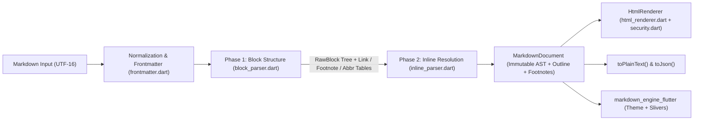
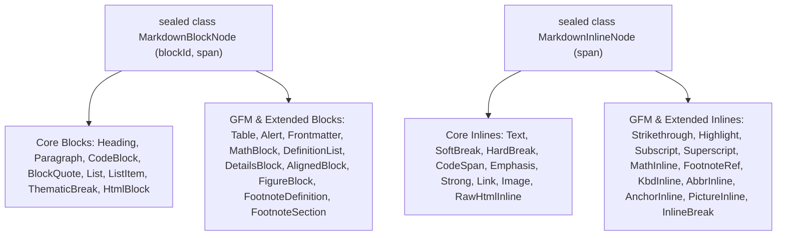
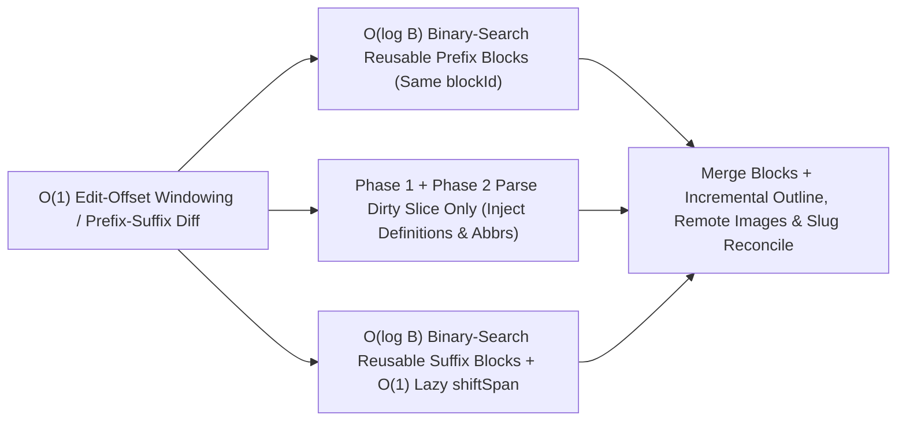
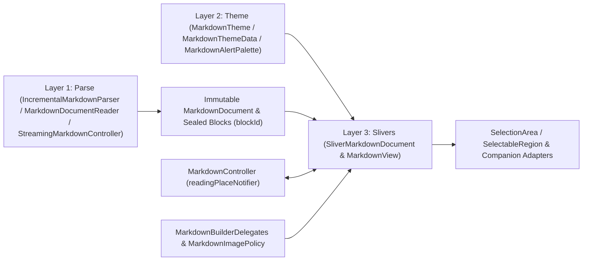

# Architecture & Design

**`markdown_engine`** is a pure-Dart CommonMark `0.31.2` and GitHub Flavored Markdown (`0.29.0.gfm.13`) parser, immutable syntax tree, HTML/text/JSON exporter, incremental streaming engine, and Flutter rendering suite ([`REFERENCE.md`](../REFERENCE.md)). Every stage of block structuring, inline delimiter resolution, sanitization, and serialization runs synchronously in memory without a WebView or JavaScript runtime.

---

## 1. Scope & Design Goals

* **Strict Pure-Dart Core Boundary**: Everything under `packages/markdown_engine/lib/` depends exclusively on `package:meta` (`^1.16.0`) and never imports `package:flutter`, `dart:ui`, `dart:io`, `dart:html`, or `dart:js*`. `MarkdownEngine` executes synchronously on caller strings with zero filesystem, network, or global mutable state.
* **Specification-Driven Parity**: Core parsing targets exact HTML compliance with vendored CommonMark 0.31.2 (652 examples) and `github/cmark-gfm` 0.29.0.gfm.13 (672 spec + 30 extension examples) fixtures in `corpus/spec/`, verified by `tool/verify_spec.dart` and summarized in [`doc/COVERAGE.md`](COVERAGE.md).
* **Dart 3 Sealed AST**: All 18 block node types extend `sealed class MarkdownBlockNode` and all 20 inline node types extend `sealed class MarkdownInlineNode`, providing exhaustive `switch` checks, structural value equality, and UTF-16 `SourceSpan` tracking.
* **Incremental & Streaming First**: `IncrementalMarkdownParser` and `StreamingMarkdownController` avoid quadratic reparses in live editors and token feeds while guaranteeing exact parity with full `MarkdownEngine.parse`.
* **Defense in Depth**: Configurable `MarkdownBudgets`, `MarkdownUrlPolicy` URI allowlisting, GFM `tagfilter`, and deep raw HTML sanitization (`sanitizeHtml: true`) bound untrusted Markdown deterministically.

---

## 2. Two-Phase CommonMark & GFM Pipeline

`MarkdownEngine.parse()` (`packages/markdown_engine/lib/src/engine.dart`) enforces `maxInputLength` upfront and runs the two-phase CommonMark parsing algorithm. Default `const MarkdownOptions()` enables all 23 GFM and optional extensions (individually opt-out), while `.commonMark()` and `.gfm()` remain strict specification presets.

| Stage | Primary Module | Responsibility |
| :--- | :--- | :--- |
| **Entry & Guard** | `engine.dart`, `budgets.dart` | Validates `source.length <= effective.maxInputLength` and dispatches Phase 1 and Phase 2 synchronously. |
| **Normalization & Frontmatter** | `block_parser.dart`, `frontmatter.dart` | Normalizes `\r\n` / `\r` endings to `\n`, replaces NUL (`U+0000`) with `U+FFFD`, and extracts leading YAML (`---`) or TOML (`+++`) frontmatter. |
| **Phase 1 — Block Structure** | `block_parser.dart` | Builds the open container tree, collects first-wins link/footnote/abbreviation definitions, assigns pooled `blockId`s, and transforms structured extension blocks. |
| **Phase 2 — Inline Resolution** | `inline_parser.dart`, `entities.dart`, `unicode.dart`, `emoji.dart`, `slugs.dart` | Resolves code spans, entities, emphasis/strikethrough delimiters, links, images, autolinks, inline math, footnotes, shortcodes, and heading slugs. |
| **Exporters & Sanitization** | `document.dart`, `html_renderer.dart`, `security.dart`, `url_utils.dart` | Builds immutable `MarkdownDocument` snapshots with lazy metadata and emits sanitized HTML, normalized plain text, and JSON. |

### Phase 1: Line-by-Line Container Stack & Post-Processing

* **Zero-Allocation Line Indexing**: `_splitLineRanges` indexes normalized line slices into a flat `Int32List` without allocating per-line `String` objects, scanning lines via a reusable `_LineCursor`.
* **Container Stack & Cold Openers**: Maintains an open-container stack across blockquotes, lists, footnote definitions, code fences, HTML blocks 1–7, display math, GFM pipe tables, headings, thematic breaks, and paragraphs while isolating cold openers (such as `_tryOpenFencedCode` and `_buildRareBlock`) off hot loops.
* **Definitions & Structured Post-Processing**: Extracts leading link reference definitions into a normalized first-wins table (`Unicode` case-folded, whitespace-collapsed) when paragraphs finalize, then transforms `alerts`, `definitionLists`, `detailsBlocks`, `figureBlocks`, and `alignedBlocks` during Phase 1 finalization so Phase 2 resolves their inlines uniformly.

### Phase 2: Delimiter Stack & Cross-Reference Resolution

* **Fast-Path Inline Scanning**: Uses a cached 128-byte structural ASCII lookup table (`_getStructuralLut`), single-backtick `indexOf` code-span fast paths, reusable resolvers (`ReusableBlockInlineResolver`), and single-pass linear text coalescing (`_coalesceTextNodes`).
* **Delimiter Stack & Entities**: Resolves emphasis, strikethrough, highlight, subscript, and superscript delimiters via CommonMark flanking rules backed by `unicode.dart`, alongside HTML5 named/numeric entities (`entities.dart`), links, images, CommonMark/GFM autolinks, inline math, inline HTML elements, emoji shortcodes, and smart punctuation.
* **Footnotes, Slugs & Lazy Document State**: Queues footnote citations (`[^label]`) iteratively in first-reference order (preventing cyclic recursion) to append `FootnoteSectionNode`, computes deduplicated slugs via `HeadingSlugGenerator` (`slugs.dart`), and defers `source`, `outline`, and `remoteImageAddresses` on `MarkdownDocument` via `_DocumentLazyState` until accessed.

---

## 3. Immutable Sealed AST Hierarchy

Every AST node in `packages/markdown_engine/lib/src/ast.dart` is `@immutable`, freezes child lists and frontmatter entries once at construction for `O(1)` getter access, implements structural `==` and `hashCode`, extracts plain text via `toPlainText()`, and supports `O(1)` lazy span relocation via `shiftSpan(offsetDelta, lineDelta)`.

* **18 `MarkdownBlockNode` Subtypes**: Covers core CommonMark blocks (headings, paragraphs, code blocks, blockquotes, lists, list items, thematic breaks, raw HTML blocks) plus GFM pipe tables, GitHub alerts, frontmatter, display math, definition lists, `
`, aligned containers, `<figure>`, and footnotes; see the [API Manual](API_MANUAL.md#5-sealed-ast-reference-and-supporting-types) for the full subtype table.
* **20 `MarkdownInlineNode` Subtypes**: Covers core CommonMark inlines (text, soft/hard breaks, code spans, emphasis, strong, links, images, raw HTML) plus GFM strikethrough, highlight, subscript/superscript, inline math, footnote refs, `<kbd>`, `<abbr>`, anchors, `<picture>`, and inline ` ` breaks; see the [API Manual](API_MANUAL.md#5-sealed-ast-reference-and-supporting-types) for the full subtype table.
* **Pooled `blockId` Identity**: Every `MarkdownBlockNode` carries a deterministic `blockId` string drawn from precomputed `_precomputedBlockIds` (`b-0`..`b-4095`) to avoid hot string interpolation and keep UI widget state, selection anchors, and scroll positions stable across incremental updates.

---

## 4. HTML Sanitizer, URL Security Gate & Resource Budgets

Untrusted Markdown introduces three threat classes: executable URI schemes, raw HTML/XSS injection, and algorithmic complexity attacks. `markdown_engine` enforces layered controls across `security.dart`, `budgets.dart`, and `html_renderer.dart`:

### URL Security Gate (`MarkdownUrlPolicy`)

When `MarkdownOptions.sanitizeUrls` is enabled (the default across all presets), links, images, `<picture>` sources, and sanitized HTML URI attributes pass through `MarkdownUrlPolicy`:

* **Obfuscation Stripping & ASCII Fast Path**: Strips ASCII control characters (`<= 0x20`, `0x7F`), Unicode whitespace, and zero-width characters (`stripControlAndWhitespaceForUrl`), decodes HTML5 entities before scheme inspection, and fast-paths clean HTTP/HTTPS and `#fragment` URIs inside `MarkdownUrlPolicy.isAllowed`.
* **Strict vs. Blocklist Constructors**: `MarkdownUrlPolicy.strict()` (default on `MarkdownOptions()`) allows explicit HTTP, HTTPS, and mailto schemes plus relative and fragment URLs while rejecting protocol-relative and userinfo authority forms; `MarkdownUrlPolicy()` enforces `defaultBlockedSchemes` (`javascript`, `vbscript`, `data`).
* **Custom Policy Controls**: Supports custom `allowedSchemes` and case-insensitive `allowedHosts` (stripping ports and IPv6 brackets), relative/fragment toggles, and `allowSafeImageDataUrls` for base64 raster images while keeping SVG and HTML data URIs blocked.

### GFM Tagfilter & Linear HTML5 Sanitizer

* **GFM `tagfilter` (`gfmTagFilter: true`)**: Escapes the opening `<` of disallowed GFM raw HTML tags (such as script, style, iframe, title, and textarea) to `&lt;` per the GFM 0.29 specification.
* **Linear-Time HTML5 Sanitizer (`sanitizeHtml: true`)**: `sanitizeRawHtml()` runs a zero-backtracking state-machine allowlist tokenizer handling slash-separated attributes, unescaped `<` inside quotes, and HTML5 entity decoding before URL and CSS checks:

| Sanitization Category | Targets Neutralized or Validated (`sanitizeHtml: true`) |
| :--- | :--- |
| **Stripped Elements** | Raw-text and container subtrees (script, style, iframe, svg, math, object, applet, template, form, noscript, title, textarea, xmp, noembed, noframes, frameset, plaintext) plus non-allowlisted tags (embed, base, link, meta, frame). |
| **Stripped Attributes** | Inline `on*` event handlers, `srcdoc`, `http-equiv`, `formaction`, `dynsrc`, `lowsrc`, `xmlns`, and unsafe CSS `style` values (`url(...)`, `expression(...)`). |
| **Validated URI Attributes** | Checks `href`, `src`, `srcset`, `ping`, and media/form URI attributes (such as action, poster, cite, background, longdesc, and `xlink:href`) against `urlPolicy.isAllowed`. |

### Resource & Complexity Budgets (`MarkdownBudgets`)

| Budget Field | Default Limit | Protected Resource |
| :--- | ---: | :--- |
| `maxInputLength` | `500,000` UTF-16 code units | Maximum document length accepted per parse pass (throws `RangeError` if exceeded). |
| `maxNestingDepth` | `64` levels | Maximum nested container depth across blockquotes, lists, brackets, and inline emphasis delimiters. |
| `maxBlocks` | `50,000` blocks | Upper bound on top-level and nested block AST nodes produced per document. |
| `maxTableColumns` | `128` columns | Maximum column count accepted in a GFM pipe table (clamped on header and body rows). |
| `maxTableRows` | `10,000` body rows | Maximum body row count parsed in a single GFM pipe table. |
| `maxHtmlBytes` | `250,000` code units | Cumulative raw HTML emission budget before remaining raw HTML is escaped as text. |
| `maxTokens` | `500,000` tokens | Document-wide inline scanner and delimiter-stack work budget. |
| `maxOutputBytes` | `4,194,304` code units | Cumulative rendered output and reference/abbreviation expansion budget. |

---

## 5. Incremental & Streaming Architecture

### Incremental Editor Diffing (`IncrementalMarkdownParser`)

`IncrementalMarkdownParser` (`packages/markdown_engine/lib/src/incremental.dart`) minimizes reparsing cost when a document changes:

1. **Cached Normalization & `O(1)` Dirty Windowing**: Reuses `normalizedSource` cached on the previous `MarkdownDocument`, skips full re-normalization when the edited span has no `\r` or `\x00`, and isolates the dirty slice in `O(1)` when edit offsets are provided.
2. **Binary-Search Isolation & Container Guards**: Binary-searches leading and trailing reusable blocks in `O(log B)` and guards blank-line boundaries around `ListNode`, `DefinitionListNode`, `DetailsBlockNode`, `FigureBlockNode`, `AlignedBlockNode`, and `HtmlBlockNode` so edits cannot split or miss adjacent merges.
3. **Dirty Slice Parsing & `O(1)` Lazy Span Shifting**: Runs Phase 1 and Phase 2 only on the dirty slice (propagating `previousDocument.linkDefinitions` and `abbreviations`), shifts suffix blocks lazily while keeping every `blockId`, and updates `outline` and `remoteImageAddresses` incrementally.
4. **Safe Full-Reparse Fallbacks**: Falls back to `MarkdownEngine.parse` if `options` changed, frontmatter was touched or added, footnotes are active, or the dirty slice introduces or modifies definitions (`]:`).

### Streaming Token Accumulation (`StreamingMarkdownController`)

`StreamingMarkdownController` (`packages/markdown_engine/lib/src/streaming.dart`) accelerates chunked network or LLM token feeds without polling timers:

* **Frozen Settled Prefix & Push Listeners**: Maintains `_settledBlocks` and `_activeBlocks`, exposing `settledPrefixBlockCount` (`0` while active definitions force full reparses; equal to `currentDocument.blocks.length` on `finish()`) alongside pure-Dart `addListener`, `removeListener`, and `dispose` callbacks.
* **Blank-Line Settling**: Freezes completed active blocks into `_settledBlocks` (advancing `_settledOffset` and `_settledLine`) once followed by a blank line and a subsequent block outside mergeable lists, definition lists, or open HTML containers.
* **`O(chunk)` Tail Fast Paths**: Scans chunks linearly for `\n`, `\r`, and `\x00`, fast-paths mid-paragraph (`_appendFastPara` via `ReusableBlockInlineResolver.parseParagraph`), open fenced code (`_tryFastOpenCodeAppend`), single-line blockquotes, trailing list-item paragraphs, and open GFM pipe tables without full Phase 1 reparses, and emits `createStreamingDocument` snapshots with lazy metadata.
* **Prefix-Preserving `replaceText` & Exact `finish()`**: `replaceText` preserves matching settled prefix blocks, enforces `maxInputLength` before mutating state, and `finish()` reconciles exact `MarkdownEngine.parse` parity while keeping `_safeSettledCount` intact for post-finish `append()` or `reset()` reuse.

---

## 6. Flutter Rendering Separation (`Parse <-> Theme <-> Sliver`)

`packages/markdown_engine_flutter` decouples parsing, visual styling, and viewport layout into independent layers so theme switches never re-parse Markdown and large documents virtualize lazily:

### 6.1 Layer 1 — Parse, Streaming Modes & Isolate Offload

* **Cached Widget Parsing (`MarkdownView`)**: Parses `data` once in widget state, applies `IncrementalMarkdownParser` automatically inside `didUpdateWidget` on compatible edits (preserving stateful `
` and copy widgets), and performs zero re-parses on Light/Dark theme toggles. `MarkdownView.document` skips parsing entirely.
* **Push-Based Streaming Dispatch (`MarkdownView.streaming`)**: Subscribes to `StreamingMarkdownController` push listeners without `Timer.periodic` polling and selects dynamically among four layout modes:

| Stream Mode | Layout Strategy |
| :--- | :--- |
| `canvasFull` | Renders eligible simple-prose streams directly on `MarkdownStreamingCanvasLeaf`. |
| `hybridCanvasTail` | Splits a frozen settled-prefix `SliverMarkdownDocument` (at `settledPrefixBlockCount`) above a trailing `MarkdownStreamingSliverAdapter` + `MarkdownStreamingCanvasLeaf`. |
| `hybridWidgetTail` | Pairs a settled prefix sliver with a slot-isolated trailing `SliverMarkdownDocument` while active blocks invoke rich or custom builders. |
| `widgetFull` | Renders the full document inside `SliverMarkdownDocument` (or a non-scrolling `Column`) on fallback or post-`finish()` handoff. |

* **Background Reader (`MarkdownDocumentReader`)**: Implements `ValueListenable<MarkdownDocument>`, parses short strings synchronously, offloads inputs `>= syncThreshold` (`4096`) to `Isolate.run` with in-flight deduplication and latest-wins coalescing, and falls back synchronously on `IsolateSpawnException`.

### 6.2 Layer 2 — Theme Tokens & Reactive Adapter Derivation

* **Widgets-First Footprint**: Built on `package:flutter/widgets.dart` with scoped `package:flutter/material.dart` `show` imports (`SelectionArea`, `Tooltip`, `ColorScheme`, `Theme`, `ThemeData`) targeting Flutter `>=3.47.0` and Dart `^3.13.0`.
* **Hoisted Render Environment**: `MarkdownRenderEnvironment` resolves ambient text scale, directionality, selection registrar, selection color, locale, `boldText`, and overlay presence once per view/sliver instead of per block.
* **Reactive Math & Mermaid Derivation**: `deriveTexMathThemeData` and `deriveMermaidTheme` (`pele.PelePalette`) map `MarkdownThemeData` colors dynamically so Light/Dark theme switches repaint math and re-palette Mermaid without re-parsing source text or re-running TeX layout.

### 6.3 Layer 3 — Virtualized Slivers, Fast Prose & Selection

* **Virtualized Sliver Layout (`SliverMarkdownDocument`)**: Stateful sliver backed by `RenderSliverList` keyed by `blockId` with `Float64List` extent estimation, batched leading-child scroll-offset corrections (capped after 3 cycles), keep-alives, and top-level block memoization.
* **Fast Leaf RenderBoxes & Streaming Canvas**: Eligible prose, code blocks, and table cells bypass heavy wrapper trees via `FastMarkdownText`, `MarkdownParagraphLeaf`, and `MarkdownHorizontalOverflowBox`. `RenderMarkdownStreamingCanvas` maintains `O(tail)` incremental sync, visible-viewport prefix `ui.Picture` reuse, and cross-sliver selection.
* **Release-Safe Selection (`MarkdownRichText`)**: Guards `SelectionArea` behind `MaterialLocalizations` (falling back to `SelectableRegion` in widgets-only apps), tracks explicit layout readiness in `_SafeRenderParagraph` across debug/profile/release builds, excludes UI chrome, and exports full plain text on Cmd+A.
* **Navigation & Accessibility (`MarkdownController`)**: Tracks owner-scoped `ScrollController` attachments, isolates `readingPlaceNotifier` from document rebuilds via `RenderAbstractViewport` metrics, performs frame-synchronized `scrollToAnchor` convergence, and wires `Semantics` alongside keyboard `FocusableActionDetector` controls.

### 6.4 Built-In Math, Mermaid Worker Pool & Native HTML Rendering

| Subsystem | Module(s) | Architecture & Caching Behavior |
| :--- | :--- | :--- |
| **Built-In TeX Math** | `built_in_math.dart` (`tex_math_flutter`) | `BuiltInMathCache` stores `(font.signature, displayMode, latex)` `DisplayList`, spoken text, and error entries under a 1,024-entry / 8 MiB LRU budget, serving synchronous `TexMath.displayList` once the bundled font is warm. |
| **Built-In Mermaid & Worker Pool** | `built_in_mermaid.dart`, `built_in_mermaid_worker.dart` (`_io` / `_stub`) | `BuiltInMermaidCache` caches compiled `vector_graphics` payloads under a 128-entry / 16 MiB LRU budget; `PersistentMermaidWorker` keeps 1 pre-warmed primary `Isolate` and lazily scales up to `maxMermaidConcurrentWorkers` burst isolates (15s idle teardown, web `compute()` fallback). |
| **Native HTML Block & Table Renderer** | `html_block_renderer.dart`, `inline_renderer.dart`, `block_renderer.dart` | `parseHtmlBlockFragment` tokenizes HTML fragments in linear time into native AST blocks (tables with captions/headers/footers/colspan, description lists, `
`, `<figure>`, aligned blocks, headings, lists, and block-wrapping anchors) within bounds, while `inline_renderer.dart` renders inline HTML formatting, `<picture>`, and ``. |
| **Image & Link Security** | `delegates.dart`, `inline_renderer.dart`, `block_renderer.dart` | Enforces `MarkdownUrlPolicy` on interactive taps and `<picture>`/`` sources, gates remote images via `MarkdownImagePolicy`, caches decoded data-URI images, and disposes gesture recognizers post-frame. |

---

## 7. Verification & Monorepo Boundaries

| Workspace Area | Responsibility | Quality Gate |
| :--- | :--- | :--- |
| `packages/markdown_engine/` | Pure-Dart parser, AST, exporters, incremental/streaming (`meta` only, Dart `^3.8.0`). | `dart test`, `dart run example/main.dart`, `dart doc --dry-run`, `dart pub publish --dry-run` |
| `packages/markdown_engine_flutter/` | Flutter widgets, built-in `tex_math_flutter` + `pele_dart` renderers, theming, selection, and streaming helpers (`>=3.47.0`, Dart `^3.13.0`). | `flutter test`, `dart doc --dry-run`, `flutter pub publish --dry-run` |
| `packages/markdown_engine_flutter/example/` | Standalone Flutter example app exercising widgets and theming. | `flutter test` |
| `studio/` | macOS inspection workbench (`>=3.47.0`, Dart `^3.13.0`). | `flutter test` |
| `tool/` & `corpus/` | Spec verification (`verify_spec.dart`), SHA-256 reference integrity (`sync_reference.dart`), lockstep versions (`check_versions.dart`), and native AOT benchmarks (`benchmark_suite.dart`). | `dart analyze --fatal-infos`, `dart format --output=none --set-exit-if-changed` |
