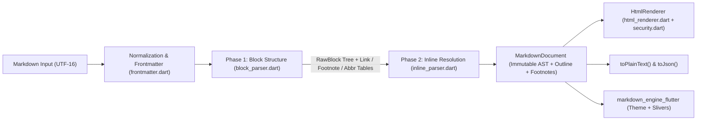
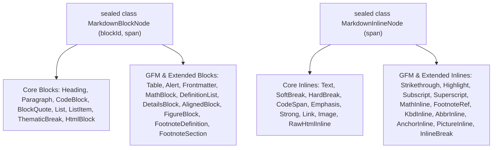
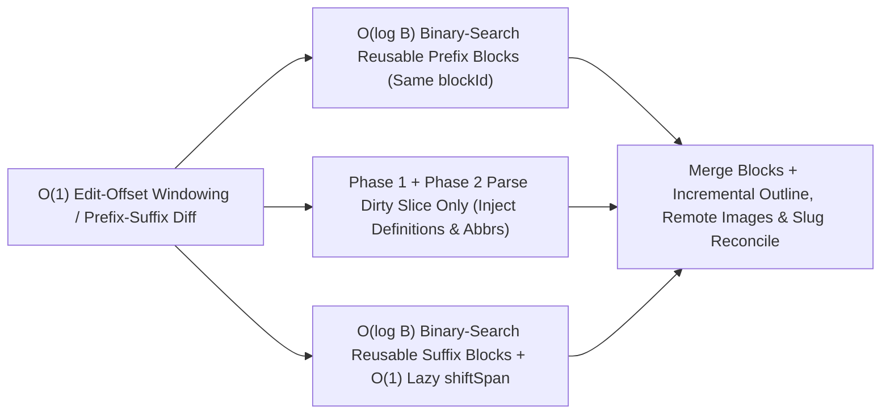
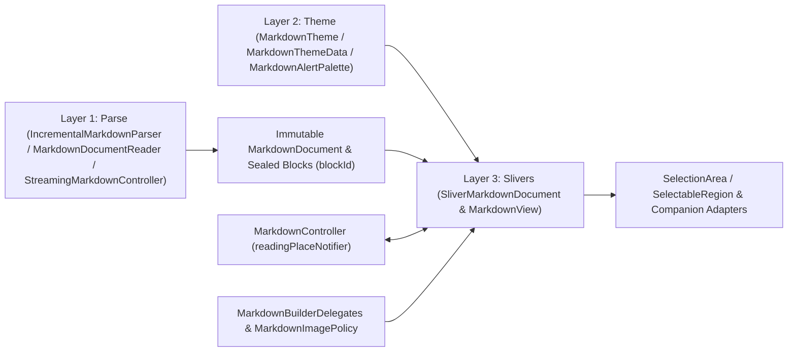

# Architecture & Design

**`markdown_engine`** is a pure-Dart CommonMark `0.31.2` and GitHub Flavored Markdown (`0.29.0.gfm.13`) parser, immutable syntax tree, HTML/text/JSON exporter, incremental streaming engine, and Flutter rendering suite ([`REFERENCE.md`](../REFERENCE.md)). Every stage of block structuring, inline delimiter resolution, sanitization, and serialization runs synchronously in memory without a WebView or JavaScript runtime.

---

## 1. Scope & Design Goals

* **Strict Pure-Dart Core Boundary**: Everything under `packages/markdown_engine/lib/` depends exclusively on `package:meta` (`^1.16.0`) and never imports `package:flutter`, `dart:ui`, `dart:io`, `dart:html`, or `dart:js*`. `MarkdownEngine` executes synchronously on caller-supplied strings with zero filesystem access, zero network calls, and zero global mutable state across parses.
* **Specification-Driven Parity**: Core block and inline parsing targets exact HTML compliance with vendored official CommonMark `0.31.2` (`652` examples) and `github/cmark-gfm 0.29.0.gfm.13` (`672` spec + `30` extension examples) fixtures in `corpus/spec/`, continuously verified by `tool/verify_spec.dart` and summarized in [`doc/COVERAGE.md`](COVERAGE.md).
* **Dart 3 Sealed AST**: All 18 block node types extend `sealed class MarkdownBlockNode` and all 20 inline node types extend `sealed class MarkdownInlineNode`, giving exporters, linters, and Flutter renderers compile-time exhaustive `switch` checks alongside immutable value equality and UTF-16 `SourceSpan` tracking.
* **Incremental & Streaming First**: Dedicated `IncrementalMarkdownParser` and `StreamingMarkdownController` entry points avoid quadratic full-document reparses in live editors and token-by-token streaming feeds while guaranteeing exact parity with full `MarkdownEngine.parse`.
* **Defense in Depth**: Configurable `MarkdownBudgets`, `MarkdownUrlPolicy` URI allowlisting, GFM `tagfilter`, and deep raw HTML sanitization (`sanitizeHtml: true`) bound hostile Markdown payloads deterministically.

---

## 2. Two-Phase CommonMark & GFM Pipeline

`MarkdownEngine.parse()` (`packages/markdown_engine/lib/src/engine.dart`) enforces `maxInputLength` upfront and delegates non-empty input to the two-phase CommonMark parsing algorithm extended with GFM and opt-in document constructs:

| Stage | Primary Module | Responsibility |
| :--- | :--- | :--- |
| **Entry & Guard** | `engine.dart`, `budgets.dart` | Validates `source.length <= effective.maxInputLength` and dispatches Phase 1 and Phase 2 synchronously. |
| **Normalization & Frontmatter** | `block_parser.dart`, `frontmatter.dart` | Normalizes `\r\n` and `\r` line endings to `\n`, replaces NUL (`U+0000`) with `U+FFFD`, and extracts optional leading YAML (`---`) or TOML (`+++`) frontmatter into `FrontmatterNode` / `MarkdownFrontmatter`. |
| **Phase 1 — Block Structure** | `block_parser.dart` | Indexes normalized line slices in a flat `Int32List` without per-line `String` allocations, scans lines via a reusable `_LineCursor` and open-container stack (`_DocOpenBlock`, blockquotes, lists, list items, footnote definitions, code fences, HTML blocks 1–7, `$$...$$` and `\[...\]` display math, GFM pipe tables, ATX/setext headings, thematic breaks, paragraphs), collects first-wins link reference definitions (`[label]: url "title"`), footnote definitions, and abbreviation definitions, and runs post-processing for GitHub alerts, definition lists, `
`, `<figure>`, and `
`. |
| **Phase 2 — Inline Resolution** | `inline_parser.dart`, `entities.dart`, `unicode.dart`, `emoji.dart`, `slugs.dart` | Resolves inline code spans, backslash escapes, HTML5 named and numeric character references, emphasis and GFM strikethrough delimiter stacks, links, images, CommonMark and GFM extended autolinks, inline math (`$...$` and `\(...\)`), footnotes (`[^label]`), highlight/subscript/superscript, emoji shortcodes, smart punctuation, `<kbd>`, `<abbr>`, `<picture>`, heading anchor slugs, document outline, and deduplicated remote image URLs using linear `StringBuffer` text accumulation. |
| **Exporters & Sanitization** | `document.dart`, `html_renderer.dart`, `security.dart`, `url_utils.dart` | Emits CommonMark/GFM HTML with percent-encoded URLs, URL policy checks, GFM `tagfilter` or deep HTML sanitization, raw HTML byte budgets, normalized plain text, and JSON metadata snapshots. |

### Phase 1: Line-by-Line Container Stack & Post-Processing

Phase 1 maintains a stack of open containers rooted at the document node. For each normalized source line, the block engine first checks continuation markers on open containers (blockquote `>`, list item indentation, footnote indentation), closes unmatched containers, detects new block starters (headings, fenced/indented code, HTML blocks, thematic breaks, blockquotes, lists, display math, tables), and attaches remaining lines to paragraphs or active leaf blocks while recording exact UTF-16 `SourceSpan` offsets and 1-based line numbers.

When paragraphs finalize, leading CommonMark link reference definitions are extracted into a normalized first-wins table (`Unicode` case-folded and whitespace-collapsed labels) before any inline parsing runs. Optional structured extensions (`alerts`, `definitionLists`, `detailsBlocks`, `figureBlocks`, `alignedBlocks`) transform matched raw blocks cleanly during Phase 1 finalization so Phase 2 resolves their inner inline runs uniformly.

### Phase 2: Delimiter Stack & Cross-Reference Resolution

Phase 2 walks every finalized block's raw inline strings with access to the complete Phase 1 link-reference, footnote, and abbreviation tables. Inline emphasis (`*`, `_`), GFM strikethrough (`~`, `~~`), highlight (`==`), subscript (`~`), and superscript (`^`) resolve through the CommonMark flanking-delimiter stack rules backed by Unicode whitespace and punctuation tables (`unicode.dart`). Links and images resolve inline destinations, full/collapsed/shortcut reference labels, and image dimensions while enforcing `MarkdownUrlPolicy` when `sanitizeUrls` is enabled.

Footnote citations (`[^label]`) are queued iteratively in order of first reference so footnotes referencing other footnotes resolve deterministically without cyclic recursion, appending a `FootnoteSectionNode` at the end of the document block list. Heading nodes compute GitHub-style deduplicated slugs via `HeadingSlugGenerator` (or honor `explicitHeadingIds` such as `{#custom-id}`) and populate `MarkdownDocument.outline`.

---

## 3. Immutable Sealed AST Hierarchy

Every AST node in `packages/markdown_engine/lib/src/ast.dart` is `@immutable`, freezes child lists and frontmatter entries once at construction for $O(1)$ getter access, implements structural `==` and `hashCode`, extracts plain text via `toPlainText()`, and supports constant-time ($O(1)$) lazy span relocation via `shiftSpan(offsetDelta, lineDelta)`.

* **18 `MarkdownBlockNode` Subtypes**: `FrontmatterNode`, `HeadingNode`, `ParagraphNode`, `CodeBlockNode`, `BlockQuoteNode`, `AlertNode`, `ListNode`, `ListItemNode`, `TableNode`, `ThematicBreakNode`, `HtmlBlockNode`, `DetailsBlockNode`, `AlignedBlockNode`, `FigureBlockNode`, `MathBlockNode`, `DefinitionListNode`, `FootnoteDefinitionNode`, and `FootnoteSectionNode`.
* **20 `MarkdownInlineNode` Subtypes**: `TextNode`, `SoftBreakNode`, `HardBreakNode`, `CodeSpanNode`, `EmphasisNode`, `StrongNode`, `StrikethroughNode`, `HighlightNode`, `SubscriptNode`, `SuperscriptNode`, `LinkNode`, `ImageNode`, `MathInlineNode`, `FootnoteRefNode`, `KbdInlineNode`, `AbbrInlineNode`, `AnchorInlineNode`, `PictureInlineNode`, `InlineBreakNode`, and `RawHtmlInlineNode`.
* **Stable `blockId` Identity**: Every `MarkdownBlockNode` carries a deterministic `blockId` string preserved across incremental reuse so downstream UI frameworks (such as Flutter slivers) retain widget state, selection anchors, and scroll positions for untouched sections.

---

## 4. HTML Sanitizer, URL Security Gate & Resource Budgets

Untrusted Markdown introduces three distinct threat classes: executable URI schemes, raw HTML/XSS injection, and algorithmic complexity attacks (deep nesting or oversized tables). `markdown_engine` enforces layered controls across `security.dart`, `budgets.dart`, and `html_renderer.dart`:

### URL Security Gate (`MarkdownUrlPolicy`)

When `MarkdownOptions.sanitizeUrls` is enabled (the default across all presets), links, images, `<picture>` sources, and sanitized HTML URI attributes pass through `MarkdownUrlPolicy` (defaulting to `const MarkdownUrlPolicy.strict()` on `MarkdownOptions()`):

* Strips ASCII control characters (`<= 0x20`, `0x7F`), Unicode whitespace, and zero-width characters (`stripControlAndWhitespaceForUrl`), and decodes HTML5 entities before extracting the URI scheme so obfuscated payloads such as `java\tscript:alert(1)`, `\u00A0javascript:`, or `&#x6A;avascript:` cannot bypass validation.
* `MarkdownUrlPolicy.strict()` uses an explicit scheme allowlist (`http`, `https`, `mailto`, plus relative/fragment URLs when enabled) while rejecting protocol-relative (`//`, `\\`, `/\`, `\/`) and authority userinfo (`user:pass@host`) URLs by default (`allowProtocolRelative: false`, `allowUserInfo: false`); `MarkdownUrlPolicy()` blocks `javascript`, `vbscript`, and `data` via `defaultBlockedSchemes`.
* Supports custom scheme allowlists (`allowedSchemes`), case-insensitive host allowlists (`allowedHosts`), toggles for relative (`allowRelative`) and `#fragment` (`allowFragments`) links, and opt-in raster image data URIs (`allowSafeImageDataUrls` permitting base64 `png`/`jpeg`/`jpg`/`gif`/`webp` while keeping SVG data URIs blocked).

### GFM Tagfilter & Linear HTML5 Sanitizer

* **GFM `tagfilter` (`gfmTagFilter: true`)**: Escapes the opening `<` of `<title>`, `<textarea>`, `<style>`, `<xmp>`, `<iframe>`, `<noembed>`, `<noframes>`, `<script>`, and `<plaintext>` tags to `&lt;` per the GFM `0.29` specification.
* **Linear-Time State-Machine HTML5 Sanitizer (`sanitizeHtml: true`)**: `sanitizeRawHtml()` executes a linear-time state-machine HTML tokenizer and allowlist sanitizer (zero backtracking regexes), handling slash-separated attributes (``), `<` inside quoted attribute values, HTML5 entity decoding before `urlPolicy.isAllowed` and CSS `url(...)` inspection, stripping dangerous elements (`<script>`, `<style>`, `<noscript>`, `<template>`, `<iframe>`, `<object>`, `<embed>`, `<applet>`, `<base>`, `<link>`, `<meta>`, `<title>`, `<textarea>`, `<xmp>`, `<noembed>`, `<noframes>`, `<plaintext>`, `<svg>`, `<math>`, `<form>`, `<frame>`, `<frameset>`), removing `on*` handlers and `srcdoc`, validating `href`, `src`, `srcset`, `background`, `cite`, `ping`, `longdesc`, `poster`, `action`, `formaction`, and `xlink:href` against `urlPolicy`, and re-escaping serialized output cleanly.

### Resource & Complexity Budgets (`MarkdownBudgets`)

| Budget Field | Default Limit | Protected Resource |
| :--- | ---: | :--- |
| `maxInputLength` | `500,000` UTF-16 code units | Maximum document length accepted per parse pass (throws `RangeError` if exceeded). |
| `maxNestingDepth` | `64` levels | Maximum nested container depth across blockquotes, lists, brackets, and inline emphasis delimiters (bounded safely inside `Isolate.run`). |
| `maxBlocks` | `50,000` blocks | Upper bound on top-level and nested block AST nodes produced per document across all container depths. |
| `maxTableColumns` | `128` columns | Maximum column count accepted in a GFM pipe table (clamped on header and body rows). |
| `maxTableRows` | `10,000` body rows | Maximum body row count parsed in a single GFM pipe table. |
| `maxHtmlBytes` | `250,000` code units | Cumulative raw HTML emission budget before remaining raw HTML is escaped as text. |
| `maxTokens` | `500,000` tokens | Document-wide inline scanner and delimiter-stack work budget. |
| `maxOutputBytes` | `4,194,304` code units | Cumulative rendered output and reference/abbreviation expansion budget. |

---

## 5. Incremental & Streaming Architecture

### Incremental Editor Diffing (`IncrementalMarkdownParser`)

`IncrementalMarkdownParser` (`packages/markdown_engine/lib/src/incremental.dart`) minimizes reparsing cost when a user edits a large Markdown document:

1. **Cached Normalization & $O(1)$ Dirty Windowing**: Reuses `normalizedSource` cached on the previous `MarkdownDocument`, skips full-document `normalizeMarkdownSource` when the prior source is already normalized and the edited span contains no `\r` or `\x00`, and locates the dirty slice directly in $O(1)$ when `(editStartOffset, editOldEndOffset, editNewEndOffset)` are provided (fast-pathing prefix/suffix scans when offsets are omitted).
2. **Binary-Search Blank-Line & Container Isolation**: Binary-searches leading and trailing reusable blocks in $O(\log B)$ and enforces shared container-merge guards (`ListNode`, `DefinitionListNode`, `DetailsBlockNode`, `FigureBlockNode`, `AlignedBlockNode`, `HtmlBlockNode`) across blank-line boundaries so edits never split or miss adjacent container merges.
3. **Dirty Slice Parsing & $O(1)$ Lazy Span Shifting**: Runs Phase 1 and Phase 2 only on the dirty slice (propagating `previousDocument.linkDefinitions` and `previousDocument.abbreviations`), wraps shifted suffix blocks in $O(1)$ lazy span-shifted nodes preserving every `blockId`, and updates `outline` and `remoteImageAddresses` incrementally across all container types.
4. **Safe Full-Reparse Fallbacks**: Automatically falls back to full `MarkdownEngine.parse` if `options` changed, frontmatter was touched or introduced, footnotes are active, or the dirty slice introduces or modifies link/footnote/abbreviation definitions (`]:`).

### Streaming Token Accumulation (`StreamingMarkdownController`)

`StreamingMarkdownController` (`packages/markdown_engine/lib/src/streaming.dart`) is tailored for chunked network or LLM token feeds:

* **Frozen Settled Prefix & Push Listeners**: Maintains `_settledBlocks` (immutable finalized top-level blocks) and `_activeBlocks` (trailing open blocks), exposing `settledPrefixBlockCount` (the exact prefix length of `currentDocument.blocks` whose frozen objects stay `identical` across active tail chunks, returning `0` while active definitions force full reparsing and equaling `currentDocument.blocks.length` on `finish()`) alongside pure-Dart `addListener`, `removeListener`, and `dispose` callbacks with zero polling timers required. Whenever a block inside the active tail is followed by a blank line and a subsequent block (excluding mergeable lists, definition lists, or open HTML containers), it freezes into `_settledBlocks` and advances `_settledOffset` and `_settledLine`.
* **True $O(\text{chunk})$ Tail Work**: Normalizes incoming chunks incrementally, scans only new non-fenced lines for reference definitions (`]:`), parses only the unsettled tail substring from `_settledOffset`, reserves settled heading slugs via the shared `HeadingSlugGenerator`, preserves stable `blockId` values across chunks and `finish()`, and updates `outline` and `remoteImageAddresses` incrementally without re-walking `_settledBlocks`.
* **Prefix-Preserving `replaceText` & Safe Post-`finish()` Continuation**: `replaceText(fullText)` retains already-settled blocks whenever the settled prefix matches byte-for-byte, checks `maxInputLength` before mutating internal state, and `finish()` reconciles exact parity with `MarkdownEngine.parse(buffer)` while keeping `_safeSettledCount` intact so subsequent `append()` or `reset()` calls resume cleanly.

---

## 6. Flutter Rendering Separation (`Parse <-> Theme <-> Sliver`)

`packages/markdown_engine_flutter` cleanly decouples parsing, visual styling, and viewport layout into three independent layers so theme switches never re-parse Markdown and large documents virtualize lazily:

* **Layer 1 — Parse, Incremental Edits, Split Streaming & Isolate Offload (`markdown_engine`, `MarkdownDocumentReader`)**: `MarkdownView` caches the parsed `MarkdownDocument` in widget state, applies `IncrementalMarkdownParser` automatically inside `didUpdateWidget` when `data` edits occur with compatible options (preserving `blockId`s and interactive `
`/`Copy` widget state), and performs zero re-parses across Light/Dark `MarkdownTheme` flips. `MarkdownView.document` skips parsing completely, `MarkdownView.streaming` subscribes directly to `StreamingMarkdownController` push listeners without `Timer.periodic` polling and splits `CustomScrollView` into a settled-prefix `SliverMarkdownDocument` (sliced at `settledPrefixBlockCount` prior to frontmatter filtering) plus an active `_SliverMarkdownTail` sliver so trailing chunk appends never rebuild settled blocks, and `MarkdownDocumentReader` implements `ValueListenable<MarkdownDocument>` (`hasRead`, in-flight deduplication, latest-wins coalescing, and `IsolateSpawnException` sync fallback).
* **Layer 2 — Theme Tokens & Reactive Adapter Derivation (`MarkdownTheme`, `MarkdownThemeData`, `MarkdownAlertPalette`, `MarkdownAlertColors`)**: Built `package:flutter/widgets.dart`-first with scoped `package:flutter/material.dart` `show` imports (`SelectionArea`, `Tooltip`, and `ColorScheme`/`Theme`/`ThemeData`), targeting Flutter `>=3.47.0` and Dart `^3.13.0`. Supports built-in `.light()`/`.dark()` palettes, `.fromColorScheme`, `.fromTheme`, and smooth `.lerp` transitions, and dynamically derives `TexMathThemeData` (`deriveTexMathThemeData`) and `pele.PelePalette` (`deriveMermaidTheme`) from `MarkdownThemeData` without re-parsing source text or re-running TeX layout.
* **Layer 3 — Virtualized Slivers, Built-In Math & Mermaid, Memoization, Selection & Accessibility (`SliverMarkdownDocument`, `MarkdownView`, `MarkdownBuiltInRenderers`, `MarkdownController`, `MarkdownBuilderDelegates`)**: `SliverMarkdownDocument` is a `StatefulWidget` (`addAutomaticKeepAlives: true` by default so active drag selections stay alive off-screen) caching visible blocks, `blockId` indices, and built sliver delegates via `SliverChildBuilderDelegate`, paired with child subtree memoization in `_MarkdownTopLevelBlockWidgetState` and `_MarkdownInlineTextState`. `MarkdownView` guards `SelectionArea` behind `MaterialLocalizations` (falling back to `SelectableRegion` in `WidgetsApp` contexts), supports optional `focusNode`, excludes UI chrome (`Copy`, bullets, alert titles, disclosure arrows) via `SelectionContainer.disabled`, and exports full `activeDocument.toPlainText()` on `Cmd+A` / Select All across off-screen slivers. Built-in TeX math (`built_in_math.dart` via `tex_math_flutter`) caches up to `256` `(font.signature, displayMode, latex)` `DisplayList` / spoken-text / error entries in `BuiltInMathCache` (serving synchronous `TexMath.displayList` once `TexMathFontBundle.cachedMathFont` is loaded and falling back to async `TexMath` while cold, with baseline `WidgetSpan` alignment, link gesture/keyboard support, `TexMathOverflow.scroll`, and safe `TexMathErrorWidget` fallbacks). Built-in Mermaid (`built_in_mermaid.dart` via `pele_dart` + `vector_graphics`) caches up to `128` `(paletteKey, trimmedCode)` compiled payloads in `BuiltInMermaidCache`, compiles flattened SVGs via `vg.encodeSvg` on background `compute` isolates (`_runInRealAsyncZone`, cleanly released on `MarkdownBuiltInRenderers.dispose()`), renders `VectorGraphic` inside `RepaintBoundary` + `Semantics` with responsive scaling or horizontal scrolling, shows a calm `'Mermaid diagram preview'` source card for unclosed streaming fences (`isFencedCodeBlockClosed`), and falls back to a styled source card with `Copy` on invalid syntax. Custom builders (`mathInlineBuilder`, `mathBlockBuilder`, `diagramBuilder`) override built-in renderers, while `enableBuiltInMath: false` and `enableBuiltInMermaid: false` restore raw fallbacks. `MarkdownController` tracks owner-scoped `ScrollController` attachments, separates `readingPlaceNotifier` from document rebuilds using mounted `RenderAbstractViewport` positions, and performs frame-synchronized `scrollToAnchor` convergence. `MarkdownBuilderDelegates` enforces `MarkdownUrlPolicy`, normalizes/gates remote/external images via `MarkdownImagePolicy`, reuses/post-frame-disposes `TapGestureRecognizer`s, caches decoded `data:image/` payloads, and exposes screen-reader `Semantics` alongside keyboard `FocusableActionDetector` controls.

---

## 7. Verification & Monorepo Boundaries

| Workspace Area | Responsibility | Quality Gate |
| :--- | :--- | :--- |
| `packages/markdown_engine/` | Pure-Dart parser, AST, exporters, incremental/streaming (`meta` only, Dart `^3.8.0`). | `dart test`, `dart run example/main.dart`, `dart doc --dry-run`, `dart pub publish --dry-run` |
| `packages/markdown_engine_flutter/` | Flutter widgets, built-in `tex_math_flutter` + `pele_dart` renderers, theming, selection, and streaming helpers (`>=3.47.0`, Dart `^3.13.0`). | `flutter test`, `dart doc --dry-run`, `flutter pub publish --dry-run` |
| `packages/markdown_engine_flutter/example/` | Standalone Flutter example app exercising widgets and theming. | `flutter test` |
| `studio/` | macOS inspection workbench (`>=3.47.0`, Dart `^3.13.0`). | `flutter test` |
| `tool/` & `corpus/` | Spec verification (`verify_spec.dart`), SHA-256 reference integrity (`sync_reference.dart`), lockstep versions (`check_versions.dart`), and native AOT benchmarks (`benchmark_suite.dart`). | `dart analyze --fatal-infos`, `dart format --output=none --set-exit-if-changed` |
