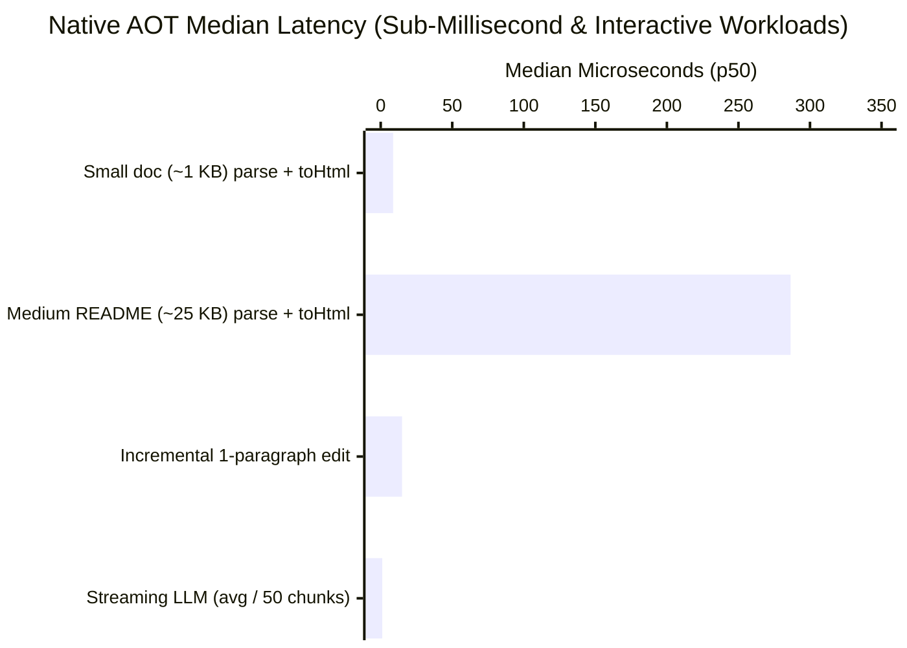
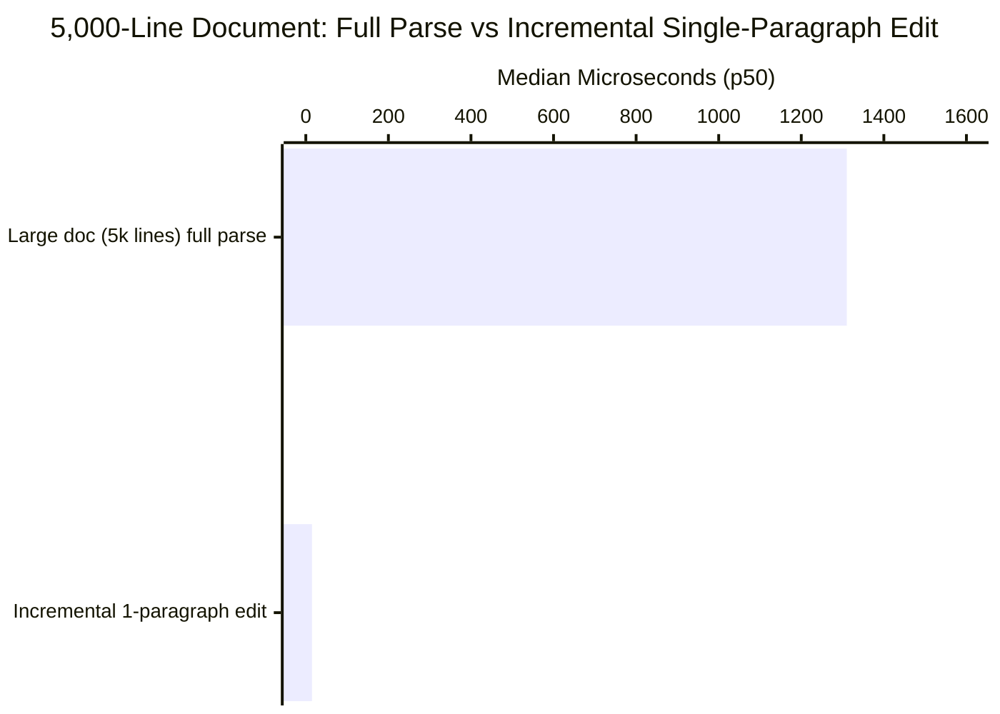

# Benchmarks (Native AOT, Head-to-Head & macOS Profile)

These timings are measured from a self-compiled native AOT binary built with `dart compile exe tool/benchmark_suite.dart` against the pure-Dart `markdown_engine` package (`MarkdownOptions.gfm()`), paired with head-to-head AOT and Flutter test comparisons against `package:markdown 7.3.1`, `flutter_md 0.3.1`, and `flutter_markdown_plus 1.0.12`, persistent vs one-shot Mermaid worker isolate timings, and real macOS `--profile` Impeller (`MetalSDF`) frame-timing telemetry exercising `markdown_engine_flutter`'s built-in `tex_math_flutter` OpenType math, `pele_dart` + `vector_graphics` Mermaid rendering, and hybrid two-sliver streaming tail canvas.

Every AOT workload runs warmup batches before recording repeated multi-iteration samples to report median (`p50`), mean, `p95`, min/max latencies, and UTF-8 throughput (`MB/s`), alongside incremental block-reuse and streaming tail-latency telemetry.

## Head-to-Head Scoreboard

| Category | Workload | `markdown_engine` / `markdown_engine_flutter` | `flutter_md 0.3.1` | `package:markdown 7.3.1` | `flutter_markdown_plus 1.0.12` |
| :--- | :--- | ---: | ---: | ---: | ---: |
| **Native AOT** | Small (`937 B`) parse + HTML | **8.60 us** (`103.94 MB/s`) | N/A | 209.91 us (`4.26 MB/s`, `24.41x` slower) | N/A |
| **Native AOT** | Medium (`24.7 KB`) parse + HTML | **275.04 us** (`87.53 MB/s`) | N/A | 5.762 ms (`4.18 MB/s`, `20.95x` slower) | N/A |
| **Native AOT** | Large (`4,996` lines) AST parse | **1.282 ms** (`128.73 MB/s`) | N/A | 43.645 ms (`3.78 MB/s`, `34.06x` slower) | N/A |
| **Native AOT** | Large (`4,996` lines) parse + HTML | **2.412 ms** (`68.40 MB/s`) | N/A | 53.439 ms (`3.09 MB/s`, `22.16x` slower) | N/A |
| **Native AOT** | Incremental 1-para edit (`4,996` lines) | **15.04 us** (`1,457/1,458` reused) | N/A | 43.645 ms *(full re-parse, `2,901.93x` slower)* | N/A |
| **Native AOT** | 50-chunk LLM stream (per chunk) | **1.10 us/chunk** (`55.00 us` total) | N/A | 265.94 us/chunk (`13.297 ms`, `241.76x` slower) | N/A |
| **Native AOT** | Adversarial (`<a *5000` / `*a *5000` / `$a *5000` / `10 KB` nested) | **656 / 544 / 722 / 463 us** (`ok`) | N/A | 9.884 / 8.045 / 7.007 / 29.377 ms (`ok`) | N/A |
| **Spec Parity** | CommonMark `0.31.2` / GFM `0.29.0` Spec / Ext | **652/652 · 670/670 · 30/30 (100%)** | N/A *(no HTML serializer)* | 641/652 · 644/670 · 22/30 | N/A *(wraps `package:markdown`)* |
| **Flutter JIT** | Small / Medium / Large AST parse | **10.67 us / 203.60 us / 1.496 ms** | 18.17 us / 250.50 us / 1.944 ms | 238.49 us / 5.777 ms / 49.691 ms | N/A *(wraps `package:markdown`)* |
| **Flutter JIT** | 50-chunk LLM stream (per chunk) | 2.29 us/chunk (`114.50 us` total) | **2.26 us/chunk** (`113.00 us` total) | 288.41 us/chunk (`14.421 ms` total) | N/A *(wraps `package:markdown`)* |
| **Flutter Widget** | B1: 403-block build & pump (`800x600`) | **17.09 ms** (**15.23 ms** `.document`) | 28.46 ms (`25.22 ms` pre-parsed) | N/A | 41.27 ms |
| **Flutter Widget** | B2: Light <-> Dark toggle (`12` toggles) | **5.09 ms/toggle** (`0` re-parses) | 22.26 ms/toggle (`0` re-parses) | N/A | 27.21 ms/toggle (`12` re-parses) |
| **Flutter Widget** | B3: 30-chunk LLM streaming session (prose) | 15.66 ms (`0.52 ms/chunk`) | **14.28 ms** (`0.48 ms/chunk`) | N/A | 111.73 ms (`3.72 ms/chunk`) |
| **Flutter Widget** | B4: 30-chunk mixed stream (math + Mermaid + alert + prose) | **40.31 ms** *(native `TexMath` + `VectorGraphic` + alert + canvas tail)* | 11.23 ms *(raw text/code only; no math/Mermaid/alert)* | N/A | 117.16 ms *(raw blocks + full rebuild)* |
| **macOS Profile** | Scroll (`500` sections) / Streaming (`48` chunks @ 60Hz) | **0.93 ms** / **0.43 ms** build p50 (`0` jank) | N/A | N/A | N/A |

## Host Environment

| Property | Value |
| :--- | :--- |
| CPU | `Apple M4` |
| Architecture | `arm64` |
| OS | `macos` (`Version 15.6 (Build 24G84)`) |
| Logical Cores | `10` |
| Memory | `32 GiB` |
| Dart SDK | `3.13.5` |
| Execution Mode | `Native AOT` (plus Flutter Test JIT and macOS `--profile` Impeller for Flutter frames) |
| Peak Process RSS (`benchmark_suite.dart`) | `52.61 MiB` |

## Measured Native AOT Timings (`tool/benchmark_suite.dart`)

| Benchmark | Payload | Samples x Batch | Mean | Median (p50) | p95 | Throughput (p50) | CI Ceiling (p50) |
| :--- | ---: | ---: | ---: | ---: | ---: | ---: | ---: |
| `small_doc_parse_and_html` | 937 B (18 lines) | `25 x 400` | 8.76 us | **8.68 us** | 9.49 us | 102.92 MB/s | <= 2.000 ms |
| `medium_doc_parse_and_html` | 24.7 KB (479 lines) | `25 x 25` | 283.51 us | **286.44 us** | 296.91 us | 84.05 MB/s | <= 30.000 ms |
| `large_doc_5000_lines_parse` | 168.9 KB (4996 lines) | `21 x 4` | 1.331 ms | **1.310 ms** | 1.485 ms | 125.90 MB/s | <= 200.000 ms |
| `incremental_single_paragraph_edit` | 168.9 KB (4996 lines) | `25 x 25` | 15.90 us | **14.92 us** | 20.97 us | 11056.68 MB/s | <= 25.000 ms |
| `streaming_llm_50_chunks_per_chunk` | 2.1 KB / 50 chunks | `25 x 15` | 1.15 us | **1.10 us** | 1.39 us | 37.44 MB/s | <= 5.000 ms |





## Incremental Editing & Streaming Telemetry

Both `IncrementalMarkdownParser` and `StreamingMarkdownController` verify exact HTML equivalence against `MarkdownEngine.parse` before timed sampling begins.

### Incremental Single-Paragraph Edit (5,000-Line Document)

| Metric | Measured Value |
| :--- | ---: |
| Full 5,000-line parse (`large_doc_5000_lines_parse` p50) | `1.310 ms` |
| Incremental single-paragraph edit (`incremental_single_paragraph_edit` p50) | `14.92 us` |
| **Speedup Factor vs Full Parse** | **`87.82x`** |
| Edited Location | Line `2480` of `4996` |
| Reused Top-Level Blocks | `1457 / 1458` (**99.93%**) |
| Reparsed Top-Level Blocks | `1` |

### Streaming LLM Chunked Append (50 Chunks)

| Metric | Measured Value |
| :--- | ---: |
| Total Chunks Appended | `50` |
| Total Streamed Payload | `2.1 KB` |
| **Average Per-Chunk Tail Latency (p50 / Mean)** | **`1.10 us`** / `1.15 us` |
| Full 50-Chunk Session Time (p50 / Mean) | `55.00 us` / `57.50 us` |
| Settled Prefix Blocks Frozen Before `finish()` | `14 / 15` |

## Real macOS `--profile` Impeller Frame Timings (`studio/lib/profile_benchmark_main.dart`)

Run via `dart run tool/run_macos_profile_benchmark.dart` (`flutter run -d macos --profile -t lib/profile_benchmark_main.dart` under Impeller `MetalSDF`) after `MarkdownBuiltInRenderers.warmUp()`, recording live `SchedulerBinding.instance.addTimingsCallback` `FrameTiming` build and raster durations across two phases with real built-in `tex_math_flutter` OpenType math, persistent-isolate `pele_dart` + `vector_graphics` Mermaid diagrams, and the hybrid two-sliver streaming tail canvas:

| Workload | Frames | Build (p50 / p95 / p99 / max) | Raster (p50 / p95 / p99 / max) | Jank (`> 16.67 ms`) |
| :--- | ---: | ---: | ---: | ---: |
| 500-section scroll (`TexMath` + Mermaid + tables + alerts) | `152` | **0.93 ms** / 1.79 ms / 2.26 ms / 2.57 ms | **0.63 ms** / 1.32 ms / 1.44 ms / 1.58 ms | **0** build, **0** raster, **0** total |
| 60Hz live streaming (`48` chunks with math & Mermaid) | `50` | **0.43 ms** / 1.20 ms / 3.75 ms / 4.01 ms | **0.45 ms** / 1.20 ms / 2.03 ms / 2.73 ms | **0** build, **0** raster, **0** total |

* **Built-In Dual-Budget Cache & Hybrid Streaming Telemetry**: Across both `--profile` phases (`152` scroll frames + `50` streaming frames), `MarkdownBuiltInRenderers` (backed by dual entry+byte LRU caches defaulting to `1,024` entries / `8 MiB` for math and `128` entries / `16 MiB` for Mermaid, plus the default-on persistent Mermaid worker isolate) recorded `311` cold math layouts with `23` LRU cache hits and `12` cold Mermaid compilations with `1` LRU cache hit, delivering zero dropped frames across the 60 Hz (`16.67 ms`) budget.

## Persistent vs One-Shot Mermaid Worker Isolate (10-Diagram Cold Benchmark)

Measured on cold cache across 10 distinct Mermaid diagrams (median of 10 rounds under `debugForceAsyncMermaidInTests = true` exercising real background `Isolate` execution on Apple M4), comparing default `MarkdownBuiltInRenderers.usePersistentMermaidIsolate = true` against `usePersistentMermaidIsolate = false` (one-shot `compute()` per diagram):

| Dispatch Pattern (10 Distinct Diagrams) | `usePersistentMermaidIsolate = true` (Default) | `usePersistentMermaidIsolate = false` (One-Shot `compute()`) | Notes |
| :--- | ---: | ---: | :--- |
| Unwarmed sequential | **43.86 ms** | 54.69 ms | Single lazy worker isolate eliminates 9 extra isolate spawns and repeated `pele_dart` + `vector_graphics_compiler` initialization (`1.25x` faster) |
| Post-`warmUp()` sequential | **38.33 ms** | 55.72 ms | Persistent pre-warmed worker serves sequential diagrams with zero spawn or warm-up overhead (`1.45x` faster) |
| Post-`warmUp()` concurrent (`Future.wait`) | 41.74 ms | **14.76 ms** | Single persistent worker bounds memory to 1 isolate (`41.74 ms`), while setting `usePersistentMermaidIsolate = false` fans batch `Future.wait` loads across 10 parallel `compute()` isolates |

## Methodology & Regression Ceilings

Each AOT benchmark executes deterministic in-memory fixtures under `MarkdownOptions.gfm()` with zero filesystem or network I/O during timed loops. Each timed sample wraps `batchIterations` consecutive calls in a single `Stopwatch` window and divides elapsed microseconds by `batchIterations` (and by `50` chunks for `streaming_llm_50_chunks_per_chunk`) to eliminate clock-quantization jitter. Throughput (`MB/s`) divides the UTF-8 payload byte count (in MiB, `1024 * 1024` bytes) by median latency in seconds.

`dart run tool/benchmark_suite.dart --check-regressions` enforces generous latency ceilings (plus minimum `>= 90%` block reuse, `>= 2.0x` incremental speedup, and `>= 1` settled streaming block) so CI catches catastrophic `O(N^2)` algorithmic regressions without flaking across heterogeneous shared runner hardware.

## Running Locally

```bash
# Run native AOT benchmarks and enforce CI regression ceilings
dart run tool/benchmark_suite.dart --check-regressions

# Run real macOS --profile Impeller frame-time benchmark (500-section scroll + 60Hz streaming)
dart run tool/run_macos_profile_benchmark.dart --no-pub --timeout=180

# Emit structured JSON telemetry from native AOT suite
dart run tool/benchmark_suite.dart --json
```

---

## Head-to-Head Comparison (`markdown_engine` vs `package:markdown` vs `flutter_md` vs `flutter_markdown_plus`)

The standalone comparison package in [`tool/compare/`](../tool/compare/pubspec.yaml) benchmarks `markdown_engine` (`0.1.0`) and `markdown_engine_flutter` (`0.1.0`) directly against [`package:markdown`](https://pub.dev/packages/markdown) `7.3.1` (`ExtensionSet.gitHubFlavored`), [`flutter_md`](https://pub.dev/packages/flutter_md) `0.3.1` (`Markdown.fromString`, `StreamingMarkdownParser`, `MarkdownWidget`), and [`flutter_markdown_plus`](https://pub.dev/packages/flutter_markdown_plus) `1.0.12` (`Markdown`) on the same Apple M4 (`arm64`, macOS 15.6, Dart `3.13.5`) host.

### Comparison Methodology

* **Native AOT (`tool/compare/bin/compare_parsers_aot.dart`)**: Compares pure-Dart `markdown_engine` (`MarkdownOptions.gfm()`) against `package:markdown 7.3.1` (`ExtensionSet.gitHubFlavored`, `enableTagfilter: true`) on identical small, medium, and 5,000-line payloads, incremental single-paragraph edits, 50-chunk LLM streams, adversarial inputs (wrapped in `try`/`catch` for `StackOverflowError`), and full CommonMark `0.31.2` / GFM `0.29.0` specification parity.
* **Flutter Test JIT & Widget Suite (`tool/compare/test/compare_flutter_bench_test.dart`)**: Compares `markdown_engine`, `flutter_md 0.3.1` (whose barrel library exports Flutter renderers and therefore runs inside `flutter test` rather than pure-Dart AOT), and `package:markdown 7.3.1` / `flutter_markdown_plus 1.0.12` on JIT parser throughput, CommonMark `0.31.2` feature spot checks, and four headless `800x600` Flutter widget pump benchmarks (including mixed-content streaming with settled `TexMath`, `VectorGraphic` Mermaid, and GitHub alerts plus trailing `MarkdownStreamingCanvasLeaf` prose). Because `flutter_md 0.3.1` has no HTML serializer, HTML output parity and `AST + HTML` timings for `flutter_md` are reported as `N/A`.

### Native AOT Parser Throughput (`markdown_engine` vs `package:markdown 7.3.1`)

| Workload | Payload | `markdown_engine` (p50) | `package:markdown 7.3.1` (p50) | Speedup vs `package:markdown` |
| :--- | ---: | ---: | ---: | ---: |
| Small doc parse + HTML | 937 B | **8.60 us** (`103.94 MB/s`) | 209.91 us (`4.26 MB/s`) | **24.41x** |
| Medium README parse + HTML | 24.7 KB | **275.04 us** (`87.53 MB/s`) | 5.762 ms (`4.18 MB/s`) | **20.95x** |
| Large 5,000-line AST parse | 168.9 KB (`4,996` lines) | **1.282 ms** (`128.73 MB/s`) | 43.645 ms (`3.78 MB/s`) | **34.06x** |
| Large 5,000-line parse + HTML | 168.9 KB (`4,996` lines) | **2.412 ms** (`68.40 MB/s`) | 53.439 ms (`3.09 MB/s`) | **22.16x** |
| Incremental 1-paragraph edit | 168.9 KB (`1,457/1,458` reused) | **15.04 us** | 43.645 ms *(full re-parse)* | **2,901.93x** (`85.21x` vs own full) |
| 50-chunk LLM stream (per chunk) | 2.1 KB / `50` chunks | **1.10 us/chunk** (`55.00 us` total) | 265.94 us/chunk (`13.297 ms` total) | **241.76x** |

### Native AOT Adversarial Resilience (`markdown_engine` vs `package:markdown 7.3.1`)

| Adversarial Input | Payload | `markdown_engine` | `package:markdown 7.3.1` | Notes |
| :--- | ---: | ---: | ---: | :--- |
| 5,000 unmatched `<` (`<a ` * 5000) | 14.6 KB | **656.00 us** (`ok`) | 9.884 ms (`ok`) | **15.07x** faster; bounded linear raw-HTML / angle scan |
| 5,000 unmatched `*` (`*a ` * 5000) | 14.6 KB | **544.00 us** (`ok`) | 8.045 ms (`ok`) | **14.79x** faster; linear `_coalesceTextNodes` and bounded delimiter stack |
| 5,000 unmatched `$` (`$a ` * 5000, `math: true`) | 14.6 KB | **722.00 us** (`ok`) | 7.007 ms (`ok`) | **9.70x** faster; early unmatched-`$` fast-path bailout |
| 10 KB nested emphasis (`*a ` * 1706 + core + ` a*` * 1706) | 10.0 KB | **463.00 us** (`ok`) | 29.377 ms (`ok`) | **63.45x** faster; bounded depth (`maxNestingDepth`) |

### Specification Parity (`CommonMark 0.31.2` & `GFM 0.29.0`)

| Suite | Active Cases | `markdown_engine` | `package:markdown 7.3.1` | `flutter_md 0.3.1` |
| :--- | ---: | ---: | ---: | :--- |
| CommonMark `0.31.2` | 652 | **652 / 652 (100.0%)** | 641 / 652 (`98.3%`, `0` crashes) | N/A *(no HTML serializer; diverges on `__bold__` -> underline, Setext headings, reference links, `<url>` autolinks, HTML entities, indented code, raw HTML)* |
| GFM `0.29.0` Spec | 670 (`2` disabled) | **670 / 670 (100.0%)** | 644 / 670 (`96.1%`, `0` crashes) | N/A *(no HTML serializer)* |
| GFM `0.29.0` Extensions | 30 (`1` ignored) | **30 / 30 (100.0%)** | 22 / 30 (`73.3%`, `0` crashes) | N/A *(no HTML serializer)* |

### Flutter Test JIT Parser Throughput

| Workload | Payload | `markdown_engine` (p50) | `flutter_md 0.3.1` (p50) | `package:markdown 7.3.1` (p50) |
| :--- | ---: | ---: | ---: | ---: |
| Small doc AST | 937 B | **10.67 us** (`83.77 MB/s`; AST+HTML `13.41 us`) | 18.17 us (`49.19 MB/s`) | 238.49 us (`3.75 MB/s`) |
| Medium README AST | 24.7 KB | **203.60 us** (`118.24 MB/s`; AST+HTML `296.70 us`) | 250.50 us (`96.11 MB/s`) | 5.777 ms (`4.17 MB/s`) |
| Large 5,000-line AST | 168.9 KB (`4,996` lines) | **1.496 ms** (`110.27 MB/s`; AST+HTML `2.647 ms`) | 1.944 ms (`84.88 MB/s`) | 49.691 ms (`3.32 MB/s`) |
| 50-chunk LLM stream (per chunk) | 2.1 KB / `50` chunks | 2.29 us/chunk (`114.50 us` total) | **2.26 us/chunk** (`113.00 us` total) | 288.41 us/chunk (`14.421 ms` total) |

### Headless Flutter Widget Benchmarks (`800x600` Viewport)

| Benchmark | `markdown_engine_flutter` (`MarkdownView`) | `flutter_md 0.3.1` (`MarkdownWidget`) | `flutter_markdown_plus 1.0.12` (`Markdown`) | Observations |
| :--- | ---: | ---: | ---: | :--- |
| 403-block initial build & pump | **17.09 ms** (**15.23 ms** `.document`) | 28.46 ms (`25.22 ms` pre-parsed) | 41.27 ms | Lazy `SliverMarkdownDocument` plus `FastMarkdownText` / `MarkdownParagraphLeaf` / `MarkdownHorizontalOverflowBox` eliminate per-block `Text` and `SingleChildScrollView` overhead |
| Light <-> Dark theme toggle (`12` toggles, 403 blocks) | **5.09 ms/toggle** (`0` re-parses) | 22.26 ms/toggle (`0` re-parses, caller-cached AST) | 27.21 ms/toggle (`12` re-parses) | `MarkdownView` separates parsing from `MarkdownThemeData`, memoizes blocks/inlines, and repaints fast (`4.37x` faster than `flutter_md`) |
| Live 30-chunk LLM streaming session (prose) | 15.66 ms (`0.52 ms/chunk`) | **14.28 ms** (`0.48 ms/chunk`) | 111.73 ms (`3.72 ms/chunk`) | `MarkdownView.streaming` combines push listeners (`0` polling timers), mid-paragraph streaming fast paths, and tail-isolated `RenderMarkdownStreamingCanvas` (`ui.Picture` prefix caching + native selection) |
| Live mixed-content 30-chunk streaming (math + Mermaid + alert + prose) | **40.31 ms** (`1.34 ms/chunk`; `2` math layouts, `1` Mermaid compile) | 11.23 ms (`0.37 ms/chunk`; raw text/code only) | 117.16 ms (`3.91 ms/chunk`; raw blocks + full rebuild) | Hybrid two-sliver streaming freezes settled `TexMath`, `VectorGraphic` Mermaid, and alert widgets in `SliverMarkdownDocument` (`0` rebuilds on tail prose) while streaming trailing chunks on `MarkdownStreamingCanvasLeaf` (`2.91x` faster than `flutter_markdown_plus` despite rendering native math, Mermaid, and alerts) |

### Running Head-to-Head Comparisons Locally

```bash
# Pure-Dart Native AOT parser, incremental, streaming, adversarial, and spec parity comparison
(cd tool/compare && flutter pub get)
dart compile exe tool/compare/bin/compare_parsers_aot.dart -o /tmp/compare_parsers.exe
/tmp/compare_parsers.exe
rm -f /tmp/compare_parsers.exe

# Flutter JIT throughput, CommonMark spot checks, and headless widget benchmarks
(cd tool/compare && flutter test --no-pub test/compare_flutter_bench_test.dart)
```
