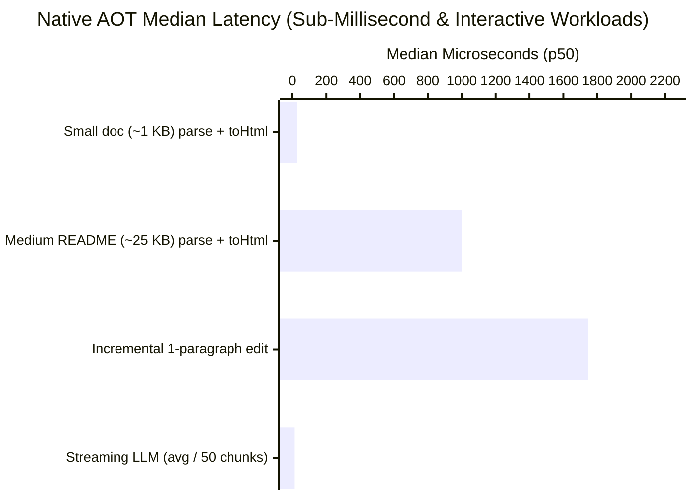
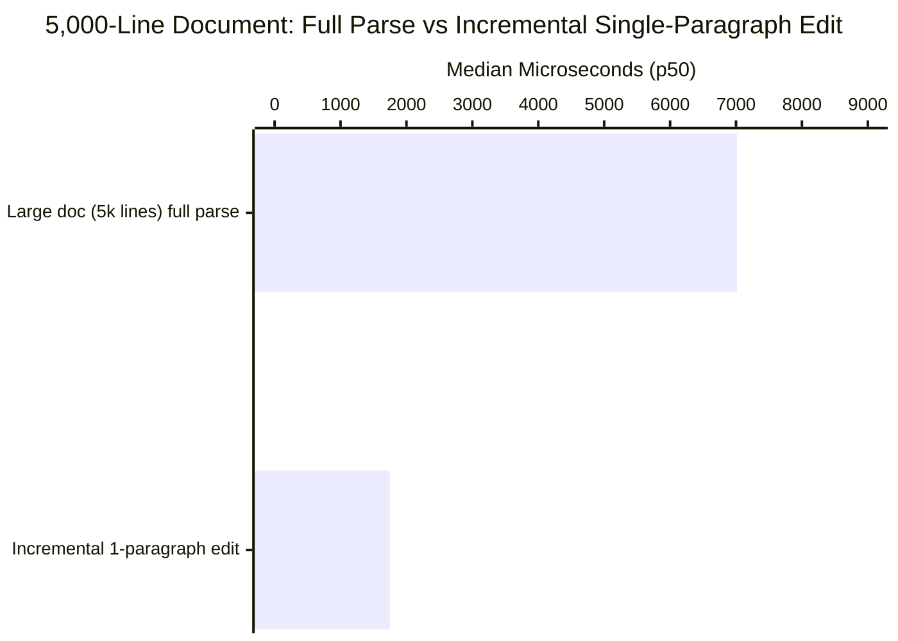

# Benchmarks (Native AOT)

These timings are measured from a self-compiled native AOT binary built with `dart compile exe tool/benchmark_suite.dart` and executed directly against the pure-Dart `markdown_engine` package (`MarkdownOptions.gfm()`).

Every workload runs warmup batches before recording repeated multi-iteration samples to report median (`p50`), mean, `p95`, min/max latencies, and UTF-8 throughput (`MB/s`), alongside incremental block-reuse and streaming tail-latency telemetry.

## Host Environment

| Property | Value |
| :--- | :--- |
| CPU | `Apple M4` |
| Architecture | `arm64` |
| OS | `macos` (`Version 15.6 (Build 24G84)`) |
| Logical Cores | `10` |
| Memory | `32 GiB` |
| Dart SDK | `3.13.5` |
| Execution Mode | `Native AOT` |
| Peak Process RSS | `56.06 MiB` |

## Measured Native AOT Timings

| Benchmark | Payload | Samples x Batch | Mean | Median (p50) | p95 | Throughput (p50) | CI Ceiling (p50) |
| :--- | ---: | ---: | ---: | ---: | ---: | ---: | ---: |
| `small_doc_parse_and_html` | 937 B (18 lines) | `25 x 400` | 28.30 us | **27.80 us** | 36.43 us | 32.15 MB/s | <= 2.000 ms |
| `medium_doc_parse_and_html` | 24.7 KB (479 lines) | `25 x 25` | 1.060 ms | **999.36 us** | 1.340 ms | 24.09 MB/s | <= 30.000 ms |
| `large_doc_5000_lines_parse` | 168.9 KB (4996 lines) | `21 x 4` | 7.038 ms | **7.013 ms** | 8.493 ms | 23.52 MB/s | <= 200.000 ms |
| `incremental_single_paragraph_edit` | 168.9 KB (4996 lines) | `25 x 25` | 1.717 ms | **1.747 ms** | 2.058 ms | 94.43 MB/s | <= 25.000 ms |
| `streaming_llm_50_chunks_per_chunk` | 2.1 KB / 50 chunks | `25 x 15` | 13.18 us | **13.29 us** | 17.67 us | 3.09 MB/s | <= 5.000 ms |





## Incremental Editing & Streaming Telemetry

Both `IncrementalMarkdownParser` and `StreamingMarkdownController` verify exact HTML equivalence against `MarkdownEngine.parse` before timed sampling begins.

### Incremental Single-Paragraph Edit (5,000-Line Document)

| Metric | Measured Value |
| :--- | ---: |
| Full 5,000-line parse (`large_doc_5000_lines_parse` p50) | `7.013 ms` |
| Incremental single-paragraph edit (`incremental_single_paragraph_edit` p50) | `1.747 ms` |
| **Speedup Factor vs Full Parse** | **`4.01x`** |
| Edited Location | Line `2480` of `4996` |
| Reused Top-Level Blocks | `1457 / 1458` (**99.93%**) |
| Reparsed Top-Level Blocks | `1` |

### Streaming LLM Chunked Append (50 Chunks)

| Metric | Measured Value |
| :--- | ---: |
| Total Chunks Appended | `50` |
| Total Streamed Payload | `2.1 KB` |
| **Average Per-Chunk Tail Latency (p50 / Mean)** | **`13.29 us`** / `13.18 us` |
| Full 50-Chunk Session Time (p50 / Mean) | `664.50 us` / `659.00 us` |
| Settled Prefix Blocks Frozen Before `finish()` | `14 / 15` |

## Methodology & Regression Ceilings

Each benchmark executes deterministic in-memory fixtures under `MarkdownOptions.gfm()` with zero filesystem or network I/O during timed loops. Each timed sample wraps `batchIterations` consecutive calls in a single `Stopwatch` window and divides elapsed microseconds by `batchIterations` (and by `50` chunks for `streaming_llm_50_chunks_per_chunk`) to eliminate clock-quantization jitter. Throughput (`MB/s`) divides the UTF-8 payload byte count (in MiB, `1024 * 1024` bytes) by median latency in seconds.

`dart run tool/benchmark_suite.dart --check-regressions` enforces generous latency ceilings (plus minimum `>= 90%` block reuse, `>= 2.0x` incremental speedup, and `>= 1` settled streaming block) so CI catches catastrophic `O(N^2)` algorithmic regressions without flaking across heterogeneous shared runner hardware.

## Running Locally

```bash
# Run native AOT benchmarks and enforce CI regression ceilings
dart run tool/benchmark_suite.dart --check-regressions

# Regenerate doc/BENCHMARKS.md with fresh local measurements
dart run tool/benchmark_suite.dart --update-docs

# Emit structured JSON telemetry
dart run tool/benchmark_suite.dart --json
```
