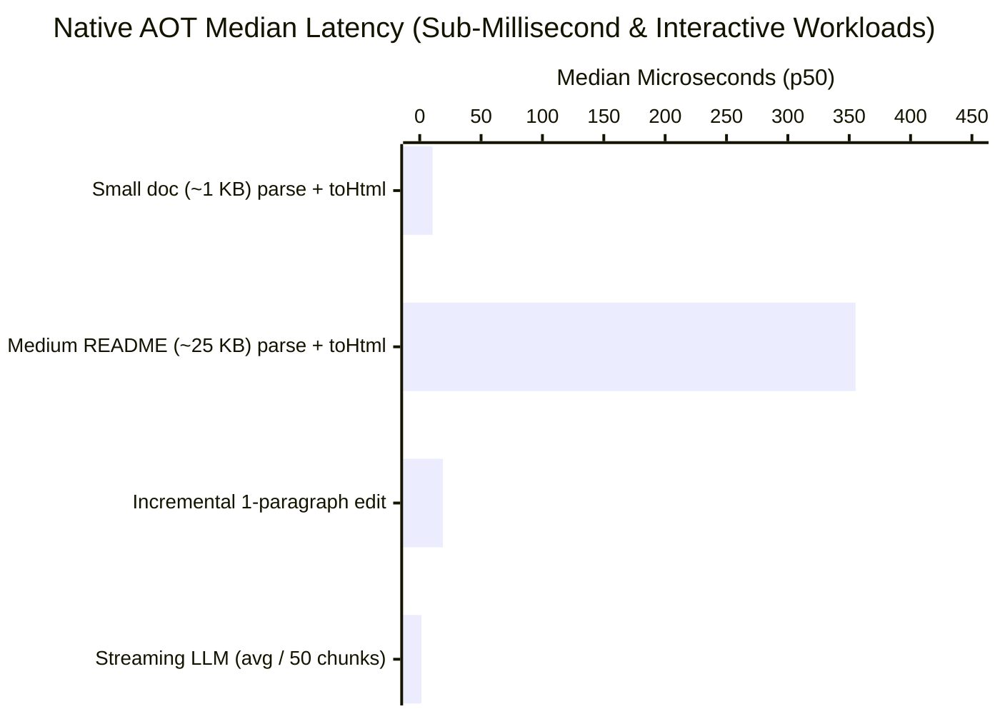
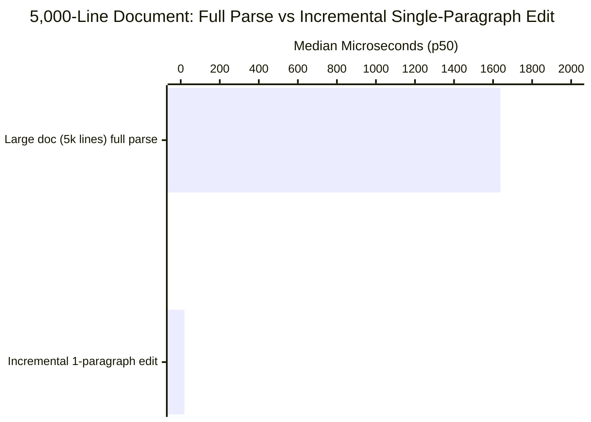

# Benchmarks (Native AOT, Head-to-Head & macOS Profile)

These timings are measured from a self-compiled native AOT binary built with `dart compile exe tool/benchmark_suite.dart` against the pure-Dart `markdown_engine` package (`MarkdownOptions.gfm()`), paired with head-to-head AOT and Flutter test comparisons against `package:markdown 7.3.1`, `flutter_md 0.3.1`, and `flutter_markdown_plus 1.0.12`, plus real macOS `--profile` Impeller (`MetalSDF`) frame-timing telemetry exercising `markdown_engine_flutter`'s built-in `tex_math_flutter` OpenType math and `pele_dart` + `vector_graphics` Mermaid rendering.

Every AOT workload runs warmup batches before recording repeated multi-iteration samples to report median (`p50`), mean, `p95`, min/max latencies, and UTF-8 throughput (`MB/s`), alongside incremental block-reuse and streaming tail-latency telemetry. For full transparency, all measurements below were recorded sequentially on the same Apple M4 workstation while concurrent background system load was tapering down (`uptime` load averages recorded before/after each pass: `23.75 / 40.50 / 43.63` for `tool/benchmark_suite.dart`, `19.97 -> 17.07` for `compare_parsers_aot.dart`, `13.93 -> 13.30` for `tool/compare` Flutter JIT/Widgets, and `11.48 -> 9.84` for macOS `--profile`).

## Head-to-Head Scoreboard

| Category | Workload | `markdown_engine` / `markdown_engine_flutter` | `flutter_md 0.3.1` | `package:markdown 7.3.1` | `flutter_markdown_plus 1.0.12` | Host Load (`uptime` 1m/5m/15m) |
| :--- | :--- | ---: | ---: | ---: | ---: | :--- |
| **Native AOT** | Small (`937 B`) parse + HTML | **11.78 us** (`75.86 MB/s`) | N/A | 293.78 us (`3.04 MB/s`, `24.94x` slower) | N/A | `19.97 -> 17.07` (5m `38.84 -> 36.65`) |
| **Native AOT** | Medium (`24.7 KB`) parse + HTML | **426.16 us** (`56.49 MB/s`) | N/A | 7.627 ms (`3.16 MB/s`, `17.90x` slower) | N/A | `19.97 -> 17.07` (5m `38.84 -> 36.65`) |
| **Native AOT** | Large (`4,996` lines) AST parse | **1.749 ms** (`94.31 MB/s`) | N/A | 53.481 ms (`3.08 MB/s`, `30.57x` slower) | N/A | `19.97 -> 17.07` (5m `38.84 -> 36.65`) |
| **Native AOT** | Large (`4,996` lines) parse + HTML | **2.947 ms** (`55.98 MB/s`) | N/A | 65.645 ms (`2.51 MB/s`, `22.28x` slower) | N/A | `19.97 -> 17.07` (5m `38.84 -> 36.65`) |
| **Native AOT** | Incremental 1-para edit (`4,996` lines) | **19.32 us** (`1,457/1,458` reused) | N/A | 53.481 ms *(full re-parse, `2,768.18x` slower)* | N/A | `19.97 -> 17.07` (5m `38.84 -> 36.65`) |
| **Native AOT** | 50-chunk LLM stream (per chunk) | **1.50 us/chunk** (`75.00 us` total) | N/A | 302.29 us/chunk (`15.115 ms`, `201.53x` slower) | N/A | `19.97 -> 17.07` (5m `38.84 -> 36.65`) |
| **Native AOT** | Adversarial (`<a *5000` / `*a *5000` / `$a *5000` / `10 KB` nested) | **776 / 599 / 536 / 461 us** (`ok`) | N/A | 10.934 / 8.697 / 7.719 / 33.640 ms (`ok`) | N/A | `19.97 -> 17.07` (5m `38.84 -> 36.65`) |
| **Spec Parity** | CommonMark `0.31.2` / GFM `0.29.0` Spec / Ext | **652/652 · 670/670 · 30/30 (100%)** | N/A *(no HTML serializer)* | 641/652 · 644/670 · 22/30 | N/A *(wraps `package:markdown`)* | `19.97 -> 17.07` (5m `38.84 -> 36.65`) |
| **Flutter JIT** | Small / Medium / Large AST parse | **10.11 us / 193.50 us / 1.421 ms** | 13.42 us / 242.40 us / 1.736 ms | 222.91 us / 5.398 ms / 47.252 ms | N/A *(wraps `package:markdown`)* | `13.93 -> 13.30` (5m `35.00 -> 34.52`) |
| **Flutter JIT** | 50-chunk LLM stream (per chunk) | 2.33 us/chunk (`116.50 us` total) | **2.15 us/chunk** (`107.50 us` total) | 276.87 us/chunk (`13.844 ms` total) | N/A *(wraps `package:markdown`)* | `13.93 -> 13.30` (5m `35.00 -> 34.52`) |
| **Flutter Widget** | B1: 403-block build & pump (`800x600`) | **16.16 ms** (**12.77 ms** `.document`) | 26.11 ms (`22.52 ms` pre-parsed) | N/A | 35.83 ms | `13.93 -> 13.30` (5m `35.00 -> 34.52`) |
| **Flutter Widget** | B2: Light <-> Dark toggle (`12` toggles) | **3.19 ms/toggle** (`0` re-parses) | 18.30 ms/toggle (`0` re-parses) | N/A | 22.79 ms/toggle (`12` re-parses) | `13.93 -> 13.30` (5m `35.00 -> 34.52`) |
| **Flutter Widget** | B3: 30-chunk LLM streaming session | 11.92 ms (`0.40 ms/chunk`) | **11.89 ms** (`0.40 ms/chunk`) | N/A | 82.47 ms (`2.75 ms/chunk`) | `13.93 -> 13.30` (5m `35.00 -> 34.52`) |
| **macOS Profile** | Scroll (`500` sections) / Streaming (`48` chunks @ 60Hz) | **1.73 ms** / **0.74 ms** build p50 (`0` jank) | N/A | N/A | N/A | `11.48 -> 9.84` (5m `33.43 -> 30.17`) |

## Host Environment

| Property | Value |
| :--- | :--- |
| CPU | `Apple M4` |
| Architecture | `arm64` |
| OS | `macos` (`Version 15.6 (Build 24G84)`) |
| Logical Cores | `10` |
| Memory | `32 GiB` |
| Dart SDK | `3.13.5` |
| Execution Mode | `Native AOT` (plus Flutter Test JIT and macOS `--profile` Impeller for Flutter frames) |
| Peak Process RSS (`benchmark_suite.dart`) | `52.52 MiB` |
| `uptime` During Passes | `23.75 / 40.50 / 43.63` (`benchmark_suite.dart`), `19.97 -> 17.07` (`compare_parsers_aot.dart`), `13.93 -> 13.30` (`tool/compare` Flutter), `11.48 -> 9.84` (`--profile`) |

## Measured Native AOT Timings (`tool/benchmark_suite.dart`)

| Benchmark | Payload | Samples x Batch | Mean | Median (p50) | p95 | Throughput (p50) | CI Ceiling (p50) |
| :--- | ---: | ---: | ---: | ---: | ---: | ---: | ---: |
| `small_doc_parse_and_html` | 937 B (18 lines) | `25 x 400` | 10.63 us | **10.49 us** | 11.31 us | 85.23 MB/s | <= 2.000 ms |
| `medium_doc_parse_and_html` | 24.7 KB (479 lines) | `25 x 25` | 356.24 us | **355.20 us** | 377.66 us | 67.78 MB/s | <= 30.000 ms |
| `large_doc_5000_lines_parse` | 168.9 KB (4996 lines) | `21 x 4` | 1.700 ms | **1.638 ms** | 1.996 ms | 100.71 MB/s | <= 200.000 ms |
| `incremental_single_paragraph_edit` | 168.9 KB (4996 lines) | `25 x 25` | 19.29 us | **18.96 us** | 21.60 us | 8700.72 MB/s | <= 25.000 ms |
| `streaming_llm_50_chunks_per_chunk` | 2.1 KB / 50 chunks | `25 x 15` | 1.43 us | **1.41 us** | 1.56 us | 29.15 MB/s | <= 5.000 ms |





## Incremental Editing & Streaming Telemetry

Both `IncrementalMarkdownParser` and `StreamingMarkdownController` verify exact HTML equivalence against `MarkdownEngine.parse` before timed sampling begins.

### Incremental Single-Paragraph Edit (5,000-Line Document)

| Metric | Measured Value |
| :--- | ---: |
| Full 5,000-line parse (`large_doc_5000_lines_parse` p50) | `1.638 ms` |
| Incremental single-paragraph edit (`incremental_single_paragraph_edit` p50) | `18.96 us` |
| **Speedup Factor vs Full Parse** | **`86.39x`** |
| Edited Location | Line `2480` of `4996` |
| Reused Top-Level Blocks | `1457 / 1458` (**99.93%**) |
| Reparsed Top-Level Blocks | `1` |

### Streaming LLM Chunked Append (50 Chunks)

| Metric | Measured Value |
| :--- | ---: |
| Total Chunks Appended | `50` |
| Total Streamed Payload | `2.1 KB` |
| **Average Per-Chunk Tail Latency (p50 / Mean)** | **`1.41 us`** / `1.43 us` |
| Full 50-Chunk Session Time (p50 / Mean) | `70.50 us` / `71.50 us` |
| Settled Prefix Blocks Frozen Before `finish()` | `14 / 15` |

## Real macOS `--profile` Impeller Frame Timings (`studio/lib/profile_benchmark_main.dart`)

Run via `dart run tool/run_macos_profile_benchmark.dart` (`flutter run -d macos --profile -t lib/profile_benchmark_main.dart` under Impeller `MetalSDF`) after `MarkdownBuiltInRenderers.warmUp()`, recording live `SchedulerBinding.instance.addTimingsCallback` `FrameTiming` build and raster durations across two phases with real built-in `tex_math_flutter` OpenType math and `pele_dart` + `vector_graphics` Mermaid diagrams (host `uptime` load averages `11.48 33.43 40.72` -> `9.84 30.17 39.18`):

| Workload | Frames | Build (p50 / p95 / p99 / max) | Raster (p50 / p95 / p99 / max) | Jank (`> 16.67 ms`) |
| :--- | ---: | ---: | ---: | ---: |
| 500-section scroll (`TexMath` + Mermaid + tables + alerts) | `152` | **1.73 ms** / 2.95 ms / 3.37 ms / 3.51 ms | **1.10 ms** / 1.57 ms / 1.87 ms / 2.05 ms | **0** build, **0** raster, **0** total |
| 60Hz live streaming (`48` chunks with math & Mermaid) | `47` | **0.74 ms** / 1.78 ms / 7.08 ms / 7.91 ms | **0.86 ms** / 1.37 ms / 2.04 ms / 2.47 ms | **0** build, **0** raster, **0** total |

* **Built-In Dual-Budget Cache Telemetry**: Across both `--profile` phases (`152` scroll frames + `47` streaming frames), `MarkdownBuiltInRenderers` (backed by dual entry+byte LRU caches defaulting to `1,024` entries / `8 MiB` for math and `128` entries / `16 MiB` for Mermaid) recorded `311` cold math layouts with `21` LRU cache hits and `12` cold Mermaid compilations with `1` LRU cache hit, delivering zero dropped frames across the 60 Hz (`16.67 ms`) budget.

## Methodology & Regression Ceilings

Each AOT benchmark executes deterministic in-memory fixtures under `MarkdownOptions.gfm()` with zero filesystem or network I/O during timed loops. Each timed sample wraps `batchIterations` consecutive calls in a single `Stopwatch` window and divides elapsed microseconds by `batchIterations` (and by `50` chunks for `streaming_llm_50_chunks_per_chunk`) to eliminate clock-quantization jitter. Throughput (`MB/s`) divides the UTF-8 payload byte count (in MiB, `1024 * 1024` bytes) by median latency in seconds.

`dart run tool/benchmark_suite.dart --check-regressions` enforces generous latency ceilings (plus minimum `>= 90%` block reuse, `>= 2.0x` incremental speedup, and `>= 1` settled streaming block) so CI catches catastrophic `O(N^2)` algorithmic regressions without flaking across heterogeneous shared runner hardware.

## Running Locally

```bash
# Run native AOT benchmarks and enforce CI regression ceilings
dart run tool/benchmark_suite.dart --check-regressions

# Run real macOS --profile Impeller frame-time benchmark (500-section scroll + 60Hz streaming)
dart run tool/run_macos_profile_benchmark.dart

# Emit structured JSON telemetry from native AOT suite
dart run tool/benchmark_suite.dart --json
```

---

## Head-to-Head Comparison (`markdown_engine` vs `package:markdown` vs `flutter_md` vs `flutter_markdown_plus`)

The standalone comparison package in [`tool/compare/`](../tool/compare/pubspec.yaml) benchmarks `markdown_engine` (`0.1.0`) and `markdown_engine_flutter` (`0.1.0`) directly against [`package:markdown`](https://pub.dev/packages/markdown) `7.3.1` (`ExtensionSet.gitHubFlavored`), [`flutter_md`](https://pub.dev/packages/flutter_md) `0.3.1` (`Markdown.fromString`, `StreamingMarkdownParser`, `MarkdownWidget`), and [`flutter_markdown_plus`](https://pub.dev/packages/flutter_markdown_plus) `1.0.12` (`Markdown`) on the same Apple M4 (`arm64`, macOS 15.6, Dart `3.13.5`) host.

### Comparison Methodology

* **Native AOT (`tool/compare/bin/compare_parsers_aot.dart`)**: Compares pure-Dart `markdown_engine` (`MarkdownOptions.gfm()`) against `package:markdown 7.3.1` (`ExtensionSet.gitHubFlavored`, `enableTagfilter: true`) on identical small, medium, and 5,000-line payloads, incremental single-paragraph edits, 50-chunk LLM streams, adversarial inputs (wrapped in `try`/`catch` for `StackOverflowError`), and full CommonMark `0.31.2` / GFM `0.29.0` specification parity (`uptime` load averages `19.97 38.84 42.98` -> `17.07 36.65 42.07`).
* **Flutter Test JIT & Widget Suite (`tool/compare/test/compare_flutter_bench_test.dart`)**: Compares `markdown_engine`, `flutter_md 0.3.1` (whose barrel library exports Flutter renderers and therefore runs inside `flutter test` rather than pure-Dart AOT), and `package:markdown 7.3.1` / `flutter_markdown_plus 1.0.12` on JIT parser throughput, CommonMark `0.31.2` feature spot checks, and headless `800x600` Flutter widget pump benchmarks (`uptime` load averages `13.93 35.00 41.39` -> `13.30 34.52 41.18`). Because `flutter_md 0.3.1` has no HTML serializer, HTML output parity and `AST + HTML` timings for `flutter_md` are reported as `N/A`.

### Native AOT Parser Throughput (`markdown_engine` vs `package:markdown 7.3.1`)

| Workload | Payload | `markdown_engine` (p50) | `package:markdown 7.3.1` (p50) | Speedup vs `package:markdown` |
| :--- | ---: | ---: | ---: | ---: |
| Small doc parse + HTML | 937 B | **11.78 us** (`75.86 MB/s`) | 293.78 us (`3.04 MB/s`) | **24.94x** |
| Medium README parse + HTML | 24.7 KB | **426.16 us** (`56.49 MB/s`) | 7.627 ms (`3.16 MB/s`) | **17.90x** |
| Large 5,000-line AST parse | 168.9 KB (`4,996` lines) | **1.749 ms** (`94.31 MB/s`) | 53.481 ms (`3.08 MB/s`) | **30.57x** |
| Large 5,000-line parse + HTML | 168.9 KB (`4,996` lines) | **2.947 ms** (`55.98 MB/s`) | 65.645 ms (`2.51 MB/s`) | **22.28x** |
| Incremental 1-paragraph edit | 168.9 KB (`1,457/1,458` reused) | **19.32 us** | 53.481 ms *(full re-parse)* | **2,768.18x** (`90.54x` vs own full) |
| 50-chunk LLM stream (per chunk) | 2.1 KB / `50` chunks | **1.50 us/chunk** (`75.00 us` total) | 302.29 us/chunk (`15.115 ms` total) | **201.53x** |

### Native AOT Adversarial Resilience (`markdown_engine` vs `package:markdown 7.3.1`)

| Adversarial Input | Payload | `markdown_engine` | `package:markdown 7.3.1` | Notes |
| :--- | ---: | ---: | ---: | :--- |
| 5,000 unmatched `<` (`<a ` * 5000) | 14.6 KB | **776.00 us** (`ok`) | 10.934 ms (`ok`) | **14.09x** faster; bounded linear raw-HTML / angle scan |
| 5,000 unmatched `*` (`*a ` * 5000) | 14.6 KB | **599.00 us** (`ok`) | 8.697 ms (`ok`) | **14.52x** faster; linear `_coalesceTextNodes` and bounded delimiter stack |
| 5,000 unmatched `$` (`$a ` * 5000, `math: true`) | 14.6 KB | **536.00 us** (`ok`) | 7.719 ms (`ok`) | **14.40x** faster; early unmatched-`$` fast-path bailout |
| 10 KB nested emphasis (`*a ` * 1706 + core + ` a*` * 1706) | 10.0 KB | **461.00 us** (`ok`) | 33.640 ms (`ok`) | **72.97x** faster; bounded depth (`maxNestingDepth`) |

### Specification Parity (`CommonMark 0.31.2` & `GFM 0.29.0`)

| Suite | Active Cases | `markdown_engine` | `package:markdown 7.3.1` | `flutter_md 0.3.1` |
| :--- | ---: | ---: | ---: | :--- |
| CommonMark `0.31.2` | 652 | **652 / 652 (100.0%)** | 641 / 652 (`98.3%`, `0` crashes) | N/A *(no HTML serializer; diverges on `__bold__` -> underline, Setext headings, reference links, `<url>` autolinks, HTML entities, indented code, raw HTML)* |
| GFM `0.29.0` Spec | 670 (`2` disabled) | **670 / 670 (100.0%)** | 644 / 670 (`96.1%`, `0` crashes) | N/A *(no HTML serializer)* |
| GFM `0.29.0` Extensions | 30 (`1` ignored) | **30 / 30 (100.0%)** | 22 / 30 (`73.3%`, `0` crashes) | N/A *(no HTML serializer)* |

### Flutter Test JIT Parser Throughput

| Workload | Payload | `markdown_engine` (p50) | `flutter_md 0.3.1` (p50) | `package:markdown 7.3.1` (p50) |
| :--- | ---: | ---: | ---: | ---: |
| Small doc AST | 937 B | **10.11 us** (`88.36 MB/s`; AST+HTML `11.28 us`) | 13.42 us (`66.59 MB/s`) | 222.91 us (`4.01 MB/s`) |
| Medium README AST | 24.7 KB | **193.50 us** (`124.42 MB/s`; AST+HTML `277.00 us`) | 242.40 us (`99.32 MB/s`) | 5.398 ms (`4.46 MB/s`) |
| Large 5,000-line AST | 168.9 KB (`4,996` lines) | **1.421 ms** (`116.09 MB/s`; AST+HTML `2.394 ms`) | 1.736 ms (`95.00 MB/s`) | 47.252 ms (`3.49 MB/s`) |
| 50-chunk LLM stream (per chunk) | 2.1 KB / `50` chunks | 2.33 us/chunk (`116.50 us` total) | **2.15 us/chunk** (`107.50 us` total) | 276.87 us/chunk (`13.844 ms` total) |

### Headless Flutter Widget Benchmarks (`800x600` Viewport)

| Benchmark | `markdown_engine_flutter` (`MarkdownView`) | `flutter_md 0.3.1` (`MarkdownWidget`) | `flutter_markdown_plus 1.0.12` (`Markdown`) | Observations |
| :--- | ---: | ---: | ---: | :--- |
| 403-block initial build & pump | **16.16 ms** (**12.77 ms** `.document`) | 26.11 ms (`22.52 ms` pre-parsed) | 35.83 ms | Lazy `SliverMarkdownDocument` plus `FastMarkdownText` / `MarkdownParagraphLeaf` / `MarkdownHorizontalOverflowBox` eliminate per-block `Text` and `SingleChildScrollView` overhead |
| Light <-> Dark theme toggle (`12` toggles, 403 blocks) | **3.19 ms/toggle** (`0` re-parses) | 18.30 ms/toggle (`0` re-parses, caller-cached AST) | 22.79 ms/toggle (`12` re-parses) | `MarkdownView` separates parsing from `MarkdownThemeData`, memoizes blocks/inlines, and repaints fast (`5.74x` faster than `flutter_md`) |
| Live 30-chunk LLM streaming session | 11.92 ms (`0.40 ms/chunk`) | **11.89 ms** (`0.40 ms/chunk`) | 82.47 ms (`2.75 ms/chunk`) | `MarkdownView.streaming` combines push listeners (`0` polling timers), mid-paragraph streaming fast paths, and tail-isolated `RenderMarkdownStreamingCanvas` (`ui.Picture` prefix caching + native selection) |

### Running Head-to-Head Comparisons Locally

```bash
# Pure-Dart Native AOT parser, incremental, streaming, adversarial, and spec parity comparison
(cd tool/compare && flutter pub get)
dart compile exe tool/compare/bin/compare_parsers_aot.dart -o /tmp/compare_parsers.exe
/tmp/compare_parsers.exe
rm -f /tmp/compare_parsers.exe

# Flutter JIT throughput, CommonMark spot checks, and headless widget benchmarks
(cd tool/compare && flutter test test/compare_flutter_bench_test.dart)
```
