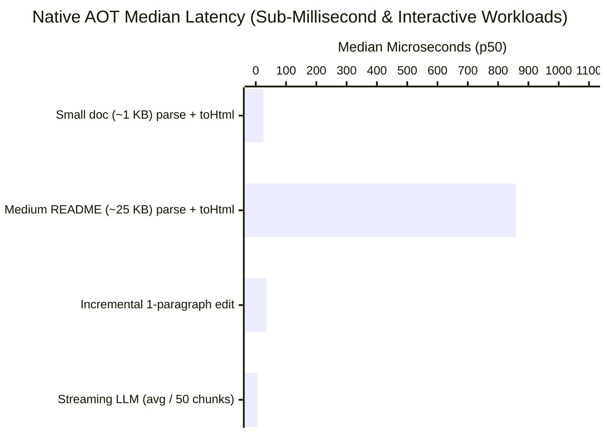
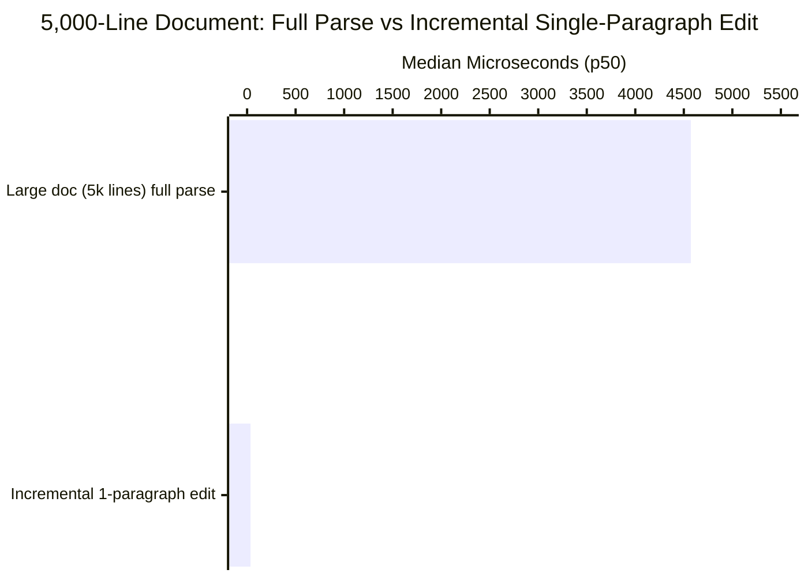

# Benchmarks (Native AOT & macOS Profile)

These timings are measured from a self-compiled native AOT binary built with `dart compile exe tool/benchmark_suite.dart` against the pure-Dart `markdown_engine` package (`MarkdownOptions.gfm()`), paired with real macOS `--profile` Impeller (`MetalSDF`) frame-timing telemetry exercising `markdown_engine_flutter`'s built-in `tex_math_flutter` OpenType math and `pele_dart` + `vector_graphics` Mermaid rendering, and head-to-head comparisons against `package:markdown`, `flutter_md`, and `flutter_markdown_plus`.

Every AOT workload runs warmup batches before recording repeated multi-iteration samples to report median (`p50`), mean, `p95`, min/max latencies, and UTF-8 throughput (`MB/s`), alongside incremental block-reuse and streaming tail-latency telemetry. Note that the Native AOT and `tool/compare` numbers below were recorded while concurrent background VM and build workloads were active on the host (`load averages: 14.6..19.9`).

## Host Environment

| Property | Value |
| :--- | :--- |
| CPU | `Apple M4` |
| Architecture | `arm64` |
| OS | `macos` (`Version 15.6 (Build 24G84)`) |
| Logical Cores | `10` |
| Memory | `32 GiB` |
| Dart SDK | `3.13.5` |
| Execution Mode | `Native AOT` (plus macOS `--profile` Impeller for Flutter frames) |
| Peak Process RSS | `54.25 MiB` |

## Measured Native AOT Timings

| Benchmark | Payload | Samples x Batch | Mean | Median (p50) | p95 | Throughput (p50) | CI Ceiling (p50) |
| :--- | ---: | ---: | ---: | ---: | ---: | ---: | ---: |
| `small_doc_parse_and_html` | 937 B (18 lines) | `25 x 400` | 25.42 us | **25.33 us** | 27.70 us | 35.28 MB/s | <= 2.000 ms |
| `medium_doc_parse_and_html` | 24.7 KB (479 lines) | `25 x 25` | 919.58 us | **858.92 us** | 1.179 ms | 28.03 MB/s | <= 30.000 ms |
| `large_doc_5000_lines_parse` | 168.9 KB (4996 lines) | `21 x 4` | 5.189 ms | **4.573 ms** | 6.563 ms | 36.08 MB/s | <= 200.000 ms |
| `incremental_single_paragraph_edit` | 168.9 KB (4996 lines) | `25 x 25` | 42.12 us | **35.16 us** | 61.74 us | 4691.86 MB/s | <= 25.000 ms |
| `streaming_llm_50_chunks_per_chunk` | 2.1 KB / 50 chunks | `25 x 15` | 5.90 us | **5.81 us** | 7.08 us | 7.07 MB/s | <= 5.000 ms |





## Incremental Editing & Streaming Telemetry

Both `IncrementalMarkdownParser` and `StreamingMarkdownController` verify exact HTML equivalence against `MarkdownEngine.parse` before timed sampling begins.

### Incremental Single-Paragraph Edit (5,000-Line Document)

| Metric | Measured Value |
| :--- | ---: |
| Full 5,000-line parse (`large_doc_5000_lines_parse` p50) | `4.573 ms` |
| Incremental single-paragraph edit (`incremental_single_paragraph_edit` p50) | `35.16 us` |
| **Speedup Factor vs Full Parse** | **`130.05x`** |
| Edited Location | Line `2480` of `4996` |
| Reused Top-Level Blocks | `1457 / 1458` (**99.93%**) |
| Reparsed Top-Level Blocks | `1` |

### Streaming LLM Chunked Append (50 Chunks)

| Metric | Measured Value |
| :--- | ---: |
| Total Chunks Appended | `50` |
| Total Streamed Payload | `2.1 KB` |
| **Average Per-Chunk Tail Latency (p50 / Mean)** | **`5.81 us`** / `5.90 us` |
| Full 50-Chunk Session Time (p50 / Mean) | `290.50 us` / `295.00 us` |
| Settled Prefix Blocks Frozen Before `finish()` | `14 / 15` |

## Real macOS `--profile` Impeller Frame Timings (`studio/lib/profile_benchmark_main.dart`)

Run via `dart run tool/run_macos_profile_benchmark.dart` (`flutter run -d macos --profile -t lib/profile_benchmark_main.dart` under Impeller `MetalSDF`) after `MarkdownBuiltInRenderers.warmUp()`, recording live `SchedulerBinding.instance.addTimingsCallback` `FrameTiming` build and raster durations across two phases with real built-in `tex_math_flutter` OpenType math and `pele_dart` + `vector_graphics` Mermaid diagrams:

| Workload | Frames | Build (p50 / p95 / p99 / max) | Raster (p50 / p95 / p99 / max) | Jank (`> 16.67 ms`) |
| :--- | ---: | ---: | ---: | ---: |
| 500-section scroll (`TexMath` + Mermaid + tables + alerts) | `152` | **1.53 ms** / 2.54 ms / 3.72 ms / 5.72 ms | **1.00 ms** / 1.26 ms / 1.54 ms / 2.37 ms | **0** build, **0** raster, **0** total |
| 60Hz live streaming (`48` chunks with math & Mermaid) | `51` | **0.70 ms** / 1.23 ms / 5.47 ms / 6.99 ms | **0.60 ms** / 1.00 ms / 2.21 ms / 2.31 ms | **0** build, **0** raster, **0** total |

* **Built-In Cache Telemetry**: Across both `--profile` phases (`152` scroll frames + `51` streaming frames), `MarkdownBuiltInRenderers` recorded `311` cold math layouts with `23` LRU cache hits and `12` cold Mermaid compilations with `1` LRU cache hit, delivering zero dropped frames across the 60 Hz (`16.67 ms`) budget.

## Methodology & Regression Ceilings

Each AOT benchmark executes deterministic in-memory fixtures under `MarkdownOptions.gfm()` with zero filesystem or network I/O during timed loops. Each timed sample wraps `batchIterations` consecutive calls in a single `Stopwatch` window and divides elapsed microseconds by `batchIterations` (and by `50` chunks for `streaming_llm_50_chunks_per_chunk`) to eliminate clock-quantization jitter. Throughput (`MB/s`) divides the UTF-8 payload byte count (in MiB, `1024 * 1024` bytes) by median latency in seconds.

`dart run tool/benchmark_suite.dart --check-regressions` enforces generous latency ceilings (plus minimum `>= 90%` block reuse, `>= 2.0x` incremental speedup, and `>= 1` settled streaming block) so CI catches catastrophic `O(N^2)` algorithmic regressions without flaking across heterogeneous shared runner hardware.

## Running Locally

```bash
# Run native AOT benchmarks and enforce CI regression ceilings
dart run tool/benchmark_suite.dart --check-regressions

# Run real macOS --profile Impeller frame-time benchmark (500-section scroll + 60Hz streaming)
dart run tool/run_macos_profile_benchmark.dart

# Emit structured JSON telemetry from native AOT suite
dart run tool/benchmark_suite.dart --json
```

---

## Head-to-Head Comparison (`markdown_engine` vs `package:markdown` vs `flutter_md` vs `flutter_markdown_plus`)

The standalone comparison package in [`tool/compare/`](../tool/compare/pubspec.yaml) benchmarks `markdown_engine` (`0.1.0`) and `markdown_engine_flutter` (`0.1.0`) directly against [`package:markdown`](https://pub.dev/packages/markdown) `7.3.1` (`ExtensionSet.gitHubFlavored`), [`flutter_md`](https://pub.dev/packages/flutter_md) `0.3.1` (`Markdown.fromString`, `StreamingMarkdownParser`, `MarkdownWidget`), and [`flutter_markdown_plus`](https://pub.dev/packages/flutter_markdown_plus) `1.0.12` (`Markdown`) on the same Apple M4 (`arm64`, macOS 15.6, Dart `3.13.5`) host.

### Comparison Methodology

* **Native AOT (`tool/compare/bin/compare_parsers_aot.dart`)**: Compares pure-Dart `markdown_engine` (`MarkdownOptions.gfm()`) against `package:markdown 7.3.1` (`ExtensionSet.gitHubFlavored`, `enableTagfilter: true`) on identical small, medium, and 5,000-line payloads, incremental single-paragraph edits, 50-chunk LLM streams, adversarial inputs (wrapped in `try`/`catch` for `StackOverflowError`), and full CommonMark `0.31.2` / GFM `0.29.0` specification parity.
* **Flutter Test JIT & Widget Suite (`tool/compare/test/compare_flutter_bench_test.dart`)**: Compares `markdown_engine`, `flutter_md 0.3.1` (whose barrel library exports Flutter renderers and therefore runs inside `flutter test` rather than pure-Dart AOT), and `package:markdown 7.3.1` / `flutter_markdown_plus 1.0.12` on JIT parser throughput, CommonMark `0.31.2` feature spot checks, and headless `800x600` Flutter widget pump benchmarks. Because `flutter_md 0.3.1` has no HTML serializer, HTML output parity and `AST + HTML` timings for `flutter_md` are reported as `N/A`.

### Native AOT Parser Throughput (`markdown_engine` vs `package:markdown 7.3.1`)

| Workload | Payload | `markdown_engine` (p50) | `package:markdown 7.3.1` (p50) | Speedup vs `package:markdown` |
| :--- | ---: | ---: | ---: | ---: |
| Small doc parse + HTML | 937 B | **30.40 us** (`29.40 MB/s`) | 607.71 us (`1.47 MB/s`) | **19.99x** |
| Medium README parse + HTML | 24.7 KB | **1.476 ms** (`16.31 MB/s`) | 14.300 ms (`1.68 MB/s`) | **9.69x** |
| Large 5,000-line AST parse | 168.9 KB (`4,996` lines) | **7.853 ms** (`21.01 MB/s`) | 107.362 ms (`1.54 MB/s`) | **13.67x** |
| Large 5,000-line parse + HTML | 168.9 KB (`4,996` lines) | **13.816 ms** (`11.94 MB/s`) | 135.078 ms (`1.22 MB/s`) | **9.78x** |
| Incremental 1-paragraph edit | 168.9 KB (`1,457/1,458` reused) | **61.92 us** | 107.362 ms *(full re-parse)* | **1,733.89x** (`126.82x` vs own full) |
| 50-chunk LLM stream (per chunk) | 2.1 KB / `50` chunks | **8.82 us/chunk** (`441.00 us` total) | 588.72 us/chunk (`29.436 ms` total) | **66.75x** |

### Native AOT Adversarial Resilience (`markdown_engine` vs `package:markdown 7.3.1`)

| Adversarial Input | Payload | `markdown_engine` | `package:markdown 7.3.1` | Notes |
| :--- | ---: | ---: | ---: | :--- |
| 5,000 unmatched `<` (`<a ` * 5000) | 14.6 KB | **1.584 ms** (`ok`) | 21.713 ms (`ok`) | Bounded linear raw-HTML / angle scan |
| 5,000 unmatched `*` (`*a ` * 5000) | 14.6 KB | 52.299 ms (`ok`) | 18.937 ms (`ok`) | Delimiter stack bounded by `maxTokens` |
| 5,000 unmatched `$` (`$a ` * 5000, `math: true`) | 14.6 KB | **1.150 ms** (`ok`) | 15.190 ms (`ok`) | Early unmatched-`$` fast-path bailout |
| 10 KB nested emphasis (`*a ` * 1706 + core + ` a*` * 1706) | 10.0 KB | **5.596 ms** (`ok`) | 52.701 ms (`ok`) | **9.42x** faster, bounded depth (`maxNestingDepth`) |

### Specification Parity (`CommonMark 0.31.2` & `GFM 0.29.0`)

| Suite | Active Cases | `markdown_engine` | `package:markdown 7.3.1` | `flutter_md 0.3.1` |
| :--- | ---: | ---: | ---: | :--- |
| CommonMark `0.31.2` | 652 | **652 / 652 (100.0%)** | 641 / 652 (`98.3%`, `0` crashes) | N/A *(no HTML serializer; diverges on `__bold__` -> underline, Setext headings, reference links, `<url>` autolinks, HTML entities, indented code, raw HTML)* |
| GFM `0.29.0` Spec | 670 (`2` disabled) | **670 / 670 (100.0%)** | 644 / 670 (`96.1%`, `0` crashes) | N/A *(no HTML serializer)* |
| GFM `0.29.0` Extensions | 30 (`1` ignored) | **30 / 30 (100.0%)** | 22 / 30 (`73.3%`, `0` crashes) | N/A *(no HTML serializer)* |

### Flutter Test JIT Parser Throughput

| Workload | Payload | `markdown_engine` (p50) | `flutter_md 0.3.1` (p50) | `package:markdown 7.3.1` (p50) |
| :--- | ---: | ---: | ---: | ---: |
| Small doc AST | 937 B | **59.06 us** (`15.13 MB/s`; AST+HTML `65.01 us`) | 61.05 us (`14.64 MB/s`) | 748.25 us (`1.19 MB/s`) |
| Medium README AST | 24.7 KB | 1.276 ms (`18.87 MB/s`; AST+HTML `1.708 ms`) | **864.20 us** (`27.86 MB/s`) | 17.256 ms (`1.40 MB/s`) |
| Large 5,000-line AST | 168.9 KB (`4,996` lines) | 12.857 ms (`12.83 MB/s`; AST+HTML `20.724 ms`) | **7.695 ms** (`21.44 MB/s`) | 131.530 ms (`1.25 MB/s`) |
| 50-chunk LLM stream (per chunk) | 2.1 KB / `50` chunks | 37.23 us/chunk (`1.861 ms` total) | **6.75 us/chunk** (`337.50 us` total) | 742.61 us/chunk (`37.130 ms` total) |

### Headless Flutter Widget Benchmarks (`800x600` Viewport)

| Benchmark | `markdown_engine_flutter` (`MarkdownView`) | `flutter_md 0.3.1` (`MarkdownWidget`) | `flutter_markdown_plus 1.0.12` (`Markdown`) | Observations |
| :--- | ---: | ---: | ---: | :--- |
| 403-block initial build & pump | **150.11 ms** (`105.91 ms` `.document`) | 165.12 ms (`126.01 ms` pre-parsed) | 232.94 ms | Lazy `SliverMarkdownDocument` avoids upfront layout of off-screen blocks |
| Light <-> Dark theme toggle (`12` toggles, 403 blocks) | **46.65 ms/toggle** (`0` re-parses) | 96.96 ms/toggle (`0` re-parses, caller-cached AST) | 209.83 ms/toggle (`12` re-parses) | `MarkdownView` separates parsing from `MarkdownThemeData`, memoizes blocks/inlines, and repaints fast |
| Live 30-chunk LLM streaming session | 395.04 ms (`13.17 ms/chunk`) | **113.16 ms** (`3.77 ms/chunk`) | 628.23 ms (`20.94 ms/chunk`) | `MarkdownView.streaming` uses push listeners (`0` polling timers), splits settled/tail slivers, and keeps native Flutter widgets + selection |

### Running Head-to-Head Comparisons Locally

```bash
# Pure-Dart Native AOT parser, incremental, streaming, adversarial, and spec parity comparison
(cd tool/compare && flutter pub get)
dart compile exe tool/compare/bin/compare_parsers_aot.dart -o /tmp/compare_parsers.exe
/tmp/compare_parsers.exe
rm -f /tmp/compare_parsers.exe

# Flutter JIT throughput, CommonMark spot checks, and headless widget benchmarks
(cd tool/compare && flutter test test/compare_flutter_bench_test.dart)
```
