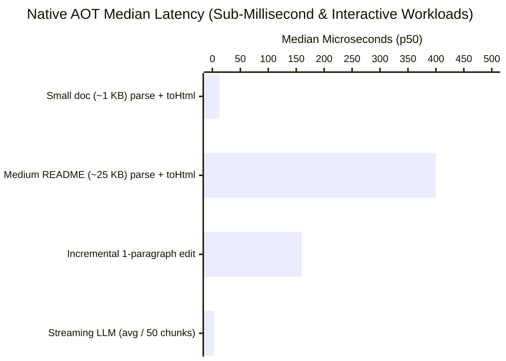
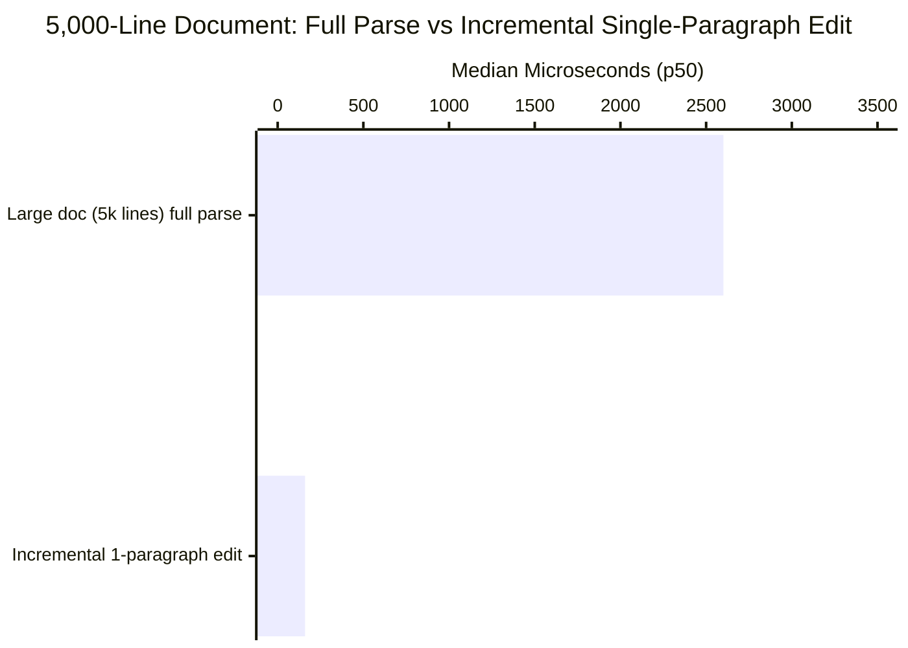

# Benchmarks (Native AOT)

These timings are measured from a self-compiled native AOT binary built with `dart compile exe tool/benchmark_suite.dart` and executed directly against the pure-Dart `markdown_engine` package (`MarkdownOptions.gfm()`).

Every workload runs warmup batches before recording repeated multi-iteration samples to report median (`p50`), mean, `p95`, min/max latencies, and UTF-8 throughput (`MB/s`), alongside incremental block-reuse and streaming tail-latency telemetry.

## Host Environment

| Property | Value |
| :--- | :--- |
| CPU | `Apple M4` |
| Architecture | `arm64` |
| OS | `macos` (`Version 15.6 (Build 24G84)`) |
| Logical Cores | `10` |
| Memory | `32 GiB` |
| Dart SDK | `3.13.5` |
| Execution Mode | `Native AOT` |
| Peak Process RSS | `55.28 MiB` |

## Measured Native AOT Timings

| Benchmark | Payload | Samples x Batch | Mean | Median (p50) | p95 | Throughput (p50) | CI Ceiling (p50) |
| :--- | ---: | ---: | ---: | ---: | ---: | ---: | ---: |
| `small_doc_parse_and_html` | 937 B (18 lines) | `25 x 400` | 12.78 us | **12.77 us** | 13.18 us | 70.00 MB/s | <= 2.000 ms |
| `medium_doc_parse_and_html` | 24.7 KB (479 lines) | `25 x 25` | 402.74 us | **399.72 us** | 442.19 us | 60.23 MB/s | <= 30.000 ms |
| `large_doc_5000_lines_parse` | 168.9 KB (4996 lines) | `21 x 4` | 2.595 ms | **2.601 ms** | 2.807 ms | 63.43 MB/s | <= 200.000 ms |
| `incremental_single_paragraph_edit` | 168.9 KB (4996 lines) | `25 x 25` | 160.04 us | **159.80 us** | 164.86 us | 1032.33 MB/s | <= 25.000 ms |
| `streaming_llm_50_chunks_per_chunk` | 2.1 KB / 50 chunks | `25 x 15` | 3.06 us | **3.05 us** | 3.14 us | 13.47 MB/s | <= 5.000 ms |





## Incremental Editing & Streaming Telemetry

Both `IncrementalMarkdownParser` and `StreamingMarkdownController` verify exact HTML equivalence against `MarkdownEngine.parse` before timed sampling begins.

### Incremental Single-Paragraph Edit (5,000-Line Document)

| Metric | Measured Value |
| :--- | ---: |
| Full 5,000-line parse (`large_doc_5000_lines_parse` p50) | `2.601 ms` |
| Incremental single-paragraph edit (`incremental_single_paragraph_edit` p50) | `159.80 us` |
| **Speedup Factor vs Full Parse** | **`16.28x`** |
| Edited Location | Line `2480` of `4996` |
| Reused Top-Level Blocks | `1457 / 1458` (**99.93%**) |
| Reparsed Top-Level Blocks | `1` |

### Streaming LLM Chunked Append (50 Chunks)

| Metric | Measured Value |
| :--- | ---: |
| Total Chunks Appended | `50` |
| Total Streamed Payload | `2.1 KB` |
| **Average Per-Chunk Tail Latency (p50 / Mean)** | **`3.05 us`** / `3.06 us` |
| Full 50-Chunk Session Time (p50 / Mean) | `152.50 us` / `153.00 us` |
| Settled Prefix Blocks Frozen Before `finish()` | `14 / 15` |

## Methodology & Regression Ceilings

Each benchmark executes deterministic in-memory fixtures under `MarkdownOptions.gfm()` with zero filesystem or network I/O during timed loops. Each timed sample wraps `batchIterations` consecutive calls in a single `Stopwatch` window and divides elapsed microseconds by `batchIterations` (and by `50` chunks for `streaming_llm_50_chunks_per_chunk`) to eliminate clock-quantization jitter. Throughput (`MB/s`) divides the UTF-8 payload byte count (in MiB, `1024 * 1024` bytes) by median latency in seconds.

`dart run tool/benchmark_suite.dart --check-regressions` enforces generous latency ceilings (plus minimum `>= 90%` block reuse, `>= 2.0x` incremental speedup, and `>= 1` settled streaming block) so CI catches catastrophic `O(N^2)` algorithmic regressions without flaking across heterogeneous shared runner hardware.

## Running Locally

```bash
# Run native AOT benchmarks and enforce CI regression ceilings
dart run tool/benchmark_suite.dart --check-regressions

# Regenerate doc/BENCHMARKS.md with fresh local measurements
dart run tool/benchmark_suite.dart --update-docs

# Emit structured JSON telemetry
dart run tool/benchmark_suite.dart --json
```

---

## Head-to-Head Comparison (`markdown_engine` vs `package:markdown` vs `flutter_md` vs `flutter_markdown_plus`)

The standalone comparison package in [`tool/compare/`](../tool/compare/pubspec.yaml) benchmarks `markdown_engine` (`0.1.0`) and `markdown_engine_flutter` (`0.1.0`) directly against [`package:markdown`](https://pub.dev/packages/markdown) `7.3.1` (`ExtensionSet.gitHubFlavored`), [`flutter_md`](https://pub.dev/packages/flutter_md) `0.3.1` (`Markdown.fromString`, `StreamingMarkdownParser`, `MarkdownWidget`), and [`flutter_markdown_plus`](https://pub.dev/packages/flutter_markdown_plus) `1.0.12` (`Markdown`) on the same Apple M4 (`arm64`, macOS 15.6, Dart `3.13.5`) host.

### Comparison Methodology

* **Native AOT (`tool/compare/bin/compare_parsers_aot.dart`)**: Compares pure-Dart `markdown_engine` (`MarkdownOptions.gfm()`) against `package:markdown 7.3.1` (`ExtensionSet.gitHubFlavored`, `enableTagfilter: true`) on identical small, medium, and 5,000-line payloads, incremental single-paragraph edits, 50-chunk LLM streams, adversarial inputs (wrapped in `try`/`catch` for `StackOverflowError`), and full CommonMark `0.31.2` / GFM `0.29.0` specification parity.
* **Flutter Test JIT & Widget Suite (`tool/compare/test/compare_flutter_bench_test.dart`)**: Compares `markdown_engine`, `flutter_md 0.3.1` (whose barrel library exports Flutter renderers and therefore runs inside `flutter test` rather than pure-Dart AOT), and `package:markdown 7.3.1` / `flutter_markdown_plus 1.0.12` on JIT parser throughput, CommonMark `0.31.2` feature spot checks, and headless `800x600` Flutter widget pump benchmarks. Because `flutter_md 0.3.1` has no HTML serializer, HTML output parity and `AST + HTML` timings for `flutter_md` are reported as `N/A`.

### Native AOT Parser Throughput (`markdown_engine` vs `package:markdown 7.3.1`)

| Workload | Payload | `markdown_engine` (p50) | `package:markdown 7.3.1` (p50) | Speedup vs `package:markdown` |
| :--- | ---: | ---: | ---: | ---: |
| Small doc parse + HTML | 937 B | **12.98 us** (`68.83 MB/s`) | 199.76 us (`4.47 MB/s`) | **15.39x** |
| Medium README parse + HTML | 24.7 KB | **403.76 us** (`59.63 MB/s`) | 5.309 ms (`4.53 MB/s`) | **13.15x** |
| Large 5,000-line AST parse | 168.9 KB (`4,996` lines) | **2.541 ms** (`64.92 MB/s`) | 38.459 ms (`4.29 MB/s`) | **15.14x** |
| Large 5,000-line parse + HTML | 168.9 KB (`4,996` lines) | **3.720 ms** (`44.34 MB/s`) | 46.014 ms (`3.59 MB/s`) | **12.37x** |
| Incremental 1-paragraph edit | 168.9 KB (`1,457/1,458` reused) | **160.24 us** | 38.459 ms *(full re-parse)* | **240.01x** (`15.86x` vs own full) |
| 50-chunk LLM stream (per chunk) | 2.1 KB / `50` chunks | **3.06 us/chunk** (`153.00 us` total) | 227.12 us/chunk (`11.356 ms` total) | **74.22x** |

### Native AOT Adversarial Resilience (`markdown_engine` vs `package:markdown 7.3.1`)

| Adversarial Input | Payload | `markdown_engine` | `package:markdown 7.3.1` | Notes |
| :--- | ---: | ---: | ---: | :--- |
| 5,000 unmatched `<` (`<a ` * 5000) | 14.6 KB | **3.651 ms** (`ok`) | 8.385 ms (`ok`) | Bounded linear raw-HTML / angle scan |
| 5,000 unmatched `*` (`*a ` * 5000) | 14.6 KB | **5.715 ms** (`ok`) | 6.678 ms (`ok`) | Delimiter stack fast path |
| 5,000 unmatched `$` (`$a ` * 5000, `math: true`) | 14.6 KB | **3.484 ms** (`ok`) | 5.903 ms (`ok`) | `markdown` has no `$...$` math pass |
| 10 KB nested emphasis (`*a ` * 1706 + core + ` a*` * 1706) | 10.0 KB | **1.583 ms** (`ok`) | 25.313 ms (`ok`) | **15.99x** faster, bounded depth (`maxNestingDepth`) |

### Specification Parity (`CommonMark 0.31.2` & `GFM 0.29.0`)

| Suite | Active Cases | `markdown_engine` | `package:markdown 7.3.1` | `flutter_md 0.3.1` |
| :--- | ---: | ---: | ---: | :--- |
| CommonMark `0.31.2` | 652 | **652 / 652 (100.0%)** | 641 / 652 (`98.3%`, `0` crashes) | N/A *(no HTML serializer; diverges on `__bold__` -> underline, Setext headings, reference links, `<url>` autolinks, HTML entities, indented code, raw HTML)* |
| GFM `0.29.0` Spec | 670 (`2` disabled) | **670 / 670 (100.0%)** | 644 / 670 (`96.1%`, `0` crashes) | N/A *(no HTML serializer)* |
| GFM `0.29.0` Extensions | 30 (`1` ignored) | **30 / 30 (100.0%)** | 22 / 30 (`73.3%`, `0` crashes) | N/A *(no HTML serializer)* |

### Flutter Test JIT Parser Throughput

| Workload | Payload | `markdown_engine` (p50) | `flutter_md 0.3.1` (p50) | `package:markdown 7.3.1` (p50) |
| :--- | ---: | ---: | ---: | ---: |
| Small doc AST | 937 B | 18.53 us (`48.22 MB/s`; AST+HTML `16.87 us`) | **12.65 us** (`70.62 MB/s`) | 219.13 us (`4.08 MB/s`) |
| Medium README AST | 24.7 KB | 347.80 us (`69.22 MB/s`; AST+HTML `421.10 us`) | **226.00 us** (`106.52 MB/s`) | 5.370 ms (`4.48 MB/s`) |
| Large 5,000-line AST | 168.9 KB (`4,996` lines) | 2.721 ms (`60.63 MB/s`; AST+HTML `3.909 ms`) | **1.744 ms** (`94.56 MB/s`) | 47.112 ms (`3.50 MB/s`) |
| 50-chunk LLM stream (per chunk) | 2.1 KB / `50` chunks | 6.93 us/chunk (`346.50 us` total) | **2.15 us/chunk** (`107.50 us` total) | 273.94 us/chunk (`13.697 ms` total) |

### Headless Flutter Widget Benchmarks (`800x600` Viewport)

| Benchmark | `markdown_engine_flutter` (`MarkdownView`) | `flutter_md 0.3.1` (`MarkdownWidget`) | `flutter_markdown_plus 1.0.12` (`Markdown`) | Observations |
| :--- | ---: | ---: | ---: | :--- |
| 403-block initial build & pump | **20.20 ms** (`16.10 ms` `.document`) | 25.86 ms (`22.26 ms` pre-parsed) | 33.14 ms | Lazy `SliverMarkdownDocument` avoids upfront layout of off-screen blocks |
| Light <-> Dark theme toggle (`12` toggles, 403 blocks) | **5.88 ms/toggle** (`0` re-parses) | 18.16 ms/toggle (`0` re-parses, caller-cached AST) | 21.89 ms/toggle (`12` re-parses) | `MarkdownView` separates parsing from `MarkdownThemeData` and repaints fast |
| Live 30-chunk LLM streaming session | 44.59 ms (`1.49 ms/chunk`) | **9.94 ms** (`0.33 ms/chunk`) | 69.45 ms (`2.32 ms/chunk`) | `MarkdownView.streaming` uses push listeners (`0` polling timers) and keeps native Flutter widgets + selection |

### Running Head-to-Head Comparisons Locally

```bash
# Pure-Dart Native AOT parser, incremental, streaming, adversarial, and spec parity comparison
(cd tool/compare && flutter pub get)
dart compile exe tool/compare/bin/compare_parsers_aot.dart -o /tmp/compare_parsers.exe
/tmp/compare_parsers.exe
rm -f /tmp/compare_parsers.exe

# Flutter JIT throughput, CommonMark spot checks, and headless widget benchmarks
(cd tool/compare && flutter test test/compare_flutter_bench_test.dart)
```
