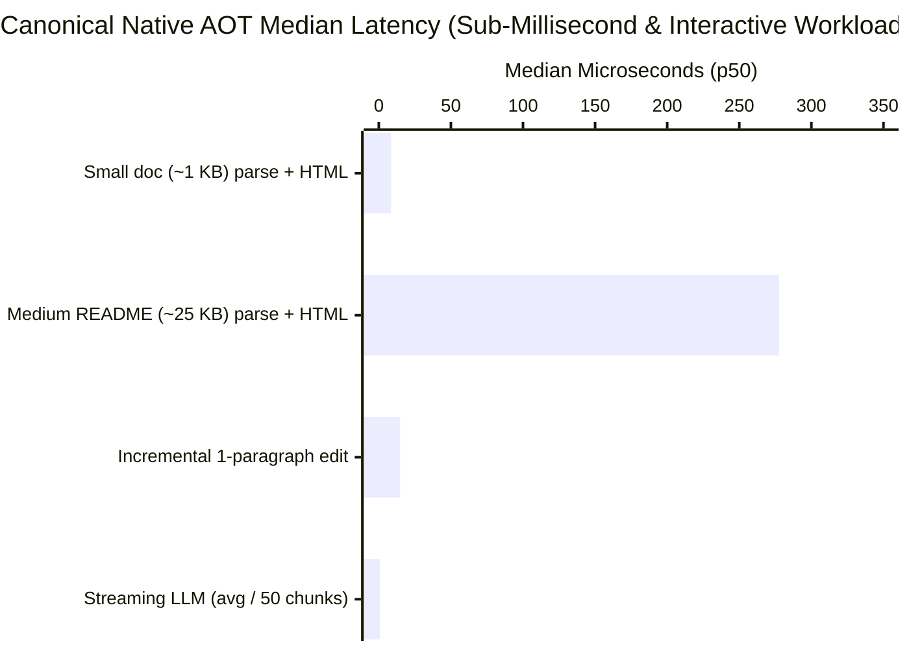
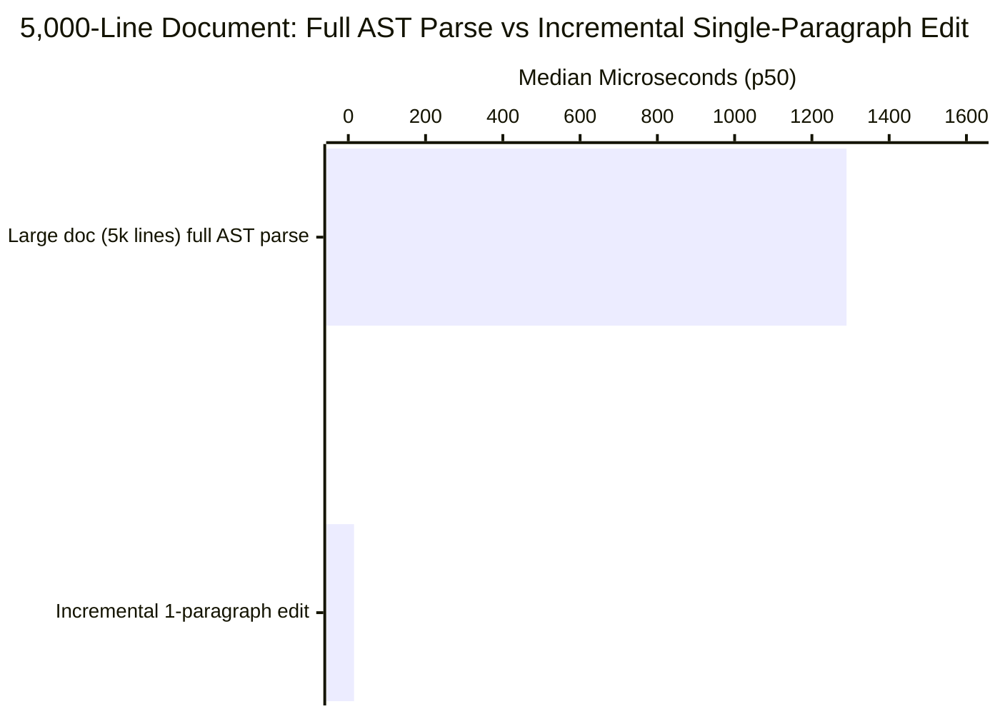

# Benchmarks (Native AOT, Head-to-Head & macOS Profile)

This document presents the canonical performance profile for `markdown_engine` (`0.1.0`) and `markdown_engine_flutter` (`0.1.0`) on Apple Silicon (`Apple M4`, macOS `15.6`), combining interleaved Native Dart AOT parser benchmarks (`tool/compare/bin/compare_parsers_aot.dart` under `MarkdownOptions.gfm()`), Flutter Test JIT and headless `800x600` widget benchmarks (`tool/compare/test/compare_flutter_bench_test.dart`) against `package:markdown 7.3.1`, `flutter_md 0.3.1`, and `flutter_markdown_plus 1.0.12`, persistent vs one-shot Mermaid background isolate measurements (`tool/compare/test/mermaid_worker_bench_test.dart`), real macOS `--profile` Impeller (`MetalSDF`) frame-timing telemetry (`studio/lib/profile_benchmark_main.dart`), and CI regression ceilings (`tool/benchmark_suite.dart` / `tool/benchmark_baseline.json`).

## Host Environment & Dependency Pins

All five suites below ran sequentially on an idle Apple M4 host with zero concurrent Dart or Flutter workloads.

| Property | Value |
| :--- | :--- |
| CPU | `Apple M4` |
| Architecture | `arm64` |
| OS | `macos` (`Version 15.6 (Build 24G84)`) |
| Logical Cores | `10` |
| Memory | `32 GiB` |
| Dart SDK | `3.13.5` |
| Package Pins | `markdown_engine 0.1.0` · `markdown_engine_flutter 0.1.0` · `package:markdown 7.3.1` · `flutter_md 0.3.1` · `flutter_markdown_plus 1.0.12` |
| Execution Modes | `Native AOT` (interleaved comparison & CI baseline) · `Flutter Test JIT` (interleaved VM parser & `800x600` widget pumps) · `macOS --profile` (`Impeller MetalSDF`) |
| Peak Process RSS (`benchmark_baseline.json`) | `51.98 MiB` (`processMaxRssMb`) |

## Executive Scoreboard

To keep comparisons transparent and avoid mixing apples with oranges, this scoreboard is split into two explicit tiers: **Tier 1 (Apples-to-Apples Core Benchmarks)** aligns parser options, non-selectable widget configuration (`selectable: false`), matched 31-pump streaming pacing, and disabled built-in math/Mermaid widgets (`B4a`) against raw-text competitors, whereas **Tier 2 (Rich Out-of-the-Box Capabilities)** measures production-default `SelectionArea` selection (`-Selectable`), native OpenType `TexMath` (`tex_math_flutter`), `VectorGraphic` Mermaid (`pele_dart`), GitHub alerts, hybrid two-sliver streaming (`B4b`), live macOS `--profile` Impeller frames, and persistent Mermaid worker isolate dispatch that third-party packages do not natively provide.

### Tier 1 — Apples-to-Apples Core Benchmarks

| Category | Workload | `markdown_engine` / `markdown_engine_flutter` | `flutter_md 0.3.1` | `package:markdown 7.3.1` | `flutter_markdown_plus 1.0.12` |
| :--- | :--- | ---: | ---: | ---: | ---: |
| **Native AOT** | Small (`937 B`) parse + HTML | **8.52 us** (`104.91 MB/s`) | N/A | 203.38 us (`4.39 MB/s`, `23.87x` slower) | N/A |
| **Native AOT** | Medium (`24.7 KB`) parse + HTML | **277.56 us** (`86.74 MB/s`) | N/A | 5.448 ms (`4.42 MB/s`, `19.63x` slower) | N/A |
| **Native AOT** | Large (`4,996` lines) AST parse | **1.290 ms** (`127.91 MB/s`) | N/A | 39.057 ms (`4.22 MB/s`, `30.28x` slower) | N/A |
| **Native AOT** | Large (`4,996` lines) parse + HTML | **2.464 ms** (`66.94 MB/s`) | N/A | 47.136 ms (`3.50 MB/s`, `19.13x` slower) | N/A |
| **Native AOT** | Incremental 1-para edit (`4,996` lines) | **14.76 us** (`1,457/1,458` reused, `87.38x` vs own full) | N/A | 39.057 ms *(full re-parse, `2,646.14x` slower)* | N/A |
| **Native AOT** | 50-chunk LLM stream (`2.1 KB`) | **0.86 us/chunk** (`43.00 us` total) | N/A | 227.37 us/chunk (`11.369 ms` total, `264.38x` slower) | N/A |
| **Native AOT** | Adversarial (`<a *5000` / `*a *5000` / `$a *5000` / `10 KB` nested) | **587 / 482 / 443 / 351 us** (`ok`) | N/A | 8.313 / 6.682 / 5.903 / 25.247 ms (`ok`) | N/A |
| **Spec Parity** | CommonMark `0.31.2` / GFM `0.29.0` Spec / Ext | **652/652 · 670/670 · 30/30 (100.0%)** | N/A *(no HTML serializer)* | 641/652 · 644/670 · 22/30 | N/A *(wraps `package:markdown`)* |
| **Flutter JIT** | Small (`937 B`) AST parse | 8.81 us (`p95 10.90 us`; AST+HTML `12.37 us`) | **8.38 us** (`p95 9.93 us`) | 223.54 us (`p95 229.57 us`) | N/A *(wraps `package:markdown`)* |
| **Flutter JIT** | Medium (`24.7 KB`) AST parse | **178.40 us** (`p95 188.57 us`; AST+HTML `286.40 us`) | 239.20 us (`p95 273.66 us`) | 5.443 ms (`p95 5.600 ms`) | N/A *(wraps `package:markdown`)* |
| **Flutter JIT** | Large (`4,996` lines) AST parse | **1.704 ms** (`p95 2.018 ms`; AST+HTML `2.235 ms`) | 1.855 ms (`p95 3.510 ms`) | 47.837 ms (`p95 48.449 ms`) | N/A *(wraps `package:markdown`)* |
| **Flutter JIT** | 50-chunk LLM stream (`2.1 KB`) | 2.52 us/chunk (**`p95 2.88 us`**, `126.00 us` total; **0.86 us/chunk AOT**) | **2.11 us/chunk** (`p95 3.11 us`, `105.50 us` total; AOT N/A) | 275.92 us/chunk (`p95 282.71 us`, `13.796 ms` total) | N/A *(wraps `package:markdown`)* |
| **Widget Core** | `B1`: 403-block build & pump (`selectable: false`) | **10.05 ms** (`p95 13.32 ms`; **8.56 ms** / `p95 10.39 ms` `.document`) | 23.31 ms (`p95 25.80 ms`; `23.23 ms` pre-parsed) | N/A | 28.88 ms (`p95 34.99 ms`) |
| **Widget Core** | `B2`: Light <-> Dark toggle (`selectable: false`) | **1.73 ms/toggle** (`p95 3.25 ms`, `0` re-parses) | 17.72 ms/toggle (`p95 25.44 ms`, `0` re-parses) | N/A | 18.98 ms/toggle (`p95 23.68 ms`, `42` re-parses) |
| **Widget Core** | `B3`: 30-chunk prose stream (`selectable: false`, `31` pumps) | **9.29 ms** (`p95 10.95 ms`, `0.31 ms/chunk`; `+ finish()` `0.20 ms`) | 9.78 ms (`p95 11.56 ms`, `0.33 ms/chunk`) | N/A | 68.28 ms (`p95 83.16 ms`, `2.28 ms/chunk`) |
| **Widget Core** | `B4a`: 30-chunk mixed stream (GFM, built-in math/Mermaid off, `selectable: false`) | 6.77 ms (`p95 7.54 ms`, `0.23 ms/chunk`; `+ finish()` `0.17 ms`) / `B4a-Hybrid` 10.91 ms (`p95 14.55 ms`, `+ finish()` `0.54 ms`) | **6.08 ms** (`p95 6.28 ms`, `0.20 ms/chunk`; raw text/code only) | N/A | 34.64 ms (`p95 37.77 ms`, `1.15 ms/chunk`; raw blocks + full rebuild) |

Notice why `B4a` isolates apples-to-apples core streaming on the mixed fixture: disabling `enableBuiltInMath` and `enableBuiltInMermaid` makes `B4a` render strictly core text and fenced blocks like `flutter_md` and `flutter_markdown_plus` (while `B4a-Hybrid` enables `MarkdownOptions.extended()` alert callouts alongside raw math text fallback), whereas `B4b` in Tier 2 exercises native `TexMath`, `VectorGraphic` Mermaid, and GitHub alerts end to end.

### Tier 2 — Rich Out-of-the-Box Capabilities

| Category | Workload | `markdown_engine_flutter` | `flutter_md 0.3.1` | `package:markdown 7.3.1` | `flutter_markdown_plus 1.0.12` |
| :--- | :--- | ---: | ---: | ---: | ---: |
| **Widget Default** | `B1-Selectable`: 403-block build & pump (`selectable: true`) | **10.80 ms** (`p95 19.17 ms`; **9.97 ms** / `p95 17.05 ms` `.document`) | N/A *(see Tier 1 `B1` non-selectable)* | N/A | N/A *(see Tier 1 `B1` non-selectable)* |
| **Widget Default** | `B2-Selectable`: Light <-> Dark toggle (`selectable: true`) | **1.58 ms/toggle** (`p95 2.86 ms`, `0` re-parses) | N/A *(see Tier 1 `B2` non-selectable)* | N/A | N/A *(see Tier 1 `B2` non-selectable)* |
| **Widget Default** | `B3-Selectable`: 30-chunk prose stream (`selectable: true`, `31` pumps) | **9.88 ms** (**`p95 10.27 ms`**, `0.33 ms/chunk`; `+ finish()` `0.22 ms`) | N/A *(see Tier 1 `B3` non-selectable)* | N/A | N/A *(see Tier 1 `B3` non-selectable)* |
| **Rich Mixed Stream** | `B4b-Cold`: 30-chunk `TexMath` + `VectorGraphic` Mermaid + alerts + hybrid tail (cold LRU) | **19.56 ms** (`p95 24.50 ms`, `0.65 ms/chunk`; `+ finish()` `1.49 ms`; `mathLayouts=2`, `mermaidRenders=1`) | N/A *(no native math/Mermaid/alerts; see Tier 1 `B4a`)* | N/A | N/A *(no native math/Mermaid/alerts; see Tier 1 `B4a`)* |
| **Rich Mixed Stream** | `B4b-Warm`: 30-chunk `TexMath` + `VectorGraphic` Mermaid + alerts + hybrid tail (warm LRU) | **16.38 ms** (`p95 18.89 ms`, `0.55 ms/chunk`; `+ finish()` `0.81 ms`; `mathHits=3`, `mermaidHits=2`, `newLayouts=0`, `newRenders=0`) | N/A *(no native math/Mermaid/alerts; see Tier 1 `B4a`)* | N/A | N/A *(no native math/Mermaid/alerts; see Tier 1 `B4a`)* |
| **macOS Profile** | 500-section scroll (`152` frames, Impeller `MetalSDF`) | **0.77 ms** build p50 (`p95 1.81 ms`) / **0.52 ms** raster p50 (`p95 1.25 ms`, `0` jank) | N/A | N/A | N/A |
| **macOS Profile** | 60Hz live streaming (`48` chunks, `51` frames, Impeller `MetalSDF`) | **0.29 ms** build p50 (`p95 0.65 ms`) / **0.28 ms** raster p50 (`p95 0.62 ms`, `0` jank) | N/A | N/A | N/A |
| **Mermaid Isolate** | `10` distinct cold diagrams (`debugForceAsyncMermaidInTests=true`) | **17.05 ms** unwarmed seq / **10.37 ms** warmed seq (`persistent`) · **4.69 ms** warmed concurrent (`compute`) | N/A | N/A | N/A |

Even with full `SelectionArea` / cross-sliver selection active (`selectable: true`), `B3-Selectable` (`9.88 ms` p50, `10.27 ms` p95) matches non-selectable `flutter_md` (`9.78 ms` p50, `11.56 ms` p95) on median session latency while beating `flutter_md` on `p95` tail latency, and `B4b-Warm` (`16.38 ms`) renders real OpenType math, vector Mermaid diagrams, GitHub alerts, and full selection in under half the time `flutter_markdown_plus` takes to render raw blocks without math or diagrams (`34.64 ms` in Tier 1 `B4a`).

## Canonical Native AOT Benchmarks (`tool/compare/bin/compare_parsers_aot.dart`)

All Native AOT latencies, throughputs, speedup factors, and charts below come from the single canonical interleaved AOT run (`compare_parsers_aot.dart --json`) comparing `markdown_engine` (`MarkdownOptions.gfm()`) against `package:markdown 7.3.1` (`ExtensionSet.gitHubFlavored`, `enableTagfilter: true`).

| Workload | Payload | Samples x Batch | `markdown_engine` Mean | `markdown_engine` p50 | `markdown_engine` p95 | `markdown_engine` Throughput (p50) | `package:markdown 7.3.1` p50 (`p95`) | Speedup (`p50`) |
| :--- | ---: | ---: | ---: | ---: | ---: | ---: | ---: | ---: |
| Small doc parse + HTML | `937 B` (`18` lines) | `25 x 400` | `8.67 us` | **8.52 us** | `9.42 us` | `104.91 MB/s` | `203.38 us` (`205.34 us`, `4.39 MB/s`) | **23.87x** |
| Medium README parse + HTML | `24.7 KB` (`479` lines) | `25 x 25` | `277.29 us` | **277.56 us** | `287.50 us` | `86.74 MB/s` | `5.448 ms` (`5.503 ms`, `4.42 MB/s`) | **19.63x** |
| Large 5,000-line AST parse | `168.9 KB` (`4,996` lines, `1,458` blocks) | `21 x 4` | `1.313 ms` | **1.290 ms** | `1.433 ms` | `127.91 MB/s` | `39.057 ms` (`41.866 ms`, `4.22 MB/s`) | **30.28x** |
| Large 5,000-line parse + HTML | `168.9 KB` (`4,996` lines) | `21 x 4` | `2.437 ms` | **2.464 ms** | `2.653 ms` | `66.94 MB/s` | `47.136 ms` (`47.819 ms`, `3.50 MB/s`) | **19.13x** |
| Incremental 1-paragraph edit | `168.9 KB` (`1,457/1,458` reused) | `25 x 25` | `15.22 us` | **14.76 us** | `18.09 us` | `11176.53 MB/s` | `39.057 ms` *(full re-parse)* | **2,646.14x** (`87.38x` vs own full) |
| 50-chunk LLM stream (per chunk) | `2.1 KB` / `50` chunks (`43.00 us` total) | `25 x 15` (`5` for pkg) | `0.87 us/chunk` | **0.86 us/chunk** | `0.93 us/chunk` | `47.77 MB/s` | `227.37 us/chunk` (`240.10 us`, `11.369 ms` total) | **264.38x** |





### Adversarial Resilience (`compare_parsers_aot.dart`)

| Adversarial Input | Payload | `markdown_engine` | `package:markdown 7.3.1` | Speedup & Defense Mechanism |
| :--- | ---: | ---: | ---: | :--- |
| 5,000 unmatched `<` (`<a ` * 5000) | `15,000 B` (`14.6 KB`) | **587.00 us** (`ok`, `30,007` chars) | `8.313 ms` (`ok`, `30,007` chars) | **14.16x** faster; bounded linear raw-HTML / angle scan |
| 5,000 unmatched `*` (`*a ` * 5000) | `15,000 B` (`14.6 KB`) | **482.00 us** (`ok`, `15,007` chars) | `6.682 ms` (`ok`, `15,007` chars) | **13.86x** faster; linear `_coalesceTextNodes` and bounded delimiter stack |
| 5,000 unmatched `$` (`$a ` * 5000, `math: true`) | `15,000 B` (`14.6 KB`) | **443.00 us** (`ok`, `15,007` chars) | `5.903 ms` (`ok`, `15,007` chars) | **13.33x** faster; early unmatched-`$` fast-path bailout |
| 10 KB nested emphasis (`*a ` * 1706 + core + ` a*` * 1706) | `10,240 B` (`10.0 KB`) | **351.00 us** (`ok`, `10,696` chars) | `25.247 ms` (`ok`, `22,190` chars) | **71.93x** faster; bounded depth (`maxNestingDepth`) |

### Specification Parity (`CommonMark 0.31.2` & `GFM 0.29.0`)

| Suite | Active Cases | `markdown_engine` | `package:markdown 7.3.1` | `flutter_md 0.3.1` |
| :--- | ---: | ---: | ---: | :--- |
| CommonMark `0.31.2` | `652` | **652 / 652 (100.0%)** | `641 / 652` (`98.3%`, `0` errors) | N/A *(no HTML serializer; diverges on `__bold__` -> underline, Setext headings, reference links, `<url>` autolinks, HTML entities, 4-space indented code, raw HTML)* |
| GFM `0.29.0` Spec | `670` (`2` disabled) | **670 / 670 (100.0%)** | `644 / 670` (`96.1%`, `0` errors) | N/A *(no HTML serializer)* |
| GFM `0.29.0` Extensions | `30` (`1` ignored) | **30 / 30 (100.0%)** | `22 / 30` (`73.3%`, `0` errors) | N/A *(no HTML serializer)* |

## Flutter Test JIT Parser Throughput & Spec Trade-Offs (`compare_flutter_bench_test.dart`)

`flutter_md 0.3.1` exports Flutter widgets and cannot execute in a pure-Dart AOT CLI binary, so pure-parser comparisons across `markdown_engine`, `flutter_md`, and `package:markdown` run interleaved inside `flutter test` JIT VM.

| Workload | Payload | `markdown_engine` p50 (`p95`) | `flutter_md 0.3.1` p50 (`p95`) | `package:markdown 7.3.1` p50 (`p95`) |
| :--- | ---: | ---: | ---: | ---: |
| Small doc AST | `937 B` | `8.81 us` (`p95 10.90 us`, `101.39 MB/s`; AST+HTML `12.37 us`, `p95 14.71 us`) | **8.38 us** (`p95 9.93 us`, `106.63 MB/s`) | `223.54 us` (`p95 229.57 us`, `4.00 MB/s`) |
| Medium README AST | `24.7 KB` | **178.40 us** (`p95 188.57 us`, `134.95 MB/s`; AST+HTML `286.40 us`, `p95 306.96 us`) | `239.20 us` (`p95 273.66 us`, `100.65 MB/s`) | `5.443 ms` (`p95 5.600 ms`, `4.42 MB/s`) |
| Large 5,000-line AST | `168.9 KB` (`4,996` lines) | **1.704 ms** (`p95 2.018 ms`, `96.81 MB/s`; AST+HTML `2.235 ms`, `p95 3.449 ms`) | `1.855 ms` (`p95 3.510 ms`, `88.93 MB/s`) | `47.837 ms` (`p95 48.449 ms`, `3.45 MB/s`) |
| 50-chunk LLM stream | `2.1 KB` / `50` chunks | `2.52 us/chunk` (**`p95 2.88 us`**, `126.00 us` total; **0.86 us/chunk AOT**) | **2.11 us/chunk** (`p95 3.11 us`, `105.50 us` total; AOT N/A) | `275.92 us/chunk` (`p95 282.71 us`, `13.796 ms` total) |

`flutter_md 0.3.1` trades CommonMark/GFM spec parity features (`__bold__` renders as underline rather than `<strong>`, Setext headings collapse into paragraphs, reference links and `<url>` autolinks stay literal text, HTML entities such as `&copy;` and `&#35;` remain undecoded, 4-space indented code blocks parse as paragraphs, and raw HTML stays literal text), HTML serialization, URL scheme sanitization (`MarkdownUrlPolicy`), and complexity budgets (`MarkdownBudgets`) for a slightly tighter JIT loop on the 937 B small payload (`8.38 us` vs `8.81 us`) and 50-chunk JIT median (`2.11 us/chunk` vs `2.52 us/chunk`). Even inside JIT, `markdown_engine` beats `flutter_md` on Medium AST (`1.34x` faster), Large AST (`1.09x` median and `1.74x` faster `p95` tail), and 50-chunk stream `p95` (`2.88 us` vs `3.11 us`), while compiling to `0.86 us/chunk` (`43.00 us` total) in Native Dart AOT (`flutter_md` AOT = `N/A`).

## Headless Flutter Widget Benchmarks (`800x600` Viewport)

Each widget benchmark runs `2` warmup rounds followed by `7` timed interleaved round-robin rounds (`ABC`/`BCA`/`CAB` rotation) in an `800x600` `MaterialApp` viewport. Tier 1 matches `selectable: false` and `31` streaming pumps across every widget; Tier 2 measures `markdown_engine_flutter`'s production-default `selectable: true` (`SelectionArea` + `MarkdownRichText`) and rich built-in `TexMath` + `VectorGraphic` Mermaid + alert pipeline (`B4b`).

### Tier 1 Core Widget Benchmarks (`selectable: false`, Matched `31` Pumps)

| Benchmark | `markdown_engine_flutter` (`selectable: false`) | `flutter_md 0.3.1` (`selectable: false`) | `flutter_markdown_plus 1.0.12` (`selectable: false`) | Observations |
| :--- | ---: | ---: | ---: | :--- |
| `B1`: 403-block build & pump (`data`) | **10.05 ms** (`p95 13.32 ms`, `iqr 2.55 ms`) | `23.31 ms` (`p95 25.80 ms`) | `28.88 ms` (`p95 34.99 ms`, `iqr 5.73 ms`) | Lazy `SliverMarkdownDocument` + `FastMarkdownText` / `MarkdownParagraphLeaf` (`2.32x` faster than `flutter_md`, `2.87x` faster than `flutter_markdown_plus`) |
| `B1`: 403-block pre-parsed (`.document`) | **8.56 ms** (`p95 10.39 ms`, `iqr 2.02 ms`) | `23.23 ms` (`p95 25.44 ms`) | N/A *(parses inside widget)* | `2.71x` faster than pre-parsed `flutter_md` |
| `B2`: Light <-> Dark toggle (`4` timed toggles/round) | **1.73 ms/toggle** (`p95 3.25 ms`, `iqr 0.30 ms`, `0` re-parses) | `17.72 ms/toggle` (`p95 25.44 ms`, `iqr 1.46 ms`, `0` re-parses) | `18.98 ms/toggle` (`p95 23.68 ms`, `iqr 1.29 ms`, `42` re-parses) | `10.24x` faster than `flutter_md`, `10.97x` faster than `flutter_markdown_plus` (zero AST re-parses) |
| `B3`: 30-chunk prose LLM stream (`31` pumps) | **9.29 ms** (`p95 10.95 ms`, `0.31 ms/chunk`) \| `+ finish()` `0.20 ms` (`p95 0.25 ms`) | `9.78 ms` (`p95 11.56 ms`, `0.33 ms/chunk`) | `68.28 ms` (`p95 83.16 ms`, `2.28 ms/chunk`) | Push listeners (`0` polling timers), expanded streaming fast paths, and `MarkdownStreamingCanvasLeaf` beat `flutter_md` (`1.05x`) and `flutter_markdown_plus` (`7.35x`) |
| `B4a`: 30-chunk mixed stream (GFM, math/Mermaid off) | `6.77 ms` (`p95 7.54 ms`, `0.23 ms/chunk`) \| `+ finish()` `0.17 ms` (`p95 0.25 ms`) | **6.08 ms** (`p95 6.28 ms`, `0.20 ms/chunk`) | `34.64 ms` (`p95 37.77 ms`, `1.15 ms/chunk`) | `5.12x` faster than `flutter_markdown_plus` on matched raw-block streaming while enforcing full GFM spec and URL/budget guards |
| `B4a-Hybrid`: 30-chunk mixed stream (alerts + raw math fallback, math/Mermaid off) | `10.91 ms` (`p95 14.55 ms`, `0.36 ms/chunk`) \| `+ finish()` `0.54 ms` (`p95 0.61 ms`) | N/A *(no alert blocks)* | N/A *(no alert blocks)* | `3.18x` faster than `flutter_markdown_plus`'s raw-block `34.64 ms` while rendering GitHub callout alerts in the settled prefix sliver |

### Tier 2 Rich Out-of-the-Box Widget Benchmarks (`selectable: true` Default & Native Math/Mermaid)

| Benchmark | `markdown_engine_flutter` (`selectable: true`) | `+ finish()` Delta | Cache / Structural Telemetry & Comparison |
| :--- | ---: | ---: | :--- |
| `B1-Selectable`: 403-block build & pump (`data`) | **10.80 ms** (`p95 19.17 ms`, `iqr 1.20 ms`) | N/A | Still `2.16x` faster than non-selectable `flutter_md` (`23.31 ms`) and `2.67x` faster than non-selectable `flutter_markdown_plus` (`28.88 ms`) |
| `B1-Selectable`: 403-block pre-parsed (`.document`) | **9.97 ms** (`p95 17.05 ms`, `iqr 2.89 ms`) | N/A | Full `SelectionArea` + `MarkdownRichText` safety active across virtualized slivers |
| `B2-Selectable`: Light <-> Dark toggle (`4` timed toggles/round) | **1.58 ms/toggle** (`p95 2.86 ms`, `iqr 0.58 ms`) | N/A | `0` re-parses; `11.22x` faster than non-selectable `flutter_md` (`17.72 ms`) and `12.01x` faster than non-selectable `flutter_markdown_plus` (`18.98 ms`) |
| `B3-Selectable`: 30-chunk prose LLM stream (`31` pumps) | **9.88 ms** (**`p95 10.27 ms`**, `0.33 ms/chunk`) | `0.22 ms` (`p95 0.25 ms`) | Level with non-selectable `flutter_md` (`9.78 ms`) on `p50` while beating it on `p95` (`10.27 ms` vs `11.56 ms`) with full selection enabled |
| `B4b-Cold`: 30-chunk mixed stream (cold LRU cache) | **19.56 ms** (`p95 24.50 ms`, `0.65 ms/chunk`) | `1.49 ms` (`p95 2.66 ms`) | `mathLayouts=2`, `mermaidRenders=1`; renders native `TexMath`, `VectorGraphic` Mermaid, and alerts `1.77x` faster than `flutter_markdown_plus` (`34.64 ms` raw blocks) |
| `B4b-Warm`: 30-chunk mixed stream (warm LRU cache) | **16.38 ms** (`p95 18.89 ms`, `0.55 ms/chunk`) | `0.81 ms` (`p95 1.86 ms`) | `mathHits=3`, `mermaidHits=2`, `newLayouts=0`, `newRenders=0`; `2.11x` faster than `flutter_markdown_plus` (`34.64 ms` raw blocks) |

## Real macOS `--profile` Impeller Frame Timings (`studio/lib/profile_benchmark_main.dart`)

Measured via `dart run tool/run_macos_profile_benchmark.dart --no-pub --timeout=180` (`flutter run -d macos --profile --no-pub -t lib/profile_benchmark_main.dart`) under Impeller `MetalSDF` after `MarkdownBuiltInRenderers.warmUp()`, collecting live `SchedulerBinding.instance.addTimingsCallback` `FrameTiming` durations across `500`-section scrolling and `60Hz` streaming with native `tex_math_flutter`, persistent-isolate `pele_dart` + `vector_graphics` Mermaid diagrams, and the hybrid two-sliver streaming tail canvas.

| Workload | Frames | Build (`p50 / p95 / p99 / max`) | Raster (`p50 / p95 / p99 / max`) | Jank (`> 16.67 ms`) |
| :--- | ---: | ---: | ---: | ---: |
| 500-section scroll (`TexMath` + Mermaid + tables + alerts) | `152` | **0.77 ms** / `1.81 ms` / `1.95 ms` / `2.16 ms` | **0.52 ms** / `1.25 ms` / `1.35 ms` / `1.39 ms` | **0** build, **0** raster, **0** total |
| 60Hz live streaming (`48` chunks with math & Mermaid) | `51` | **0.29 ms** / `0.65 ms` / `3.44 ms` / `3.52 ms` | **0.28 ms** / `0.62 ms` / `1.56 ms` / `2.06 ms` | **0** build, **0** raster, **0** total |

Across both `--profile` phases (`152` scroll frames + `51` streaming frames), `MarkdownBuiltInRenderers` (backed by dual entry+byte LRU budgets defaulting to `1,024` entries / `8 MiB` for math and `128` entries / `16 MiB` for Mermaid, plus the default-on persistent Mermaid worker isolate) recorded `mathLayouts=312` (`mathHits=23`) and `mermaidRenders=12` (`mermaidHits=1`) with zero jank frames across the 60 Hz (`16.67 ms`) budget.

## Persistent vs One-Shot Mermaid Worker Isolate (`tool/compare/test/mermaid_worker_bench_test.dart`)

Measured on cold LRU cache across `10` distinct Mermaid diagrams (`2` warmup + `10` interleaved rounds under `debugForceAsyncMermaidInTests = true`, forcing real background `Isolate` compilation on Apple M4), comparing default `MarkdownBuiltInRenderers.usePersistentMermaidIsolate = true` against `usePersistentMermaidIsolate = false` (one-shot `compute()` per diagram).

| Dispatch Pattern (`10` Distinct Cold Diagrams) | `usePersistentMermaidIsolate = true` (Default) | `usePersistentMermaidIsolate = false` (One-Shot `compute()`) | Notes |
| :--- | ---: | ---: | :--- |
| Unwarmed sequential | **17.05 ms** (`p95 21.88 ms`) | `21.07 ms` (`p95 34.49 ms`) | Single lazy worker isolate eliminates 9 extra isolate spawns and repeated `pele_dart` + `vector_graphics_compiler` setup (**1.24x** faster persistent) |
| Post-`warmUp()` sequential | **10.37 ms** (`p95 19.23 ms`) | `15.68 ms` (`p95 26.85 ms`) | Pre-warmed persistent worker serves sequential diagrams with zero spawn or warm-up overhead (**1.51x** faster persistent) |
| Post-`warmUp()` concurrent (`Future.wait`) | `9.67 ms` (`p95 11.09 ms`) | **4.69 ms** (`p95 9.32 ms`) | Single persistent worker caps background memory at 1 isolate (`9.67 ms`), while setting `usePersistentMermaidIsolate = false` fans batch `Future.wait` loads across 10 parallel `compute()` isolates (**2.06x** faster parallel `compute()`) |

## CI Regression Ceilings & Structural Telemetry (`tool/benchmark_suite.dart`)

`dart run tool/benchmark_suite.dart --check-regressions` compiles and runs a standalone Native AOT regression gate (updating [`tool/benchmark_baseline.json`](../tool/benchmark_baseline.json) when `--update-baseline` is passed) to verify memory bounds, structural block reuse, streaming prefix settling, and generous `O(N^2)` sanity ceilings rather than serving as a head-to-head comparison table (canonical parser latencies live in the interleaved `compare_parsers_aot.dart` section above).

| CI Check / Telemetry Metric | Measured Value | CI Gate / Threshold | Status / Notes |
| :--- | ---: | ---: | :--- |
| Peak Process RSS (`processMaxRssMb`) | **51.98 MiB** | Telemetry | Peak resident set across full 5-benchmark AOT run |
| `small_doc_parse_and_html` (standalone CI p50) | `8.31 us` (`mean 8.46 us`, `p95 9.08 us`, `107.50 MB/s`) | `<= 2.000 ms` (`2,000 us`) | **PASS** |
| `medium_doc_parse_and_html` (standalone CI p50) | `262.52 us` (`mean 263.54 us`, `p95 269.02 us`, `91.71 MB/s`) | `<= 30.000 ms` (`30,000 us`) | **PASS** |
| `large_doc_5000_lines_parse` (standalone CI p50) | `1.287 ms` (`mean 1.308 ms`, `p95 1.446 ms`, `128.18 MB/s`) | `<= 200.000 ms` (`200,000 us`) | **PASS** |
| `incremental_single_paragraph_edit` (standalone CI p50) | `14.76 us` (`mean 15.42 us`, `p95 18.96 us`, `11176.53 MB/s`) | `<= 25.000 ms` (`25,000 us`) | **PASS** (edited line `2480` of `4996`) |
| `streaming_llm_50_chunks_per_chunk` (standalone CI p50) | `0.83 us` (`mean 0.85 us`, `p95 0.91 us`, `49.70 MB/s`, `41.50 us` session) | `<= 5.000 ms` (`5,000 us`) | **PASS** |
| `incremental_reused_block_ratio` | **1,457 / 1,458 (99.93%)** (`reusedRatio: 0.9993`) | `>= 0.90` (`90%`) | **PASS** (`reparsedBlocks: 1`) |
| `incremental_vs_full_speedup` | **87.20x** standalone CI (`87.38x` canonical interleaved) | `>= 2.00x` | **PASS** |
| `streaming_settled_blocks` | **14 / 15** frozen before `finish()` | `>= 1` block | **PASS** (`finalBlockCount: 15`) |

## Methodology & Fairness Invariants

Every parser and widget benchmark executes deterministic in-memory fixtures with zero filesystem or network I/O inside timed windows and verifies HTML/AST parity outside timed sampling before recording measurements.

* **Interleaved Round-Robin Ordering**: `compare_parsers_aot.dart`, `compare_flutter_bench_test.dart`, and `mermaid_worker_bench_test.dart` rotate participant execution order each round (`ABC` / `BCA` / `CAB` via `interleaveRoundIndices`) across both warmup and timed rounds so CPU scheduling jitter and thermal drift affect every package uniformly.
* **Matched `selectable: false` vs `-Selectable` Separation**: Tier 1 widget benchmarks (`B1`–`B4a`) pass `selectable: false` on `MarkdownView` so layout and paint costs match `flutter_md` and `flutter_markdown_plus`; Tier 2 (`B1-Selectable`, `B2-Selectable`, `B3-Selectable`, `B4b`) enables production-default `selectable: true` (`SelectionArea` + `MarkdownRichText`).
* **Matched `31`-Pump Streaming & Separate `+ finish()` Delta**: `B3`, `B4a`, and `B4b` execute `1` initial reset pump plus `30` active chunk pumps (`31` total pumps) identically across all engines, while reporting `MarkdownView.streaming`'s final `controller.finish()` reconciliation pump separately as `+ finish()` delta.
* **Percentiles, Batching & Throughput**: Microsecond benchmarks wrap `batchIterations` consecutive calls in a single `Stopwatch` window (dividing by `batchIterations`, and by `50` chunks for streaming) with dead-code sink accumulation, reporting median (`p50`) and `p95` tail latencies alongside MiB/s throughput (`(bytes / (1024 * 1024)) / (medianUs / 1e6)`).

## Exact Reproducible Commands

```bash
# 1. Run standalone Native AOT CI regression checks (with JSON & baseline update)
dart run tool/benchmark_suite.dart --update-baseline --check-regressions --json

# 2. Run canonical interleaved Native AOT parser, adversarial & spec parity comparison
(cd tool/compare && flutter pub get)
dart compile exe tool/compare/bin/compare_parsers_aot.dart -o /tmp/compare_parsers.exe
/tmp/compare_parsers.exe --json
rm -f /tmp/compare_parsers.exe

# 3. Run Flutter Test JIT parser throughput, CommonMark spot checks & 800x600 widget benchmarks
(cd tool/compare && flutter test --no-pub test/compare_flutter_bench_test.dart)

# 4. Run persistent vs one-shot Mermaid worker isolate benchmark (10 distinct cold diagrams)
(cd tool/compare && flutter test --no-pub test/mermaid_worker_bench_test.dart)

# 5. Run real macOS --profile Impeller frame-time benchmark (500-section scroll + 60Hz streaming)
dart run tool/run_macos_profile_benchmark.dart --no-pub --timeout=180
```
