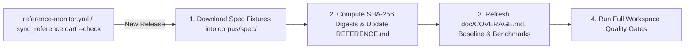

# Reference Synchronization Guide

`markdown_engine` targets exact HTML and structural parity with the pinned **CommonMark `0.31.2`** and **GitHub Flavored Markdown (`github/cmark-gfm 0.29.0.gfm.13`)** fixtures recorded in [`REFERENCE.md`](../REFERENCE.md). Every upstream version pin, example count, and lowercase SHA-256 hash lives in `REFERENCE.md` as the single source of truth across CI, documentation, and verification tools.

---

## 1. Tracked Upstream Fixtures

`tool/sync_reference.dart` and `tool/verify_spec.dart` validate three vendored specification files under `corpus/spec/`:

| Fixture Path | Upstream Source | Example Count | Verification Role |
| :--- | :--- | ---: | :--- |
| `corpus/spec/commonmark_0.31.2.json` | `https://spec.commonmark.org/0.31.2/spec.json` | 652 | Official CommonMark 0.31.2 compliance suite evaluated under `MarkdownOptions.commonMark()`. |
| `corpus/spec/gfm_0.29.0_spec.txt` | `github/cmark-gfm` (`0.29.0.gfm.13`) `test/spec.txt` | 672 (670 active, 2 disabled) | Full GFM specification covering core CommonMark 0.29 examples and tagged `table`, `strikethrough`, `autolink`, and `tagfilter` cases. |
| `corpus/spec/gfm_0.29.0_extensions.txt` | `github/cmark-gfm` (`0.29.0.gfm.13`) `test/extensions.txt` | 30 (29 exact + 1 `<IGNORE>`) | Dedicated GFM extension interoperability and crash-regression suite evaluated under `MarkdownOptions.gfm(headingSlugs: false)`. |

---

## 2. Automated Integrity Verification & Release Monitoring

### Integrity Verification (`--verify`)

`tool/sync_reference.dart --verify` reads [`REFERENCE.md`](../REFERENCE.md), confirms `commonmark` and `cmark-gfm` pins exist, checks example counts, and verifies the live SHA-256 digest of each file in `corpus/spec/`:

```bash
dart run tool/sync_reference.dart --verify
dart run tool/sync_reference.dart --verify --json
```

CI executes `dart run tool/sync_reference.dart --verify` and `dart run tool/verify_spec.dart --strict` on every push and pull request in `.github/workflows/ci.yml`.

### Upstream Release Checks (`--check`)

Query the GitHub REST API (`commonmark/commonmark-spec` and `github/cmark-gfm`, using `GH_TOKEN` or `GITHUB_TOKEN` Bearer auth when set) for newer releases relative to [`REFERENCE.md`](../REFERENCE.md):

```bash
dart run tool/sync_reference.dart --check
dart run tool/sync_reference.dart --check --json
```

With `--json`, `--check` emits a structured status object:

```json
{
  "hasUpdate": false,
  "pinnedCommonmark": "0.31.2",
  "latestCommonmark": "0.31.2",
  "pinnedGfm": "0.29.0.gfm.13",
  "latestGfm": "0.29.0.gfm.13",
  "commonmark": {
    "repository": "commonmark/commonmark-spec",
    "pinned": "0.31.2",
    "latest": "0.31.2",
    "upToDate": true
  },
  "cmarkGfm": {
    "repository": "github/cmark-gfm",
    "pinned": "0.29.0.gfm.13",
    "latest": "0.29.0.gfm.13",
    "upToDate": true
  }
}
```

### Scheduled Reference Monitor Workflow

`.github/workflows/reference-monitor.yml` runs `dart run tool/sync_reference.dart --check --json` weekly on Mondays (0 13 * * 1 UTC) and via manual workflow dispatch. When `hasUpdate` is true, it opens a deduplicated tracking issue titled `chore(reference): sync commonmark <latestCommonmark> / cmark-gfm <latestGfm>` if no open issue with that title already exists.

---

## 3. Refreshing Upstream Specification Fixtures

When adopting a newer CommonMark or `cmark-gfm` release, follow the deterministic workflow below (also documented in [`.agents/skills/sync-reference-commonmark/SKILL.md`](https://github.com/tkinnis/markdown_engine/blob/main/.agents/skills/sync-reference-commonmark/SKILL.md)):



### Step 1: Download Updated Fixtures & Compute Digests

Download the target release artifacts into `corpus/spec/` and compute their SHA-256 digests:

```bash
curl -fsSL https://spec.commonmark.org/<VERSION>/spec.json -o corpus/spec/commonmark_<VERSION>.json
curl -fsSL https://raw.githubusercontent.com/github/cmark-gfm/<TAG>/test/spec.txt -o corpus/spec/gfm_<VERSION>_spec.txt
curl -fsSL https://raw.githubusercontent.com/github/cmark-gfm/<TAG>/test/extensions.txt -o corpus/spec/gfm_<VERSION>_extensions.txt
shasum -a 256 corpus/spec/*
```

If fixture filenames or expected example counts changed, update the fixture list in `tool/sync_reference.dart` and loader paths in `tool/verify_spec.dart` accordingly.

### Step 2: Update `REFERENCE.md`

Record the new `commonmark` and `cmark-gfm` version pins, upstream URLs or tags, exact example counts, and lowercase 64-character SHA-256 digests in [`REFERENCE.md`](../REFERENCE.md).

### Step 3: Regenerate Coverage, Baseline & Multi-Suite Benchmarks

Regenerate [`doc/COVERAGE.md`](COVERAGE.md) and [`tool/benchmark_baseline.json`](https://github.com/tkinnis/markdown_engine/blob/main/tool/benchmark_baseline.json), then run the four head-to-head and profile benchmark suites on an idle host to update [`doc/BENCHMARKS.md`](BENCHMARKS.md):

> [!WARNING]
> Do **not** run `dart run tool/benchmark_suite.dart --update-docs`. That flag overwrites the entire multi-suite [`doc/BENCHMARKS.md`](BENCHMARKS.md) with standalone AOT-only output, erasing the Tier 1/Tier 2 scoreboards, `compare_parsers_aot.dart`, Flutter JIT and widget pumps, macOS `--profile` Impeller timings, and Mermaid isolate sections.

```bash
# 1. Regenerate doc/COVERAGE.md strictly
dart run tool/verify_spec.dart --strict --update-coverage

# 2. Refresh tool/benchmark_baseline.json and enforce CI regression checks
dart run tool/benchmark_suite.dart --update-baseline --check-regressions --json

# 3. Run canonical interleaved Native AOT comparison (compare_parsers_aot.dart)
(cd tool/compare && flutter pub get)
dart compile exe tool/compare/bin/compare_parsers_aot.dart -o /tmp/compare_parsers.exe
/tmp/compare_parsers.exe --json
rm -f /tmp/compare_parsers.exe

# 4. Run Flutter Test JIT parser and 800x600 widget benchmarks
(cd tool/compare && flutter test --no-pub test/compare_flutter_bench_test.dart)

# 5. Run Mermaid worker isolate benchmark (4 concurrent modes + sequential baselines)
(cd tool/compare && flutter test --no-pub test/mermaid_worker_bench_test.dart)

# 6. Run real macOS --profile Impeller frame-time benchmark
dart run tool/run_macos_profile_benchmark.dart --no-pub --timeout=180
```

Update [`doc/BENCHMARKS.md`](BENCHMARKS.md) with the verified outputs from those five runs, and if specification counts or benchmark numbers changed, update the summary tables in [`README.md`](../README.md) and [`packages/markdown_engine/README.md`](../packages/markdown_engine/README.md) so every document matches verbatim. Also preserve the `<IGNORE>` crash-regression note at the bottom of [`doc/COVERAGE.md`](COVERAGE.md) after `--update-coverage`.

### Step 4: Verify All Workspace Quality Gates

Run the complete workspace checklist before committing:

```bash
dart format --output=none --set-exit-if-changed packages tool studio
dart analyze --fatal-infos
(cd packages/markdown_engine && dart test && dart run example/main.dart && dart doc --dry-run)
(cd packages/markdown_engine_flutter && flutter test && dart doc --dry-run)
(cd packages/markdown_engine_flutter/example && flutter test)
(cd studio && flutter test)
dart run tool/check_versions.dart
dart run tool/sync_reference.dart --verify
dart run tool/verify_spec.dart --strict
dart run tool/benchmark_suite.dart --check-regressions
```
