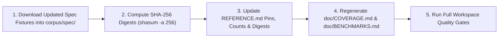

# Reference Synchronization Guide

`markdown_engine` targets exact HTML and structural parity with the pinned **CommonMark `0.31.2`** and **GitHub Flavored Markdown (`github/cmark-gfm 0.29.0.gfm.13`)** specification fixtures recorded in [`REFERENCE.md`](../REFERENCE.md). Every upstream version pin, example count, and lowercase SHA-256 integrity hash lives in `REFERENCE.md` as the single source of truth across CI, documentation, and verification scripts.

---

## 1. Tracked Upstream Fixtures

`tool/sync_reference.dart` and `tool/verify_spec.dart` validate three vendored specification files under `corpus/spec/`:

| Fixture Path | Upstream Source | Example Count | Verification Role |
| :--- | :--- | ---: | :--- |
| `corpus/spec/commonmark_0.31.2.json` | `https://spec.commonmark.org/0.31.2/spec.json` | `652` | Official CommonMark `0.31.2` compliance suite evaluated under `MarkdownOptions.commonMark()`. |
| `corpus/spec/gfm_0.29.0_spec.txt` | `github/cmark-gfm` (`0.29.0.gfm.13`) `test/spec.txt` | `672` (`670` active, `2` disabled) | Full GFM specification including core CommonMark `0.29` examples and tagged `table`, `strikethrough`, `autolink`, and `tagfilter` cases. |
| `corpus/spec/gfm_0.29.0_extensions.txt` | `github/cmark-gfm` (`0.29.0.gfm.13`) `test/extensions.txt` | `30` (`29` exact + `1` `<IGNORE>`) | Dedicated GFM extension interoperability and crash-regression suite evaluated under `MarkdownOptions.gfm(headingSlugs: false)`. |

---

## 2. Automated Integrity Verification (`--verify`)

`tool/sync_reference.dart --verify` reads [`REFERENCE.md`](../REFERENCE.md), confirms `commonmark` and `cmark-gfm` version pins are present, computes the live SHA-256 digest of each file in `corpus/spec/`, and fails with a non-zero exit code on any hash or example-count mismatch:

```bash
dart run tool/sync_reference.dart --verify
dart run tool/sync_reference.dart --verify --json
```

CI executes `dart run tool/sync_reference.dart --verify` and `dart run tool/verify_spec.dart` on every push and pull request in `.github/workflows/ci.yml`.

---

## 3. Refreshing Upstream Specification Fixtures

When adopting a newer CommonMark or `cmark-gfm` release, follow the deterministic synchronization workflow (also documented in `.agents/skills/sync-reference-commonmark/SKILL.md`):



### Step 1: Download Updated Fixtures & Compute Digests

Download the target release artifacts into `corpus/spec/` and compute their SHA-256 digests:

```bash
curl -fsSL https://spec.commonmark.org/<VERSION>/spec.json -o corpus/spec/commonmark_<VERSION>.json
curl -fsSL https://raw.githubusercontent.com/github/cmark-gfm/<TAG>/test/spec.txt -o corpus/spec/gfm_<VERSION>_spec.txt
curl -fsSL https://raw.githubusercontent.com/github/cmark-gfm/<TAG>/test/extensions.txt -o corpus/spec/gfm_<VERSION>_extensions.txt
shasum -a 256 corpus/spec/*
```

If fixture filenames or expected example counts changed, update the fixture list in `tool/sync_reference.dart` and loader paths in `tool/verify_spec.dart` accordingly.

### Step 2: Update `REFERENCE.md`

Record the new `commonmark` and `cmark-gfm` version pins, upstream URLs/tags, exact example counts, and lowercase 64-character SHA-256 digests in [`REFERENCE.md`](../REFERENCE.md).

### Step 3: Regenerate Derived Coverage & Benchmark Docs

Run the verification and native AOT benchmark generators from the repository root so [`doc/COVERAGE.md`](COVERAGE.md) and [`doc/BENCHMARKS.md`](BENCHMARKS.md) reflect live verified measurements:

```bash
dart run tool/verify_spec.dart --strict --update-coverage
dart run tool/benchmark_suite.dart --update-docs
```

If specification counts or benchmark numbers changed, update the summary tables in [`README.md`](../README.md) and [`packages/markdown_engine/README.md`](../packages/markdown_engine/README.md) so every document stays consistent.

### Step 4: Verify All Workspace Quality Gates

Run the complete workspace checklist before committing:

```bash
dart format --output=none --set-exit-if-changed packages tool studio
dart analyze --fatal-infos
(cd packages/markdown_engine && dart test && dart run example/main.dart && dart doc --dry-run)
(cd packages/markdown_engine_flutter && flutter test && dart doc --dry-run)
(cd packages/markdown_engine_flutter/example && flutter test)
(cd studio && flutter test)
dart run tool/check_versions.dart
dart run tool/sync_reference.dart --verify
dart run tool/verify_spec.dart --strict
dart run tool/benchmark_suite.dart --check-regressions
```
