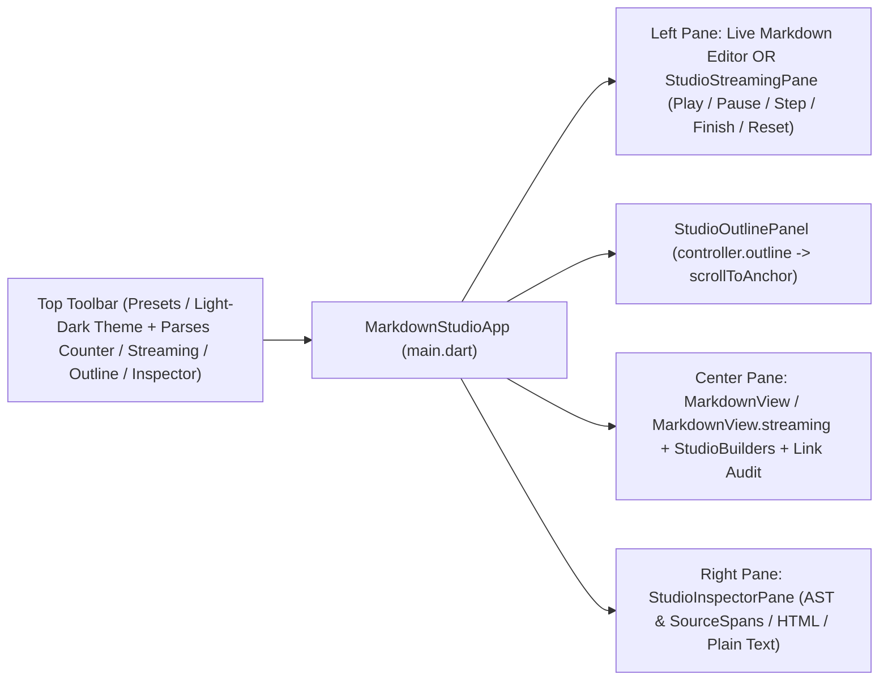

# Comparison Studio Guide

**`markdown_engine_studio`** (`studio/`) is the macOS Flutter inspection and streaming workbench for exercising **`markdown_engine`** and **`markdown_engine_flutter`** interactively across built-in presets, zero-reparse Light and Dark themes, live LLM chunk streaming, outline jumps, security link auditing, and AST/HTML/plain-text inspection.

---

## 1. Workbench Architecture & Layout

`MarkdownStudioApp` (`studio/lib/main.dart`) orchestrates a responsive multi-pane desktop workspace composed of six focused modules under `studio/lib/`:



| Module | Role |
| :--- | :--- |
| `studio/lib/main.dart` | Root `MarkdownStudioApp` coordinating presets, instant Light/Dark `MarkdownThemeData` switching, `MarkdownController` parse telemetry, streaming timer playback, outline sidebar/drawer breakpoints, and status banners/snackbars. |
| `studio/lib/studio_presets.dart` | Defines `StudioPresetId` and `studioPresets`: `CommonMark & GFM Showcase`, `Alerts, Frontmatter & HTML`, `Security & Sanitization`, and `500-Section Virtualization Stress`. |
| `studio/lib/studio_streaming_pane.dart` | Implements `StudioStreamingPane` with Play, Pause, Step, Finish, and Reset controls, an adjustable chunk interval slider (`20..400 ms`), live `settledBlockCount`, total/active tail block counts, per-chunk and average parse microseconds, and highlighted live buffer view. |
| `studio/lib/studio_outline_panel.dart` | Implements `StudioOutlinePanel`, subscribing to `MarkdownController` to highlight the active reading section and jump to any heading slug via `controller.scrollToAnchor`. |
| `studio/lib/studio_builders.dart` | Supplies demo `MarkdownBuilderDelegates` (`mathInlineBuilder`, `mathBlockBuilder`, `diagramBuilder`) and `auditDocumentLinks` / `StudioLinkAudit` for live `MarkdownUrlPolicy` allowed vs. blocked link counts. |
| `studio/lib/studio_inspector.dart` | Implements `StudioInspectorPane` with `StudioInspectorTab` tabs for an expandable AST and `SourceSpan` tree (`blockId`, node type, 1-based line ranges, UTF-16 offsets, and jump-to-block), `document.toHtml()`, and `document.toPlainText()` with clipboard copy. |

---

## 2. Key Interactive Workflows

* **Preset Sample Selector**: Switch between `CommonMark & GFM Showcase`, `Alerts, Frontmatter & HTML`, `Security & Sanitization` (enabling `sanitizeHtml: true` and `sanitizeUrls: true`), and `500-Section Virtualization Stress` (exercising lazy `SliverMarkdownDocument` rendering and outline navigation).
* **Zero-Reparse Theme Toggle**: Toggling Light and Dark mode switches `MarkdownThemeData` instantaneously while displaying the live `Parses: <controller.parseCount>` chip so you can verify zero AST re-parses occur on theme updates.
* **LLM Streaming Simulator**: Enabling **Streaming Mode** binds `MarkdownView.streaming` to `StreamingMarkdownController` (`MarkdownOptions.extended()`), allowing you to step chunk-by-chunk or stream at `20..400 ms/chunk` while observing `settledBlockCount` grow and per-chunk parse latency stay bounded.
* **Custom Companion Hooks & Link Policy Audit**: The preview pane renders inline/display math cards via `mathInlineBuilder` / `mathBlockBuilder` and Mermaid diagram cards via `diagramBuilder`, displays live `StudioLinkAudit` allowed/blocked badge counts, and reports link taps through a status banner and `SnackBar`.
* **AST, HTML & Plain-Text Inspector**: Switch `StudioInspectorPane` between the virtualized expandable AST tree (with exact `blockId` and `SourceSpan` line/offset ranges), raw `document.toHtml()` markup, and `document.toPlainText()` output.

---

## 3. Prerequisites, Headless Tests & Launch

`studio/` is an internal `publish_to: none` workspace application targeting Flutter `>=3.47.0` and Dart `^3.13.0`, with internal `markdown_engine: any` and `markdown_engine_flutter: any` workspace constraints verified by `tool/check_versions.dart`.

Resolve workspace dependencies from the repository root, run the `studio/test/widget_test.dart` suite, or launch the macOS desktop workbench:

```bash
flutter pub get
(cd studio && flutter test)
(cd studio && flutter run -d macos)
```

---

## 4. Accompanying CLI Verification Tools

Alongside the desktop Studio app, use the pure-Dart CLI tools under `tool/` to verify CommonMark/GFM HTML parity, reference fixture SHA-256 hashes, lockstep versions, and native AOT performance:

```bash
# Verify CommonMark 0.31.2 and GFM 0.29.0.gfm.13 parity (add --verbose to inspect diffs)
dart run tool/verify_spec.dart --strict

# Verify vendored corpus/spec/ SHA-256 hashes against REFERENCE.md
dart run tool/sync_reference.dart --verify

# Verify lockstep package versions across pubspecs and changelogs
dart run tool/check_versions.dart

# Run native AOT benchmarks (add --json for machine-readable output)
dart run tool/benchmark_suite.dart --check-regressions
```
