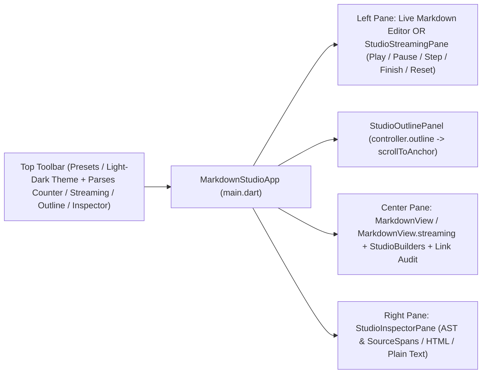

# Comparison Studio Guide

**`markdown_engine_studio`** (`studio/`) is a macOS Flutter inspection and streaming workbench for exercising **`markdown_engine`** and **`markdown_engine_flutter`**. Test built-in presets, Light/Dark theme switching, live LLM chunk streaming, outline jumps, link auditing, and AST/HTML/plain-text inspection in one desktop app.

---

## 1. Workbench Architecture & Layout

`MarkdownStudioApp` (`studio/lib/main.dart`) coordinates a multi-pane workspace across six modules alongside a macOS `--profile` benchmark entry point:



| Module | Role |
| :--- | :--- |
| `studio/lib/main.dart` | Root `MarkdownStudioApp` coordinating presets, `MarkdownBuiltInRenderers.warmUp()`, Light/Dark theme switching, `MarkdownController` telemetry, streaming playback, CLI flags (`--preset`, `--dark`, `--streaming`, `--anchor`, `--scroll`), and link banners. |
| `studio/lib/studio_presets.dart` | Defines `StudioPresetId` and the six `studioPresets`: `showcase`, `comprehensiveGuide`, `kitchenSink`, `alertsAndHtml`, `security`, and `stress500`. |
| `studio/lib/studio_streaming_pane.dart` | Implements `StudioStreamingPane` with Play, Pause, Step, Finish, and Reset controls, chunk speed slider (`20..400 ms`), `settledBlockCount`, and parse microsecond telemetry. |
| `studio/lib/studio_outline_panel.dart` | Implements `StudioOutlinePanel`, following `MarkdownController.readingPlaceNotifier` without scroll-frame rebuilds and jumping to headings via `controller.scrollToAnchor`. |
| `studio/lib/studio_builders.dart` | Supplies `buildStudioDelegates` (using built-in math and Mermaid rendering plus syntax-highlighted `buildStudioCodeBlock` blocks) and memoized `auditDocumentLinks` / `StudioLinkAudit` metrics. |
| `studio/lib/studio_inspector.dart` | Implements `StudioInspectorPane` with `StudioInspectorTab` tabs for an expandable AST and `SourceSpan` tree, memoized `toHtml()`, and memoized `toPlainText()` with copy actions. |
| `studio/lib/profile_benchmark_main.dart` | Headless macOS `--profile` `FrameTiming` benchmark measuring 500-section scrolling and 60Hz streaming (`dart run tool/run_macos_profile_benchmark.dart`). |

---

## 2. Key Interactive Workflows

* **Preset Sample Selector**: Switch between `CommonMark & GFM Showcase` (`showcase`), `Comprehensive Markdown Guide` (`StudioPresetId.comprehensiveGuide`, loaded from `assets/comprehensive_markdown_guide.md`), `Kitchen Sink (Visual Parity)`, `Alerts, Frontmatter & HTML`, `Security & Sanitization`, and `500-Section Virtualization Stress`.
* **Zero-Reparse Theme Toggle**: Flip Light and Dark modes while watching the `Parses: <controller.parseCount>` chip stay constant to confirm zero redundant AST reparses.
* **LLM Streaming Simulator**: Toggle **Streaming Mode** to step or play chunks (`20..400 ms/chunk`) through `MarkdownView.streaming`, observing `settledBlockCount` grow while per-chunk latency stays low.
* **Math, Mermaid, Images & Link Audit**: Preview native OpenType math and Mermaid diagrams alongside `MarkdownImagePolicy.ask` consent controls, live `StudioLinkAudit` allowed/blocked counts, and link-tap snackbars.
* **AST, HTML & Plain-Text Inspector**: Inspect the expandable AST with exact `blockId` and `SourceSpan` line/offset ranges, raw `document.toHtml()` output, and `document.toPlainText()` previews.

---

## 3. Prerequisites, Headless Tests & Launch

`studio/` is an internal `publish_to: none` workspace application targeting Flutter `>=3.47.0` and Dart `^3.13.0`, with workspace `any` constraints verified by `tool/check_versions.dart`.

Resolve workspace dependencies from the repository root, run `studio/test/widget_test.dart`, or launch the macOS desktop workbench:

```bash
flutter pub get
(cd studio && flutter test)
(cd studio && flutter run -d macos)
```

---

## 4. Accompanying CLI Verification Tools

Use the CLI scripts under `tool/` to check CommonMark/GFM parity, `REFERENCE.md` hashes, lockstep versions, and native AOT performance:

```bash
# Verify CommonMark 0.31.2 and GFM 0.29.0.gfm.13 parity (add --verbose to inspect diffs)
dart run tool/verify_spec.dart --strict

# Verify vendored corpus/spec/ SHA-256 hashes against REFERENCE.md
dart run tool/sync_reference.dart --verify

# Verify lockstep package versions across pubspecs and changelogs
dart run tool/check_versions.dart

# Run native AOT benchmarks (add --json for machine-readable output)
dart run tool/benchmark_suite.dart --check-regressions

# Run real macOS --profile Impeller frame-time benchmark (500-section scroll + 60Hz streaming)
dart run tool/run_macos_profile_benchmark.dart
```
