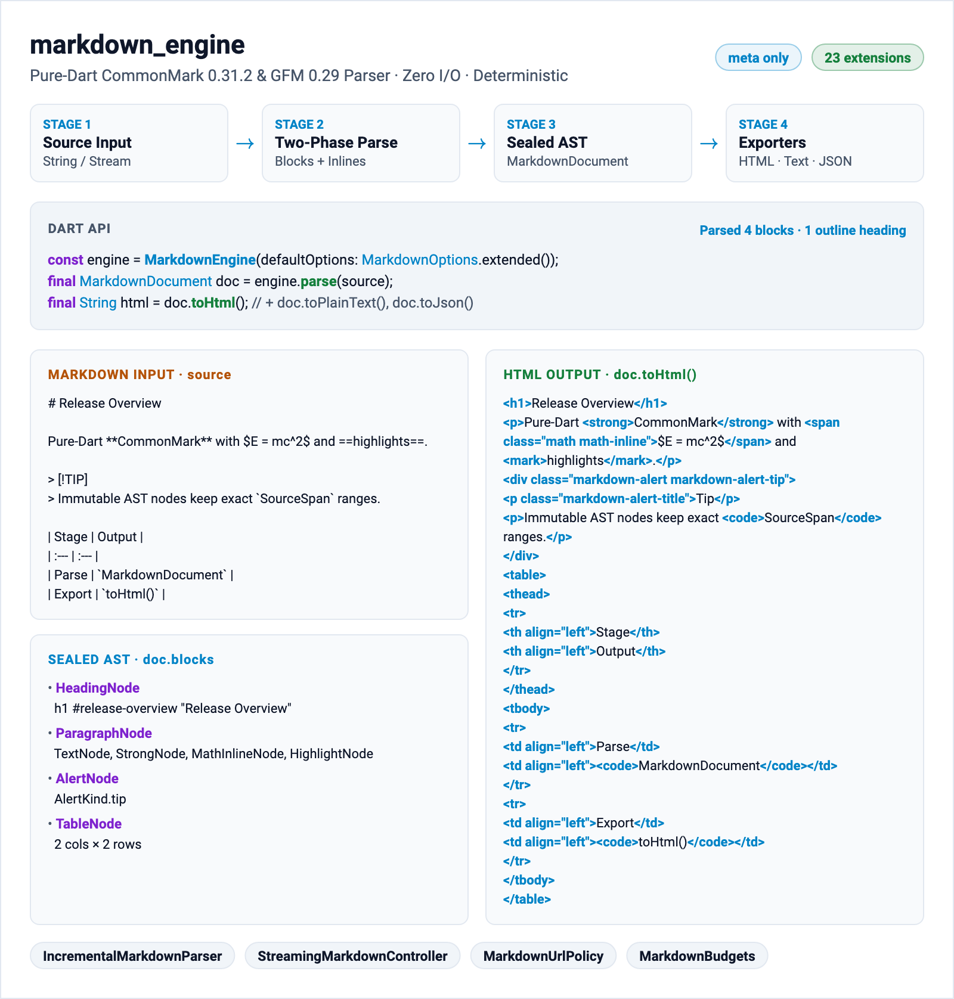
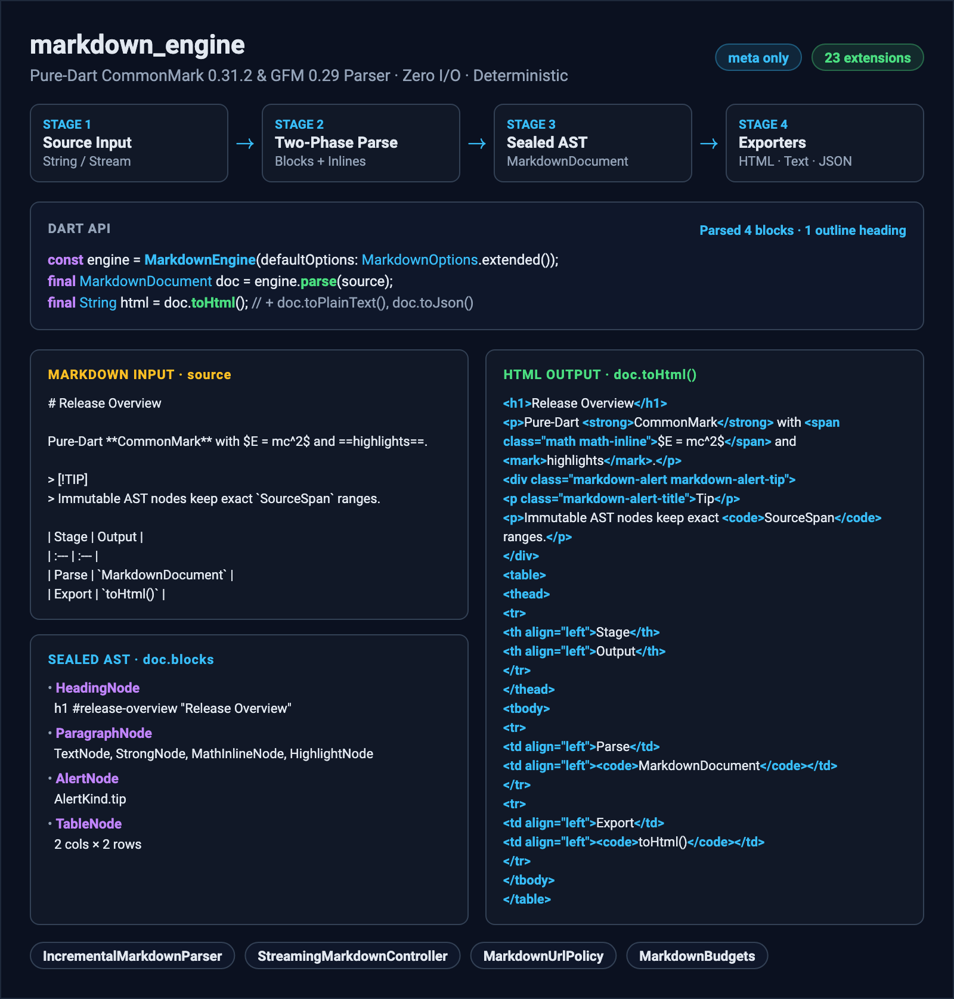

# markdown_engine

[](https://github.com/tkinnis/markdown_engine/actions/workflows/ci.yml) [](https://tkinnis.github.io/markdown_engine/) [](https://github.com/tkinnis/markdown_engine/blob/main/doc/COVERAGE.md) [](https://github.com/tkinnis/markdown_engine/blob/main/doc/COVERAGE.md) [](https://github.com/tkinnis/markdown_engine/blob/main/packages/markdown_engine/LICENSE)

Pure-Dart CommonMark `0.31.2` and GitHub Flavored Markdown (`0.29.0.gfm.13`) parser, immutable sealed AST, HTML/plain-text/JSON exporters, and incremental streaming engine. Every stage runs synchronously in memory with `package:meta` as its sole runtime dependency and zero Flutter, DOM, JavaScript, or filesystem imports.

## Installation

Add `markdown_engine` to any Dart or Flutter project (requires Dart `^3.8.0`):

```bash
dart pub add markdown_engine
```

If you are building a Flutter application and want ready-made Markdown widgets, theming, built-in math/Mermaid rendering, and selection support, use [`markdown_engine_flutter`](https://pub.dev/packages/markdown_engine_flutter).

## Quick Start

Configure `MarkdownEngine` with `MarkdownOptions()` (all 23 extensions enabled out of the box), or pass `.commonMark()` or `.gfm()` for strict specification defaults, then parse synchronously into an immutable `MarkdownDocument`:

```dart
import 'package:markdown_engine/markdown_engine.dart';

void main() {
  const MarkdownEngine engine = MarkdownEngine();

  final MarkdownDocument document = engine.parse(r'''---
title: Architecture Notes
---

# Overview

Pure-Dart **CommonMark 0.31.2** and **GFM** with ==highlight==, H~2~O, x^2^, and $E = mc^2$.

> [!NOTE]
> Supports footnotes[^1], tables, alerts, and definition lists.

[^1]: Verified against all official vendored fixtures.
''');

  print(document.frontmatter?['title']); // Architecture Notes
  print(document.outline.first.slug); // overview
  print(document.toHtml());
  print(document.toPlainText());
}
```

## Key Features

* **Two-Phase Spec Parity**: Achieves 100.0% compliance against vendored CommonMark 0.31.2 (652/652) and GFM 0.29.0.gfm.13 (670/670 spec + 30/30 extension) test suites.
* **23 Opt-Out Extensions & Strict Presets**: Enables tables, alerts, frontmatter, math, definition lists, footnotes, and extended inline syntax by default on `MarkdownOptions()`, with strict `.commonMark()` and `.gfm()` presets.
* **Immutable Dart 3 Sealed AST**: Produces 18 `MarkdownBlockNode` and 20 `MarkdownInlineNode` subtypes with `SourceSpan` ranges, structural equality, and lazy document metadata.
* **Incremental & Streaming Engines**: `IncrementalMarkdownParser` reuses unchanged blocks in live editors, while `StreamingMarkdownController` freezes settled prefix blocks across token feeds.
* **Defense-in-Depth Hardening**: Guards untrusted inputs with `MarkdownUrlPolicy.strict()`, GFM `tagfilter`, a linear-time HTML5 sanitizer, and deterministic `MarkdownBudgets` limits.

## Pipeline Overview

The pure-Dart engine parses Markdown source through two synchronous phases into an immutable `MarkdownDocument` before exporting HTML, plain text, or JSON:

| Light Overview | Dark Overview |
| :---: | :---: |
|  |  |

## Incremental Editing & Streaming

### Incremental Block Reuse (`IncrementalMarkdownParser`)

In live editors, `IncrementalMarkdownParser` isolates edited lines in constant time using optional edit offsets, reuses unchanged prefix and suffix blocks with preserved `blockId` values, and shifts trailing `SourceSpan` positions lazily:

```dart
import 'package:markdown_engine/markdown_engine.dart';

void editInPlace() {
  const IncrementalMarkdownParser parser = IncrementalMarkdownParser(
    engine: MarkdownEngine(defaultOptions: MarkdownOptions.gfm()),
  );

  final IncrementalParseResult v1 = parser.parseIncremental(
    '# Guide\n\nParagraph one.\n\nParagraph two.\n',
  );
  final IncrementalParseResult v2 = parser.parseIncremental(
    '# Guide\n\nParagraph one (updated).\n\nParagraph two.\n',
    previousResult: v1,
    editStartOffset: 9,
    editOldEndOffset: 23,
    editNewEndOffset: 33,
  );

  assert(v2.reusedBlockCount == 2);
  assert(v2.reparsedBlockCount == 1);
}
```

### Streaming Token Feeds (`StreamingMarkdownController`)

For token-by-token SSE or LLM streams, `StreamingMarkdownController` freezes completed leading blocks in `settledBlocks` and reparses only the active trailing slice. Listeners receive synchronous push notifications on every update without polling timers, and `finish()` reconciles exact parity with a full `MarkdownEngine.parse`.

```dart
import 'package:markdown_engine/markdown_engine.dart';

MarkdownDocument streamReply(Iterable<String> chunks) {
  final StreamingMarkdownController controller = StreamingMarkdownController(
    options: const MarkdownOptions.gfm(),
  );

  for (final String chunk in chunks) {
    controller.append(chunk);
  }
  return controller.finish();
}
```

## Security & Resource Budgets

Process untrusted Markdown safely using built-in URL validation, HTML sanitization, and deterministic complexity limits:

```dart
import 'package:markdown_engine/markdown_engine.dart';

const MarkdownOptions hardenedOptions = MarkdownOptions.gfm(
  sanitizeHtml: true,
  sanitizeUrls: true,
  urlPolicy: MarkdownUrlPolicy(
    allowedSchemes: <String>{'https', 'mailto'},
    allowRelative: false,
    allowFragments: true,
  ),
  budgets: MarkdownBudgets(
    maxInputLength: 100000,
    maxNestingDepth: 32,
    maxTableColumns: 32,
    maxTableRows: 500,
  ),
);
```

* **`MarkdownUrlPolicy`**: Defaults to `MarkdownUrlPolicy.strict()` on `MarkdownOptions()`, enforcing allowlist and obfuscation checks across link, image, and HTML URI attributes:

| Policy Rule | Default Behavior (`MarkdownUrlPolicy.strict()`) |
| :--- | :--- |
| **Allowed** | Explicit `http`, `https`, and `mailto` schemes, scheme-less relative paths, and `#fragment` links. |
| **Blocked** | Executable or unsafe schemes (`javascript:`, `vbscript:`, `data:`), protocol-relative (`//`), userinfo (`@`), and control-character obfuscation. |

* **GFM `tagfilter` & HTML Sanitizer**: Escapes disallowed GFM tags by default (`gfmTagFilter: true`), and when `sanitizeHtml: true` strips active HTML elements, inline event handlers, `srcdoc`, and unsafe URI attributes using a linear-time state machine.
* **`MarkdownBudgets`**: Caps document size, nesting depth, AST block count, table dimensions, raw HTML size, token count, and output bytes:

| Budget Field | Default Limit | Protected Resource |
| :--- | ---: | :--- |
| `maxInputLength` | `500,000` | Input UTF-16 code units per parse. |
| `maxNestingDepth` | `64` | Nested block containers and inline delimiters. |
| `maxBlocks` | `50,000` | Total emitted block AST nodes. |
| `maxTableColumns` | `128` | Columns per GFM pipe table. |
| `maxTableRows` | `10,000` | Body rows per GFM pipe table. |
| `maxHtmlBytes` | `250,000` | Cumulative raw HTML code units before escaping. |
| `maxTokens` | `500,000` | Inline scanner and delimiter work units. |
| `maxOutputBytes` | `4,194,304` | Rendered HTML and reference expansion size. |

## Core API Summary

| Symbol | Role |
| :--- | :--- |
| `MarkdownEngine` | Stateless entry point exposing `parse`, `renderToHtml`, and `toPlainText`. |
| `MarkdownOptions` | Configures presets (`.commonMark()`, `.gfm()`, `.extended()`), 23 individually toggleable extensions, sanitization flags, `budgets`, and `urlPolicy`. |
| `MarkdownDocument` | Immutable parsed output exposing `blocks`, lazy document metadata (frontmatter, outline, footnotes, links, abbreviations, remote images), and HTML, plain-text, and JSON exporters. |
| `HtmlRenderer` | Renders `List<MarkdownBlockNode>` to CommonMark/GFM HTML while enforcing sanitization and output budgets. |
| `IncrementalMarkdownParser` | Reuses unchanged prefix and suffix AST blocks across live edits with preserved `blockId` identity and `IncrementalParseResult` reuse metrics. |
| `StreamingMarkdownController` | Accumulates streamed chunks with frozen `settledBlocks`, `settledPrefixBlockCount` alignment, push listeners, `replaceText()`, and full-parity `finish()`. |
| `MarkdownBlockNode` / `MarkdownInlineNode` | Sealed Dart 3 AST hierarchies (18 block subtypes and 20 inline subtypes) with `SourceSpan`, `blockId`, `toPlainText()`, and `shiftSpan()`. |
| `HeadingSlugGenerator` / `slugifyHeadingText` | Generates deterministic GitHub-style heading anchor slugs with collision deduplication. |

## Companion Packages

* **Flutter Rendering ([`markdown_engine_flutter`](https://pub.dev/packages/markdown_engine_flutter))**: Renders `MarkdownDocument` ASTs in virtualized Flutter slivers with built-in OpenType math, Mermaid diagrams, theming, and text selection.
* **LaTeX Math ([`tex_math`](https://pub.dev/packages/tex_math))**: Typesets parsed `MathInlineNode` and `MathBlockNode` formulas using OpenType `MATH` font tables.
* **Mermaid Diagrams ([`pele_dart`](https://pub.dev/packages/pele_dart))**: Renders fenced `mermaid` `CodeBlockNode` payloads to pure-Dart SVG diagrams.

## Specification Parity & Native AOT Performance

Verified against the vendored CommonMark 0.31.2 and `github/cmark-gfm` 0.29.0.gfm.13 test suites:

| Suite | Passed | Failed | Disabled | Total | Pass Rate |
| :--- | ---: | ---: | ---: | ---: | ---: |
| `commonmark` (`0.31.2`) | 652 | 0 | 0 | 652 | **100.0%** |
| `gfm_spec` (`0.29.0.gfm.13`) | 670 | 0 | 2 | 672 | **100.0%** |
| `gfm_extensions` (`0.29.0.gfm.13`) | 30 | 0 | 0 | 30 | **100.0%** |

Native Dart AOT measurements on Apple M4 (`arm64`, macOS 15.6, Dart 3.13.5) under `MarkdownOptions.gfm()` (see the full [Benchmarks report](https://github.com/tkinnis/markdown_engine/blob/main/doc/BENCHMARKS.md) for methodology, head-to-head comparisons, and CI ceilings):

| Workload | Payload | Mean | Median (p50) | Throughput (p50) |
| :--- | ---: | ---: | ---: | ---: |
| `small_doc_parse_and_html` | 937 B (18 lines) | 8.67 us | **8.52 us** | 104.91 MiB/s |
| `medium_doc_parse_and_html` | 24.7 KB (479 lines) | 277.29 us | **277.56 us** | 86.74 MiB/s |
| `large_doc_5000_lines_parse` | 168.9 KB (4,996 lines) | 1.313 ms | **1.290 ms** | 127.91 MiB/s |
| `incremental_single_paragraph_edit` | 168.9 KB (1,457/1,458 reused, **87.38x**) | 15.22 us | **14.76 us** | 11176.53 MiB/s |
| `streaming_llm_50_chunks_per_chunk` | 2.1 KB / 50 chunks (43.00 us total, 14/15 settled) | 0.87 us | **0.86 us** | 47.77 MiB/s |

## License & Additional Resources

* **`markdown_engine`**: Copyright (c) 2026 Tony Kinnis — [MIT License](https://github.com/tkinnis/markdown_engine/blob/main/packages/markdown_engine/LICENSE).
* [Repository README](https://github.com/tkinnis/markdown_engine/blob/main/README.md) · [API Manual](https://github.com/tkinnis/markdown_engine/blob/main/doc/API_MANUAL.md) · [Architecture](https://github.com/tkinnis/markdown_engine/blob/main/doc/ARCHITECTURE.md) · [Coverage Matrix](https://github.com/tkinnis/markdown_engine/blob/main/doc/COVERAGE.md) · [Benchmarks](https://github.com/tkinnis/markdown_engine/blob/main/doc/BENCHMARKS.md) · [Reference Pins](https://github.com/tkinnis/markdown_engine/blob/main/REFERENCE.md) · [Security Policy](https://github.com/tkinnis/markdown_engine/blob/main/SECURITY.md)
