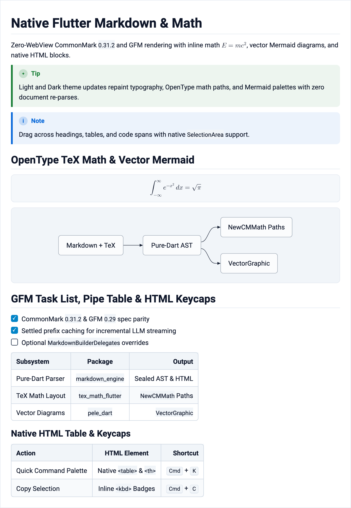
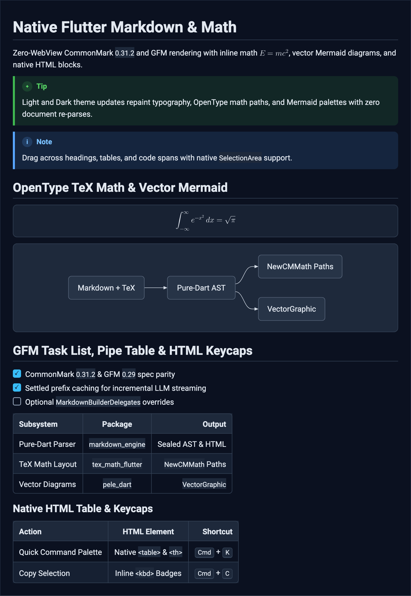
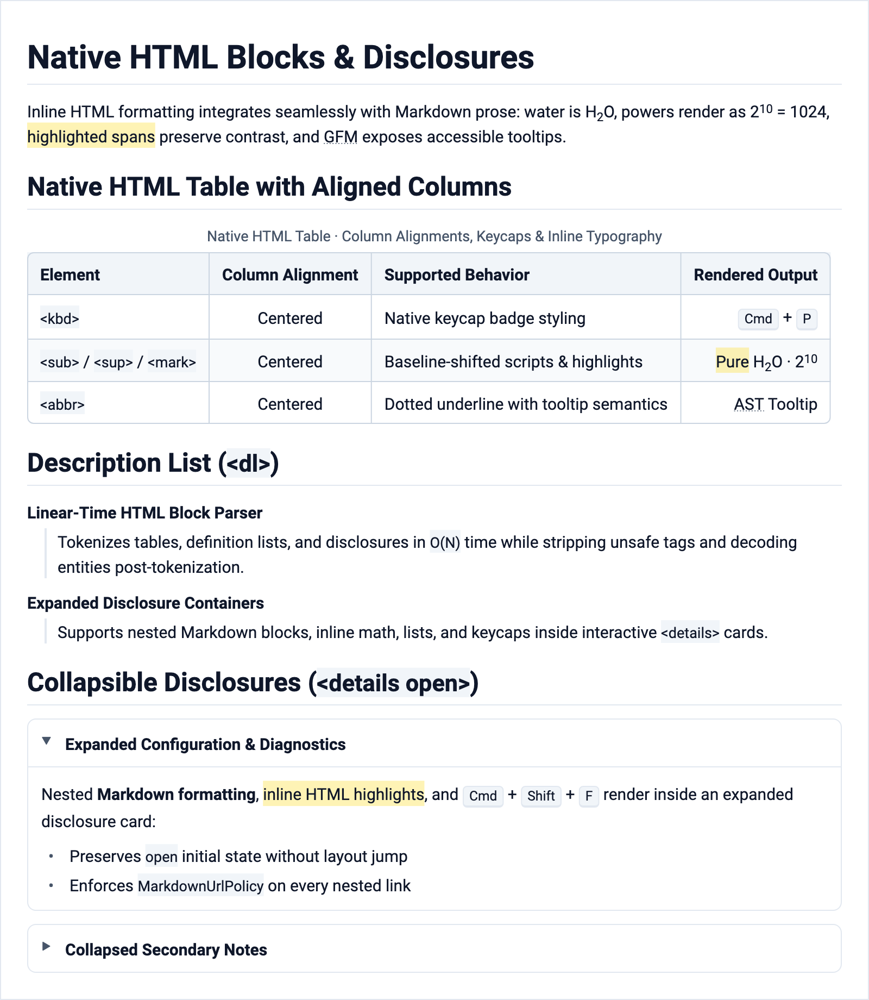

# markdown_engine_flutter

[](https://github.com/tkinnis/markdown_engine/actions/workflows/ci.yml) [](https://tkinnis.github.io/markdown_engine/) [](https://github.com/tkinnis/markdown_engine/blob/main/REFERENCE.md) [](https://github.com/tkinnis/markdown_engine/blob/main/packages/markdown_engine_flutter/LICENSE)

Flutter rendering widgets, built-in OpenType TeX math (`tex_math_flutter`) and vector Mermaid diagrams (`pele_dart`), Material and widgets-first theming, background isolate loading, native text selection, and live streaming support built on [`markdown_engine`](https://pub.dev/packages/markdown_engine).

## Installation

Add `markdown_engine_flutter` with the Flutter CLI (requires Dart `^3.13.0` and Flutter `>=3.47.0`):

```bash
flutter pub add markdown_engine_flutter
```

Importing `package:markdown_engine_flutter/markdown_engine_flutter.dart` also re-exports core parser, options, streaming, security, and AST types from `markdown_engine`; see the [API Manual](https://github.com/tkinnis/markdown_engine/blob/main/doc/API_MANUAL.md) for the complete symbol list.

## Quick Start

Wrap your subtree with `MarkdownTheme` (or inherit from Material `Theme`) and render documents with `MarkdownView`:

```dart
import 'package:flutter/material.dart';
import 'package:markdown_engine_flutter/markdown_engine_flutter.dart';

Widget buildReader(BuildContext context, MarkdownController controller) {
  return MarkdownTheme(
    data: MarkdownThemeData.fromTheme(context),
    child: MarkdownView(
      '# Hello, Flutter Markdown\n\n> [!TIP]\n> Built natively with slivers.',
      controller: controller,
      padding: const EdgeInsets.all(20.0),
      delegates: MarkdownBuilderDelegates(
        imagePolicy: MarkdownImagePolicy.ask,
        onTapLink: (String destination, String? title) {
          // Handle relative documents or internal anchors.
        },
        onOpenWebLink: (Uri uri) {
          // Open validated http/https URIs in an external browser.
        },
      ),
    ),
  );
}
```

Use `MarkdownView.document(document: preParsed)` to display a pre-parsed `MarkdownDocument` with zero parsing work inside the widget, or compose `SliverMarkdownDocument` inside your own `CustomScrollView`. For bounded cards, chat bubbles, or popovers, pass `scrollable: false`.

## Key Features

* **Built-In Math & Mermaid**: Renders LaTeX math via `tex_math_flutter` and fenced Mermaid diagrams via `pele_dart` out of the box with dual-budget LRU caching.
* **Zero-Reparse Theme Switching**: Caches parsed AST blocks across widget updates and re-derives colors and Mermaid palettes when `MarkdownTheme` switches between Light and Dark modes.
* **Lazy Sliver Virtualization**: `SliverMarkdownDocument` materializes only visible blocks keyed by `blockId` while preserving off-screen disclosures, selections, and cached extents.
* **Push-Based Streaming Views**: `MarkdownView.streaming` binds directly to `StreamingMarkdownController` without polling timers while freezing settled rich blocks.
* **Background Isolate Reader**: `MarkdownDocumentReader` parses short edits synchronously and offloads inputs of 4096 or more code units to an isolate with latest-wins coalescing.
* **Selection & Accessibility**: Integrates with `SelectionArea` and `SelectableRegion`, supports full-document Cmd+A across off-screen slivers, and exposes screen-reader `Semantics`.
* **Defense-in-Depth Security**: Enforces `MarkdownUrlPolicy` on interactive links and gates remote images via `MarkdownImagePolicy`.
* **Rich Native Widgets**: Renders headings with anchor navigation, GFM tables, task lists, GitHub alerts, frontmatter cards, disclosures, figures, definition lists, footnotes, and HTML blocks natively.

## Rendered Showcase

All rendered blocks adapt automatically across `MarkdownThemeData.light()` and `MarkdownThemeData.dark()` without re-parsing the source document:

| Light Theme (`MarkdownThemeData.light()`) | Dark Theme (`MarkdownThemeData.dark()`) |
| :---: | :---: |
|  |  |

HTML tables, aligned columns, `<kbd>` badges, description lists (`<dl>`), and interactive `<details>` disclosures map to native Flutter widgets:



## Built-In Math & Mermaid

`markdown_engine_flutter` renders inline and display LaTeX formulas alongside fenced Mermaid code blocks automatically. Pre-warm the font and diagram registry with `MarkdownBuiltInRenderers.warmUp()`, toggle `enableBuiltInMath` or `enableBuiltInMermaid`, or supply a custom `diagramBuilder`:

```dart
import 'dart:async' show unawaited;
import 'package:flutter/widgets.dart';
import 'package:markdown_engine_flutter/markdown_engine_flutter.dart';

void initMarkdownRenderers() {
  // Optional: pre-loads the math font and primes Mermaid off the UI thread.
  unawaited(MarkdownBuiltInRenderers.warmUp());
}

MarkdownBuilderDelegates buildDiagramDelegates() {
  return MarkdownBuilderDelegates(
    enableBuiltInMath: true,
    enableBuiltInMermaid: true,
    diagramBuilder: (BuildContext context, CodeBlockNode node) {
      if (node.language == 'graphviz') {
        return Text('Custom diagram (${node.literal.length} chars)');
      }
      // Returning null keeps built-in Mermaid rendering for `mermaid` fences.
      return null;
    },
  );
}
```

See the [API Manual](https://github.com/tkinnis/markdown_engine/blob/main/doc/API_MANUAL.md) for custom math, code, and image builder overrides, cache budget tuning (`configureCaches`), and Mermaid worker pool controls, and see the [Architecture Guide](https://github.com/tkinnis/markdown_engine/blob/main/doc/ARCHITECTURE.md) for internal isolate pool and LRU cache details.

## Streaming & Large Documents

### Streaming LLM Responses

Bind `MarkdownView.streaming` directly to a `StreamingMarkdownController` for zero-poll push-driven UI updates as chunks arrive:

```dart
final StreamingMarkdownController stream = StreamingMarkdownController();

Widget buildStreamingBubble() {
  return MarkdownView.streaming(
    controller: stream,
    padding: const EdgeInsets.all(16.0),
  );
}

void onToken(String chunk) {
  stream.append(chunk);
}

void onComplete() {
  stream.finish();
}
```

### Background Isolate Reading

Offload large Markdown files (4096 or more UTF-16 code units by default) onto a background isolate with `MarkdownDocumentReader` and automatic latest-wins coalescing while keeping short edits synchronous:

```dart
final MarkdownDocumentReader reader = MarkdownDocumentReader();

Future<void> loadMarkdown(String largeMarkdownText) async {
  await reader.update(largeMarkdownText);
}

Widget buildLoadedDocument() {
  return ListenableBuilder(
    listenable: reader,
    builder: (BuildContext context, Widget? child) {
      return MarkdownView.document(document: reader.document);
    },
  );
}
```

## Documentation & License

* **`markdown_engine_flutter`**: Copyright (c) 2026 Tony Kinnis — [MIT License](https://github.com/tkinnis/markdown_engine/blob/main/packages/markdown_engine_flutter/LICENSE).
* [Repository README](https://github.com/tkinnis/markdown_engine/blob/main/README.md) · [API Manual](https://github.com/tkinnis/markdown_engine/blob/main/doc/API_MANUAL.md) · [Architecture](https://github.com/tkinnis/markdown_engine/blob/main/doc/ARCHITECTURE.md) · [Coverage Matrix](https://github.com/tkinnis/markdown_engine/blob/main/doc/COVERAGE.md) · [Benchmarks](https://github.com/tkinnis/markdown_engine/blob/main/doc/BENCHMARKS.md) · [Security Policy](https://github.com/tkinnis/markdown_engine/blob/main/SECURITY.md)
