# Markdown Syntax Guide

This guide details all standard and extended Markdown syntax supported by **markdown_engine**.

---

## 1. GitHub-Style Alerts

markdown_engine supports GitHub-style blockquote alerts with dedicated icons, left borders, and contextual background styling:

### Note Alert
```markdown
> [!NOTE]
> Useful information that users should know, even when skimming.
```
> [!NOTE]
> Useful information that users should know, even when skimming.

### Tip Alert
```markdown
> [!TIP]
> Helpful advice or shortcuts for doing things faster or more easily.
```
> [!TIP]
> Helpful advice or shortcuts for doing things faster or more easily.

### Important Alert
```markdown
> [!IMPORTANT]
> Key information crucial for users to achieve their goal.
```
> [!IMPORTANT]
> Key information crucial for users to achieve their goal.

### Warning Alert
```markdown
> [!WARNING]
> Urgent info that needs immediate user attention to avoid problems.
```
> [!WARNING]
> Urgent info that needs immediate user attention to avoid problems.

### Caution Alert
```markdown
> [!CAUTION]
> Advises about risks or negative outcomes that could occur.
```
> [!CAUTION]
> Advises about risks or negative outcomes that could occur.

---

## 2. LaTeX Mathematics

markdown_engine renders LaTeX mathematical formulas natively in pure Dart using `tex_math_flutter` with OpenType `MATH` layout (`NewCMMath-Regular.otf`), inline baseline alignment, copy-as-LaTeX selection, and MathJax-aligned TeX packages.

- **Comprehensive Examples**: Browse the **[LaTeX Math Examples Gallery](latex-examples.md)** for inline baseline alignment, tables, matrices, multi-line alignments, `multline`, macros, `mhchem`, `physics`, `units`, `bussproofs`, `\href` links, overflow scrolling, and error diagnostics.

### Inline Math
Enclose formulas in single dollar signs:
```markdown
Euler's formula states that $e^{i\pi} + 1 = 0$, and mass-energy equivalence is $E = mc^2$ where $c \approx 3 \times 10^8 \text{ m/s}$.
```
Euler's formula states that $e^{i\pi} + 1 = 0$, and mass-energy equivalence is $E = mc^2$ where $c \approx 3 \times 10^8 \text{ m/s}$.

### Display / Block Math
Enclose formulas in double dollar signs on their own lines:
```markdown
$$
\int_{-\infty}^{\infty} e^{-x^2} dx = \sqrt{\pi}
$$
```
$$
\int_{-\infty}^{\infty} e^{-x^2} dx = \sqrt{\pi}
$$

---

## 3. Mermaid Diagrams

markdown_engine renders all 33 standard, beta, and specialized Mermaid diagram families offline in pure Dart using `pele_dart` and compiles them into native vector graphics (`vector_graphics`) with fenced code blocks labeled `mermaid`.

- **Proportional Scaling**: Increasing or decreasing the document font size via the `+` / `-` toolbar buttons (`Cmd+=` / `Cmd+-` / `Cmd+0`) scales Mermaid diagrams proportionally while remaining crisp at any resolution.
- **Interactive Zoom, Pan & Export Viewer**: Click any rendered diagram (or the hover **Zoom** button) to open it in a dedicated modal viewer supporting up to `1000%` magnification, drag-to-pan, trackpad pinch-to-zoom, Fit-to-Window, **Copy Diagram Image (PNG)** to the macOS clipboard, **Export Diagram (SVG / PNG)** to disk, and **Copy Mermaid Source**.
- **Comprehensive Examples**: Browse the **[Mermaid Diagram Examples Gallery](mermaid-examples.md)** for examples across flowcharts, sequence, class, state, ER, user journey, Gantt, pie, quadrant, requirement, GitGraph, C4, mindmap, timeline, Sankey, XY chart, block, packet, kanban, architecture, radar, treemap, Venn, railroad (`railroad-diagram`, `railroad`, `ebnf`, `bnf`), TreeView, Ishikawa, Cynefin, Wardley map, event modeling, agentflow, use case, swimlane, and info diagrams.

### Flowcharts
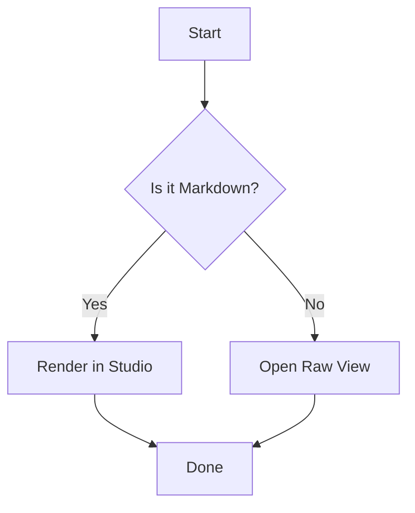

### Sequence Diagrams
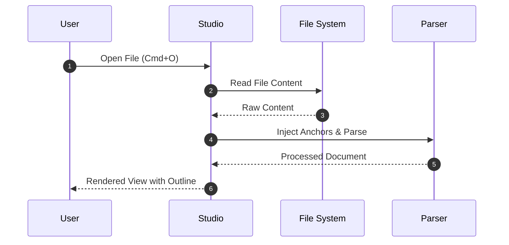

---

## 4. YAML Frontmatter & Footnotes

### YAML Frontmatter
Documents starting on line 1 with a `---` YAML frontmatter block are automatically parsed and displayed as a structured **Frontmatter** metadata card at the top of Preview mode (as seen at the very top of this guide), with list/array entries rendered as pill badges. You can toggle frontmatter visibility at any time in **Settings (`Cmd+,` → Show YAML Frontmatter in Preview)**.

```markdown
---
title: Architecture Specification
author: Platform Team
status: Approved
tags: [macos, flutter, markdown]
---
```

### Footnotes
markdown_engine supports GitHub Flavored Markdown footnotes using `[^id]` inline references and `[^id]: ...` definitions. Inline citations (`[1]`) are hyperlinked to jump directly to the GitHub-style separated footnotes section at the bottom of the page, and each footnote's `↩︎` return link jumps back to its citation:

```markdown
markdown_engine compiles Mermaid diagrams into native vector bytecode[^1] and supports named references[^note].

[^1]: Powered by `pele_dart` and `vector_graphics_compiler`.
[^note]: Footnote definitions are collected and numbered at the bottom of the rendered document.
```

markdown_engine compiles Mermaid diagrams into native vector bytecode[^1] and supports named references[^note].

[^1]: Powered by `pele_dart` and `vector_graphics_compiler`.
[^note]: Footnote definitions are collected and numbered at the bottom of the rendered document.

---

## 5. Text Formatting & Extensions

### Highlighting
Wrap text in double equals signs to highlight:
```markdown
==Highlighted text== for emphasizing critical terms.
```
==Highlighted text== for emphasizing critical terms.

### Subscript & Superscript
- Subscript (chemical formulas): `H~2~O, C~6~H~12~O~6~` produces H~2~O, C~6~H~12~O~6~
- Superscript (exponents): `E = mc^2^, 2^10^ = 1024` produces E = mc^2^, 2^10^ = 1024
- Combined notation: `X^2^~i~` produces X^2^~i~

### CommonMark Line Breaks
In accordance with the CommonMark specification:
- **Soft Line Break**: A single newline in a paragraph joins words with a space.
- **Hard Line Break**: End a line with two spaces or a backslash `\` to create an explicit line break.

---

## 6. Standard Markdown

### Typography
- **Bold text** with asterisks or underscores (`**Bold text**`).
- *Italic text* for emphasis (`*Italic text*`).
- ***Bold and italic combined*** (`***Bold and italic combined***`).
- ~~Strikethrough~~ for deprecated content (`~~Strikethrough~~`).
- `Inline code snippet` for functions and identifiers.

### Headings
```markdown
# Heading 1 (Document Title)
## Heading 2 (Major Section)
### Heading 3 (Subsection)
#### Heading 4
##### Heading 5
###### Heading 6
```

### Lists
#### Unordered Lists
```markdown
- Bullet point item
- Another item
  - Indented sub-item
```
- Bullet point item
- Another item
  - Indented sub-item

#### Ordered Lists
```markdown
1. First step
2. Second step
   1. Sub-step A
   2. Sub-step B
```
1. First step
2. Second step
   1. Sub-step A
   2. Sub-step B

#### Task Lists
```markdown
- [x] Initial design review
- [x] Implement outline view
- [ ] Write integration test
```
- [x] Initial design review
- [x] Implement outline view
- [ ] Write integration test

### Tables
```markdown
| Command | Shortcut | Description |
| :--- | :---: | :--- |
| Quick Open | `Cmd+P` | Fuzzy search files |
| Find in File | `Cmd+F` | Search current document |
| Global Search | `Cmd+Shift+F` | Full-text search across workspace |
```

| Command | Shortcut | Description |
| :--- | :---: | :--- |
| Quick Open | `Cmd+P` | Fuzzy search files |
| Find in File | `Cmd+F` | Search current document |
| Global Search | `Cmd+Shift+F` | Full-text search across workspace |

### Code Blocks
Fenced code blocks support syntax highlighting with language identifiers and a one-click **Copy** button:

```dart
void main() {
  final app = MarkdownStudioApp();
  app.run();
}
```

### Images & Click-to-Zoom Lightbox
Local and network Markdown images (``) render inline and can be clicked to open in an interactive **Image Viewer** lightbox with pan and zoom controls (click the image below to try it):

```markdown

```


### Relative Document Links
Relative Markdown links automatically open target documents in Studio:
```markdown
Check out the [Features Guide](features.md) or [Keyboard Shortcuts](shortcuts.md).
```
Check out the [Features Guide](features.md) or [Keyboard Shortcuts](shortcuts.md).

If the target document is already open in a tab, Studio switches directly to that tab.

---

## 7. Embedded HTML (GFM)

markdown_engine natively parses and renders the full GitHub Flavored Markdown HTML tag set used in project `README.md` files and technical specifications.

### Keyboard Keycaps (`<kbd>`)
Render native keycap badges with `<kbd>`:
```html
Press <kbd>Cmd</kbd> + <kbd>P</kbd> for Quick Open, or <kbd>Cmd</kbd> + <kbd>Shift</kbd> + <kbd>F</kbd> for Workspace Search.
```
Press <kbd>Cmd</kbd> + <kbd>P</kbd> for Quick Open, or <kbd>Cmd</kbd> + <kbd>Shift</kbd> + <kbd>F</kbd> for Workspace Search.

### Inline HTML Typography (`<sub>`, `<sup>`, `<mark>`, `<u>`, `<del>`, `<abbr>`, `<small>`, `<q>`, `<samp>`, `<var>`, `<br>`)
```html
Water is H<sub>2</sub>O, $2^{10}$ is 2<sup>10</sup> = 1024, <mark>highlighted terms</mark>, <u>underlined text</u>, <del>deprecated text</del>, <abbr title="GitHub Flavored Markdown">GFM</abbr>, <small>fine print</small>, <q>quoted text</q>, <samp>output</samp>, and <var>x</var>.
```
Water is H<sub>2</sub>O, $2^{10}$ is 2<sup>10</sup> = 1024, <mark>highlighted terms</mark>, <u>underlined text</u>, <del>deprecated text</del>, <abbr title="GitHub Flavored Markdown">GFM</abbr>, <small>fine print</small>, <q>quoted text</q>, <samp>output</samp>, and <var>x</var>.

Use `<br>` inside Markdown table cells for multi-line entries:

| Area | Shortcuts |
| :--- | :--- |
| **Navigation** | <kbd>Cmd</kbd> + <kbd>[</kbd> Back<br><kbd>Cmd</kbd> + <kbd>]</kbd> Forward |
| **View Modes** | <kbd>Cmd</kbd> + <kbd>E</kbd> Toggle Preview / Raw<br><kbd>Cmd</kbd> + <kbd>B</kbd> Toggle Sidebar |

### Centered Blocks, Sized ``, SVG Badges, `<picture>` Theme Switching & `<a>` Links
Align hero sections and size images using `<p align="center">`, `<div align="center">`, `<h1 align="center">`, ``, `<picture><source media="(prefers-color-scheme: dark)" ...>`, `<a href="...">`, and SVG badges (automatically detected via HTTP `Content-Type` / payload inspection and rendered at `3x` Retina resolution):

```html
<a href="https://flutter.dev/">
  <h1 align="center">
    <picture>
      <source media="(prefers-color-scheme: dark)" srcset="https://docs.flutter.dev/logo_dark.png">
      
    </picture>
  </h1>
</a>

<p align="center">
  
</p>

<p align="center">
  <strong>Centered HTML block with sized local assets, SVG badges, and clickable links.</strong>
</p>

<p align="center">
  
  
  
</p>
```

<a href="https://flutter.dev/">
  <h1 align="center">
    <picture>
      <source media="(prefers-color-scheme: dark)" srcset="https://docs.flutter.dev/logo_dark.png">
      
    </picture>
  </h1>
</a>

<p align="center">
  
</p>

<p align="center">
  <strong>Centered HTML block with sized local assets, SVG badges, and clickable links.</strong>
</p>

<p align="center">
  
  
  
</p>

### HTML Tables (`<table>`), Lists (`<ul>`, `<ol>`), and Description Lists (`<dl>`)
Raw HTML tables (`<table>`, `<thead>`, `<tbody>`, `<tr>`, `<th>`, `<td>`, `<caption>`) and description lists (`<dl>`, `<dt>`, `<dd>`) render natively alongside Markdown content:

```html
<table>
  <tr>
    <th>Element</th>
    <th align="center">Category</th>
    <th>Example</th>
  </tr>
  <tr>
    <td><code>&lt;kbd&gt;</code></td>
    <td align="center">Inline</td>
    <td><kbd>Cmd</kbd> + <kbd>P</kbd></td>
  </tr>
  <tr>
    <td><code>&lt;details&gt;</code></td>
    <td align="center">Block</td>
    <td>Collapsible disclosure card</td>
  </tr>
</table>

<dl>
  <dt>Single-Tab Invariant</dt>
  <dd>Opening an already-open document focuses its existing tab instead of duplicating it.</dd>
  <dt>Offscreen Vector Engine</dt>
  <dd>Compiles Mermaid diagrams and SVG badges at Retina resolution without blocking the UI isolate.</dd>
</dl>
```

<table>
  <tr>
    <th>Element</th>
    <th align="center">Category</th>
    <th>Example</th>
  </tr>
  <tr>
    <td><code>&lt;kbd&gt;</code></td>
    <td align="center">Inline</td>
    <td><kbd>Cmd</kbd> + <kbd>P</kbd></td>
  </tr>
  <tr>
    <td><code>&lt;details&gt;</code></td>
    <td align="center">Block</td>
    <td>Collapsible disclosure card</td>
  </tr>
</table>

<dl>
  <dt>Single-Tab Invariant</dt>
  <dd>Opening an already-open document focuses its existing tab instead of duplicating it.</dd>
  <dt>Offscreen Vector Engine</dt>
  <dd>Compiles Mermaid diagrams and SVG badges at Retina resolution without blocking the UI isolate.</dd>
</dl>

### Collapsible Disclosure Sections (`<details>` & `<summary>`)
Create interactive expandable sections using `<details>` and `<summary>` (add `open` to start expanded):

```html
<details open>
  <summary>Expanded by Default (Click to Toggle)</summary>

  Nested **Markdown**, `inline code`, and lists render inside `<details>`:
  - Supports `open` attribute
  - Renders nested Markdown blocks
</details>

<details>
  <summary>Collapsed Troubleshooting Notes</summary>

  Use `<details>` blocks to keep long logs or secondary notes tidy until needed.
</details>
```

<details open>
  <summary>Expanded by Default (Click to Toggle)</summary>

  Nested **Markdown**, `inline code`, and lists render inside `<details>`:
  - Supports `open` attribute
  - Renders nested Markdown blocks
</details>

<details>
  <summary>Collapsed Troubleshooting Notes</summary>

  Use `<details>` blocks to keep long logs or secondary notes tidy until needed.
</details>

### HTML Comments (`<!-- ... -->`)
HTML comments (`<!-- hidden note -->`) are automatically stripped in Rendered Preview while remaining visible in **Raw View** (<kbd>Cmd</kbd> + <kbd>E</kbd>) and inside fenced/inline code blocks.
<!-- This HTML comment is hidden in Rendered View but visible in Raw View -->

---

# Mermaid Diagram Examples

A comprehensive gallery of Mermaid diagrams demonstrating all **33** diagram families supported natively in **markdown_engine** via `pele_dart`: flowcharts, sequence diagrams, state diagrams, class diagrams, entity-relationship diagrams, Gantt charts, pie charts, Git graphs, user journeys, requirement diagrams, XY charts, quadrant charts, mindmaps, timelines, Sankey diagrams, packet diagrams, block diagrams, Kanban boards, C4 architecture diagrams (`C4Context`, `C4Component`), architecture diagrams, radar diagrams, treemap diagrams, Venn diagrams, railroad grammar diagrams (`railroad-ebnf-beta`, `railroad-beta`, `railroad-abnf-beta`, `railroad-peg-beta`), TreeView diagrams, Ishikawa diagrams, Cynefin diagrams, Wardley maps, event modeling diagrams, agentflow diagrams, use case diagrams, swimlane diagrams, and info diagrams.

---

## 1. Flowcharts & Graphs (`flowchart`, `graph`)

### Service Architecture Subgraphs

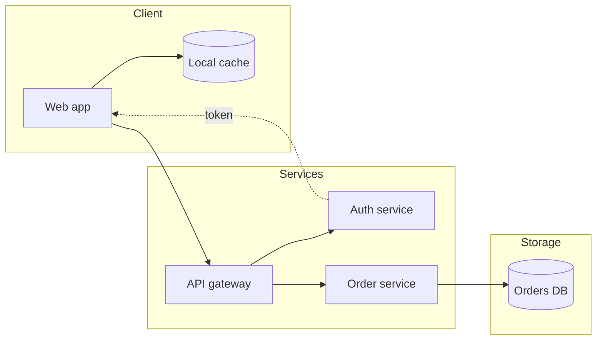

### Pure-Dart Rendering Pipeline

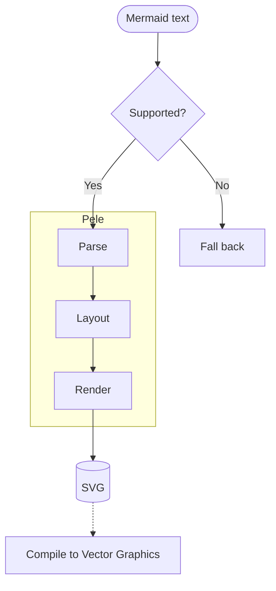

### Simple Left-Right Graph

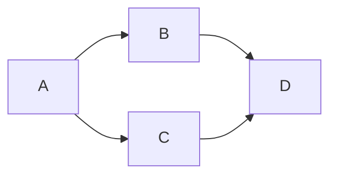

### Simple Top-Down Graph

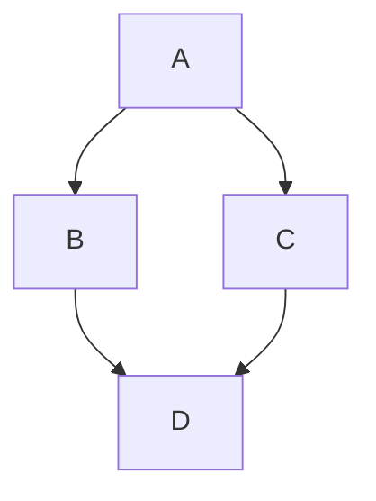

### Node Shapes & Link Variants

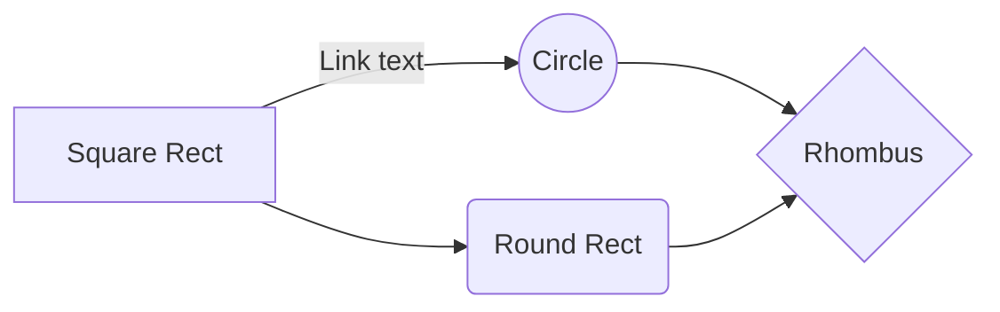

### Basic Decision Flowchart

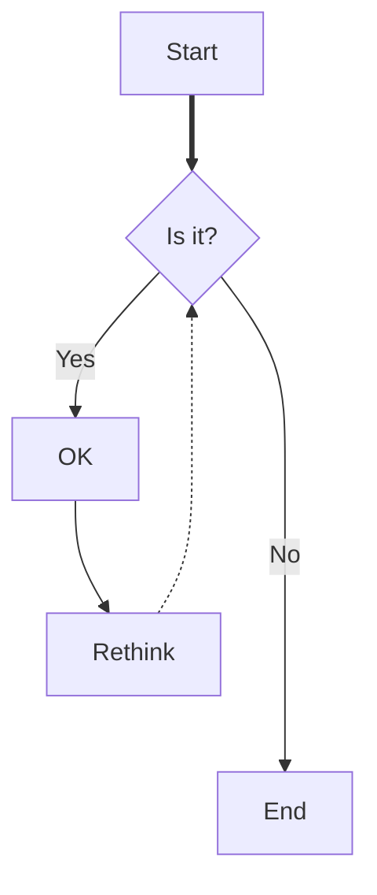

### Troubleshooting Flowchart

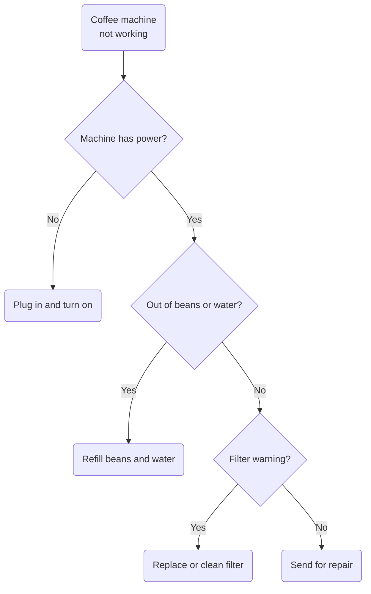

### Flowchart with Hyperlinks

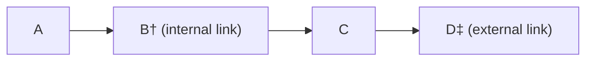

---

## 2. Sequence Diagrams (`sequenceDiagram`)

### Order Checkout & Payment Authorization

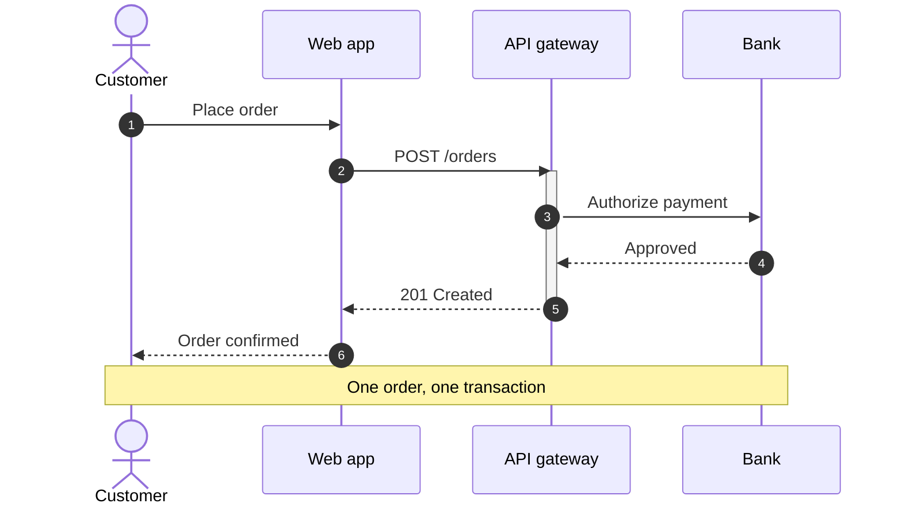

### Three-Way Handshake

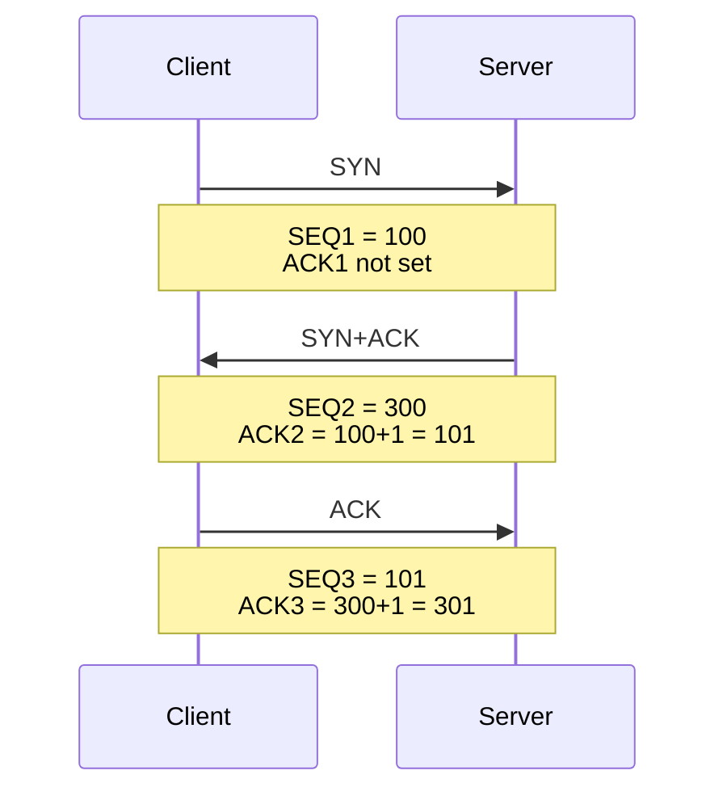

### Loops, Alt, and Opt Blocks

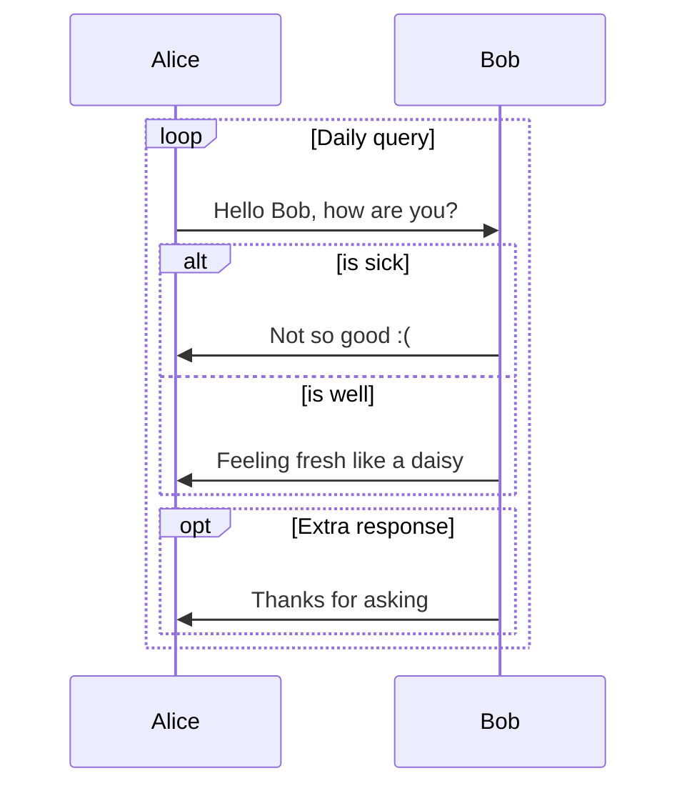

### Parallel Service Notifications (`par` / `and`)

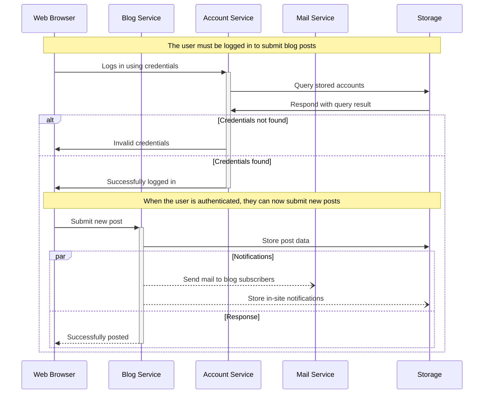

---

## 3. State Diagrams (`stateDiagram-v2`)

### Editorial Review Composite State

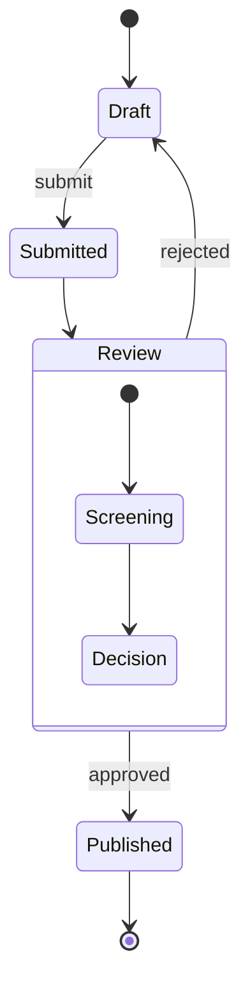

### Fork and Join State Diagram

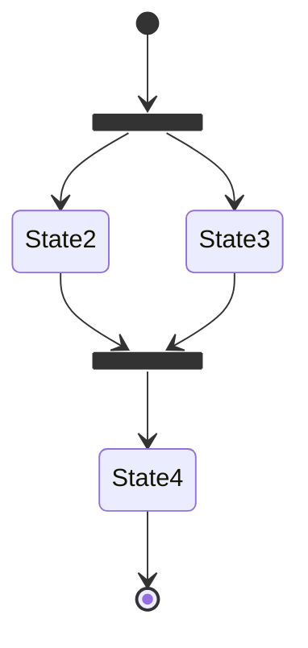

### State Diagram with Notes

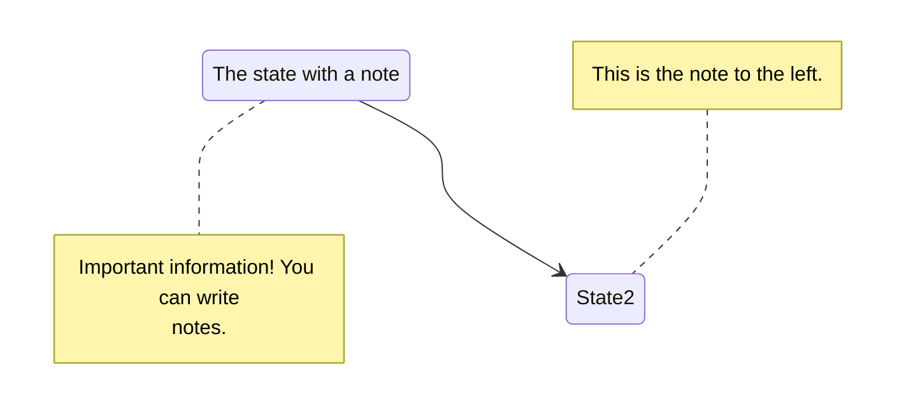

### Shipment Status State Diagram (`direction LR`)

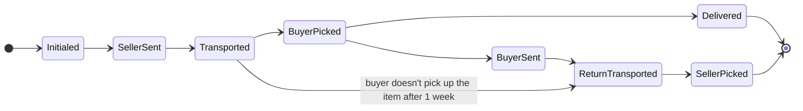

---

## 4. Class Diagrams (`classDiagram`)

### Namespace Hierarchy

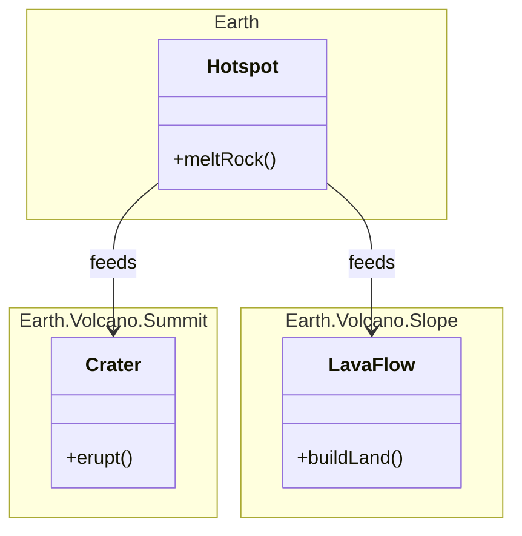

### Inheritance and Methods

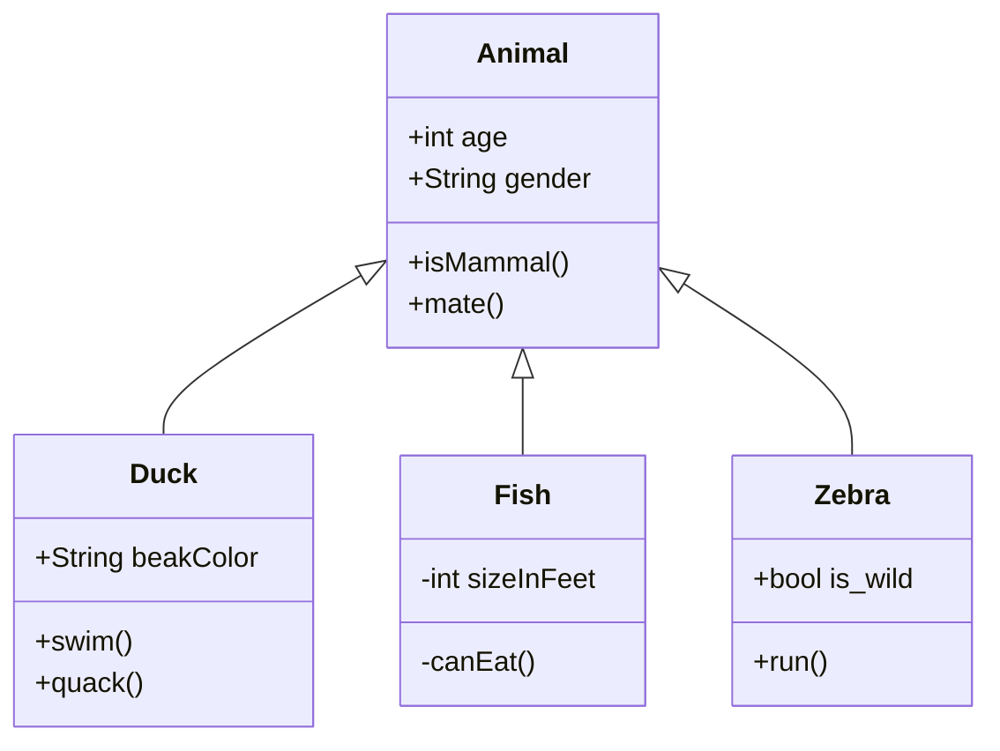

---

## 5. Entity Relationship Diagrams (`erDiagram`)

### Customer Orders & Products Schema

```mermaid
erDiagram
  CUSTOMER ||--o{ ORDER : places
  ORDER ||--|{ LINE_ITEM : contains
  PRODUCT ||--o{ LINE_ITEM : "appears in"
  CUSTOMER {
    string name
    string email
  }
  ORDER {
    int id
    date placedAt
  }
  LINE_ITEM {
    int quantity
    float price
  }
  PRODUCT {
    string sku
    string title
  }
```

### E-Commerce Domain Relationships

```mermaid
erDiagram
    CUSTOMER }|..|{ DELIVERY-ADDRESS : has
    CUSTOMER ||--o{ ORDER : places
    CUSTOMER ||--o{ INVOICE : "liable for"
    DELIVERY-ADDRESS ||--o{ ORDER : receives
    INVOICE ||--|{ ORDER : covers
    ORDER ||--|{ ORDER-ITEM : includes
    PRODUCT-CATEGORY ||--|{ PRODUCT : contains
    PRODUCT ||--o{ ORDER-ITEM : "ordered in"
```

---

## 6. Gantt Charts (`gantt`)

### Multi-Team Project Schedule

```mermaid
gantt
    title Example Gantt diagram
    dateFormat YYYY-MM-DD
    section Team 1
    Research & requirements :done, a1, 2020-03-08, 2020-04-10
    Review & documentation  :after a1, 20d
    section Team 2
    Implementation          :crit, active, 2020-03-25, 20d
    Testing                 :crit, 20d
```

### Sequential Tasks with Excluded Date

```mermaid
gantt
    dateFormat YYYY-MM-DD
    title Adding GANTT diagram to mermaid
    excludes 2014-01-10

    section A section
    Completed task :done, des1, 2014-01-06, 2014-01-08
    Active task    :active, des2, 2014-01-09, 3d
    Future task    :des3, after des2, 5d
    Future task2   :des4, after des3, 5d
```

---

## 7. Pie Charts (`pie`)

### Crew Catch Breakdown

```mermaid
pie title Fish caught by the crew
    "ʻAhi" : 386
    "Mahimahi" : 85
    "Ono" : 15
```

### Volunteer Pet Adoptions

```mermaid
pie title Pets adopted by volunteers
    "Dogs" : 386
    "Cats" : 85
    "Rats" : 15
```

---

## 8. Git Graphs (`gitGraph`)

### Branches, Merge, and Cherry-Pick

```mermaid
gitGraph
    commit id: "ZERO"
    branch develop
    branch release
    commit id: "A"
    checkout main
    commit id: "ONE"
    checkout develop
    commit id: "B"
    checkout main
    merge develop id: "MERGE"
    commit id: "TWO"
    checkout release
    cherry-pick id: "MERGE" parent: "B"
    commit id: "THREE"
    checkout develop
    commit id: "C"
```

### Commit Tags and Highlights

```mermaid
gitGraph
    commit id: "init"
    branch feature
    checkout feature
    commit id: "feat-1"
    commit tag: "v0.1.0"
    checkout main
    commit type: HIGHLIGHT
    merge feature
    commit id: "release"
```

---

## 9. User Journey Diagrams (`journey`)

### Working Day Journey

```mermaid
journey
    title My working day
    section Go to work
      Make tea: 5: Me
      Go upstairs: 3: Me
      Do work: 1: Me, Cat
    section Go home
      Go downstairs: 5: Me
      Sit down: 5: Me
```

---

## 10. Requirement Diagrams (`requirementDiagram`)

### Checkout & Payment Functional Requirements

```mermaid
requirementDiagram
  requirement checkout_req {
    id: 1
    text: Orders must be payable online.
    risk: high
    verifymethod: test
  }
  functionalRequirement payment_req {
    id: 1.1
    text: Card payments must be authorized.
    risk: high
    verifymethod: test
  }
  element checkout_service {
    type: service
  }
  checkout_req - contains -> payment_req
  checkout_service - satisfies -> payment_req
```

---

## 11. XY Charts (`xychart`, `xychart-beta`)

### Monthly Ocean Temperature

```mermaid
xychart
    title "Ocean Temperature"
    x-axis [jan, feb, mar, apr, may, jun, jul, aug, sep, oct, nov, dec]
    y-axis "Temperature (in °F)" 74 --> 82
    bar [76.3, 75.9, 76.0, 76.7, 77.8, 78.9, 79.9, 80.7, 81.1, 80.5, 79.1, 77.4]
    line [76.3, 75.9, 76.0, 76.7, 77.8, 78.9, 79.9, 80.7, 81.1, 80.5, 79.1, 77.4]
```

### Quarterly Sales Revenue

```mermaid
xychart-beta
    title "Quarterly Sales Revenue"
    x-axis [Q1, Q2, Q3, Q4]
    y-axis "Revenue (in $k)" 0 --> 120
    bar [45, 72, 88, 110]
    line [40, 68, 85, 105]
```

---

## 12. Quadrant Charts (`quadrantChart`)

### Campaign Reach vs. Engagement

```mermaid
quadrantChart
    title Reach and engagement of campaigns
    x-axis Low Reach --> High Reach
    y-axis Low Engagement --> High Engagement
    quadrant-1 We should expand
    quadrant-2 Need to promote
    quadrant-3 Re-evaluate
    quadrant-4 May be improved
    Campaign A: [0.3, 0.6]
    Campaign B: [0.45, 0.23]
    Campaign C: [0.57, 0.69]
    Campaign D: [0.78, 0.34]
    Campaign E: [0.40, 0.34]
    Campaign F: [0.35, 0.78]
```

---

## 13. Mindmaps (`mindmap`)

### Hawaiʻi History, Nature & Culture

```mermaid
mindmap
  root((Hawaiʻi))
    History
      Old legends
      ::icon(fa fa-book)
      Voyaging
        Polynesian navigators who sailed by the stars
    Nature
      Mountains<br/>and volcanoes
      Ocean life
        Reef
            Sea turtles
            Monk seals
            Parrotfish
    Culture
      Hula and lei
      ʻUkulele
```

### Engine Feature Hierarchy

```mermaid
mindmap
  root((markdown_engine))
    Rendering
      CommonMark
      GitHub Alerts
      LaTeX Math
      Pure-Dart Mermaid
    Navigation
      Quick Open
      Outline View
      File Explorer
    Search
      Ripgrep Engine
      Regex Indexing
```

---

## 14. Timelines (`timeline`)

### Timeline of the Hawaiian Islands

```mermaid
timeline
    title Timeline of the Hawaiian Islands
    section Older islands
        Kauaʻi : 5 million years old, Canyons, Sea <br>cliffs
        Oʻahu : 3 million years old, Diamond Head, Surf breaks
        Molokaʻi : 2 million years old, Fishponds, Tall cliffs
    section Younger islands
        Maui : 1 million years old, Haleakalā, Whale watching
        Hawaiʻi : Still growing, Mauna Kea, Kīlauea
```

---

## 15. Sankey Diagrams (`sankey`, `sankey-beta`)

### Energy Grid Distribution Flow

```mermaid
---
config:
  sankey:
    showValues: false
    nodeWidth: 14
    nodePadding: 18
---
sankey

Solar,Electricity Grid,140
Wind,Electricity Grid,185
Hydro,Electricity Grid,95
Natural Gas,Electricity Grid,160
Natural Gas,District Heating,110
Electricity Grid,Homes,190
Electricity Grid,Industry,230
Electricity Grid,Electric Transport,95
Electricity Grid,Grid Losses,65
District Heating,Homes,70
District Heating,Industry,40
```

---

## 16. Packet Diagrams (`packet`, `packet-beta`)

### TCP Packet Header

```mermaid
---
title: "TCP Packet"
---
packet
0-15: "Source Port"
16-31: "Destination Port"
32-63: "Sequence Number"
64-95: "Acknowledgment Number"
96-99: "Data Offset"
100-105: "Reserved"
106: "URG"
107: "ACK"
108: "PSH"
109: "RST"
110: "SYN"
111: "FIN"
112-127: "Window"
128-143: "Checksum"
144-159: "Urgent Pointer"
160-191: "(Options and Padding)"
192-255: "Data (variable length)"
```

---

## 17. Block Diagrams (`block`, `block-beta`)

### Layered Database Block Diagram

```mermaid
block
columns 1
  db(("DB"))
  blockArrowId6<["&nbsp;&nbsp;&nbsp;"]>(down)
  block:ID
    A
    B["A wide one in the middle"]
    C
  end
  space
  D
  ID --> D
  C --> D
  style B fill:#969,stroke:#333,stroke-width:4px
```

---

## 18. Kanban Boards (`kanban`)

### Engineering Sprint Board with Ticket Metadata

```mermaid
---
config:
  kanban:
    ticketBaseUrl: 'https://mermaidchart.atlassian.net/browse/#TICKET#'
---
kanban
  Todo
    [Create Documentation]
    docs[Create Blog about the new diagram]
  [In progress]
    id6[Pure-Dart vector Mermaid rendering in markdown_engine_flutter]
  id9[Ready for deploy]
    id8[Design grammar]@{ assigned: 'knsv' }
  id10[Ready for test]
    id4[Create parsing tests]@{ ticket: MC-2038, assigned: 'K.Sveidqvist', priority: 'High' }
    id66[Verify dark and light palettes]@{ priority: 'Low', assigned: 'tkinnis' }
  id11[Done]
    id5[Remove WebView dependency]
    id3[Proportional font scaling]@{ ticket: MC-2037, assigned: 'tkinnis', priority: 'High' }
```

---

## 19. C4 Architecture Diagrams (`C4Context`, `C4Component`)

### System Context Diagram

```mermaid
C4Context
    title System Context diagram for Internet Banking System
    Person(customerA, "Banking Customer A", "A customer of the bank.")
    System(SystemAA, "Internet Banking System", "Allows customers to view information about their bank accounts, and make payments.")
    System_Ext(SystemE, "Mainframe Banking System", "Stores all of the core banking information about customers, accounts, transactions, etc.")
    Rel(customerA, SystemAA, "Uses")
    Rel(SystemAA, SystemE, "Uses")
```

### API Application Component Diagram

```mermaid
C4Component
    title Component diagram for Internet Banking System - API Application

    Container(spa, "Single Page Application", "JavaScript and Angular", "Provides all the internet banking functionality to customers via their web browser.")
    Container(ma, "Mobile App", "Flutter", "Provides internet banking functionality to customers via their mobile device.")
    ContainerDb(db, "Database", "Relational Database Schema", "Stores user registration information, hashed authentication credentials, access logs, etc.")
    System_Ext(mbs, "Mainframe Banking System", "Stores all of the core banking information about customers, accounts, transactions, etc.")

    Container_Boundary(api, "API Application") {
        Component(sign, "Sign In Controller", "MVC Rest Controller", "Allows users to sign in to the internet banking system")
        Component(accounts, "Accounts Summary Controller", "MVC Rest Controller", "Provides customers with a summary of their bank accounts")
        Component(security, "Security Component", "Spring Bean", "Provides functionality related to signing in, changing passwords, etc.")
        Component(mbsfacade, "Mainframe Banking System Facade", "Spring Bean", "A facade onto the mainframe banking system.")

        Rel(sign, security, "Uses")
        Rel(accounts, mbsfacade, "Uses")
        Rel(security, db, "Read & write to", "JDBC")
        Rel(mbsfacade, mbs, "Uses", "XML/HTTPS")
    }

    Rel_Back(spa, sign, "Uses", "JSON/HTTPS")
    Rel(spa, accounts, "Uses", "JSON/HTTPS")
    Rel(ma, sign, "Uses", "JSON/HTTPS")
    Rel(ma, accounts, "Uses", "JSON/HTTPS")
```

---

## 20. Architecture Diagrams (`architecture-beta`)

### Cloud Service Topology

```mermaid
architecture-beta
    group api(cloud)[API]

    service db(database)[Database] in api
    service disk1(disk)[Storage] in api
    service disk2(disk)[Storage] in api
    service server(server)[Server] in api

    db:L -- R:server
    disk1:T -- B:server
    disk2:T -- B:db
```

---

## 21. Radar Diagrams (`radar-beta`)

### Multi-Axis Grades Comparison

```mermaid
---
title: "Grades"
---
radar-beta
  axis m["Math"], s["Science"], e["English"]
  axis h["History"], g["Geography"], a["Art"]
  curve a["Alice"]{85, 90, 80, 70, 75, 90}
  curve b["Bob"]{70, 75, 85, 80, 90, 85}

  max 100
  min 0
```

---

## 22. Treemap Diagrams (`treemap-beta`)

### Product Catalog Hierarchy

```mermaid
treemap-beta
"Products"
    "Electronics"
        "Phones": 50
        "Computers": 30
        "Accessories": 20
    "Clothing"
        "Men's": 40
        "Women's": 40
```

---

## 23. Venn Diagrams (`venn-beta`)

### Three-Set Feature Overlap

```mermaid
venn-beta
  title What makes a good feature
  set Desirable
  set Feasible
  set Viable
  union Desirable,Feasible["Buildable"]
  union Feasible,Viable["Sustainable"]
  union Desirable,Viable["Marketable"]
  union Desirable,Feasible,Viable["Ship it"]
```

---

## 24. Railroad Diagrams (`railroad-ebnf-beta`, `railroad-beta`, `railroad-abnf-beta`, `railroad-peg-beta`)

### Arithmetic Expression Grammar (`railroad-ebnf-beta`)

```mermaid
railroad-ebnf-beta
title "Arithmetic Expression Grammar"

expression = term ( ( "+" | "-" ) term )* ;
term = factor ( ( "*" | "/" ) factor )* ;
factor = number | "(" expression ")" ;
number = digit+ ;
digit = "0" | "1" | "2" | "3" | "4" | "5" | "6" | "7" | "8" | "9" ;
```

### Select Clause Combinator Grammar (`railroad-beta`)

```mermaid
railroad-beta
    select = sequence(
        terminal("SELECT"),
        nonterminal("column"),
        zeroOrMore(sequence(terminal(","), nonterminal("column"))),
        terminal("FROM"),
        nonterminal("table"),
        optional(sequence(terminal("WHERE"), nonterminal("predicate")))
    );
```

### ABNF Rule Grammar (`railroad-abnf-beta`)

```mermaid
railroad-abnf-beta
    header = field-name ":" [ field-value ] CRLF;
```

### PEG Rule Grammar (`railroad-peg-beta`)

```mermaid
railroad-peg-beta
    pair <- key ":" value ("," key ":" value)*;
```

---

## 25. TreeView Diagrams (`treeView-beta`)

### Highlighted Project Tree with Icons & Annotations

```mermaid
treeView-beta
├── src/
│   ├── App.tsx :::highlight icon(logos:react) ## main component
│   └── index.ts ## entry point
├── .env ## environment variables
├── Dockerfile
└── package.json
```

---

## 26. Ishikawa Diagrams (`ishikawa-beta`)

### Multi-Level Cause & Effect Fishbone

```mermaid
ishikawa-beta
    Blurry Photo
    Process
        Out of focus
        Shutter speed too slow
        Protective film not removed
        Beautification filter applied
    User
        Shaky hands
    Equipment
        LENS
            Inappropriate lens
            Damaged lens
            Dirty lens
        SENSOR
            Damaged sensor
            Dirty sensor
    Environment
        Subject moved too quickly
        Too dark
```

---

## 27. Cynefin Diagrams (`cynefin-beta`)

### Five-Domain Incident Response Framework

```mermaid
cynefin-beta
  title Incident Response

  complex
    "Investigate root cause"
    "Run chaos experiment"

  complicated
    "Analyze performance data"
    "Expert review needed"

  clear
    "Restart service"
    "Apply known fix"

  chaotic
    "Page on-call immediately"

  confusion
    "Unknown failure mode"

  chaotic --> complex : "stabilize"
  complex --> complicated : "codify"
```

---

## 28. Wardley Maps (`wardley-beta`)

### Tea Shop Value Chain with Evolution & Notes

```mermaid
wardley-beta
title Tea Shop Value Chain

anchor Business [0.95, 0.63]
component Cup of Tea [0.79, 0.61]
component Tea [0.63, 0.81]
component Hot Water [0.52, 0.80]
component Kettle [0.43, 0.35]
component Power [0.10, 0.70]

Business -> Cup of Tea
Cup of Tea -> Tea
Cup of Tea -> Hot Water
Hot Water -> Kettle
Kettle -> Power

evolve Kettle 0.62
evolve Power 0.89

note "Standardizing power allows Kettles to evolve faster" [0.30, 0.49]
```

---

## 29. Event Modeling Diagrams (`eventmodeling`)

### Shopping Cart Command, Event & Read-Model Slice

```mermaid
eventmodeling
    tf 01 ui CartView
    tf 02 cmd AddItem ->> 01
    tf 03 evt ItemAdded ->> 02
    tf 04 rmo CartSummary ->> 03
```

---

## 30. Agentflow Diagrams (`agentflow-beta`)

### Multi-Agent Drafting & Review Pipeline

```mermaid
agentflow-beta TB
  brief["Release brief"]@{ shape: input }
  flow writer["Drafting Agent"]
    draft["Draft the notes"]@{ shape: task }
    lookup["changelog_search"]@{ shape: tool }
    guide["Tone of voice"]@{ shape: refdoc }
    draft --> lookup
    draft -.- guide
  end
  flow reviewer["Review Agent"]
    check["Check the claims"]@{ shape: task }
    ok["Accurate?"]@{ shape: decision }
    check --> ok
  end
  publish["Publish"]@{ shape: action }
  brief --> writer
  writer --> reviewer
  ok --> publish
```

---

## 31. Use Case Diagrams (`usecase-beta`)

### Storefront & Fulfillment System Boundaries

```mermaid
usecase-beta
direction LR
actor Customer
actor Support
systemBoundary Storefront
  Browse("Browse catalog")
  Checkout("Checkout")
end
systemBoundary Fulfilment
  Track("Track delivery")
end
Customer --> Browse
Customer --> Checkout
Customer --> Track
Support --> Track
Checkout ..> : include Browse
```

---

## 32. Swimlane Diagrams (`swimlane-beta`)

### Cross-Department Order Fulfillment

```mermaid
swimlane-beta LR
  subgraph Customer
    Browse[Browse catalog]
    Pay[Pay]
  end
  subgraph Warehouse
    Pick[Pick items]
    Ship[Ship order]
  end
  subgraph Finance
    Invoice[Raise invoice]
  end
  Browse --> Pay
  Pay --> Pick
  Pick --> Ship
  Pay --> Invoice
```

---

## 33. Info Diagrams (`info`)

### Package Version Info

```mermaid
info
```

---

# LaTeX Math Examples

A comprehensive gallery exercising **markdown_engine**'s native pure-Dart LaTeX math engine (`tex_math_flutter` backed by `tex_math` and bundled `NewCMMath-Regular.otf`). Open this guide in **Markdown Studio** to test inline baseline alignment, light/dark theme switching, `Cmd+=` / `Cmd+-` font scaling, `SelectionArea` copy-as-LaTeX, horizontal overflow scrolling, clickable `\href` links, and error span diagnostics.

---

## 1. Inline Baseline Alignment & Markdown Integration

### Flowing Prose

Euler's identity $e^{i\pi} + 1 = 0$ and mass-energy equivalence $E = mc^2$ sit cleanly on the text baseline alongside taller inline expressions such as $\frac{a + b}{c + d}$, radicals like $\sqrt{x^2 + y^2}$, summation $\sum_{i=1}^{n} x_i$, and integrals $\int_0^1 f(x)\,dx$.

### Heading With Inline Math $E = mc^2$ and $\alpha + \beta$

### Markdown Table Integration

| Topic | Inline Formula | Meaning |
| :--- | :--- | :--- |
| Norm | $\lVert \mathbf{v} \rVert_2 = \sqrt{\sum_{i=1}^n \lvert v_i \rvert^2}$ | Euclidean vector length |
| Conditional | $P(A \mid B) = \frac{P(A \cap B)}{P(B)}$ | Bayes conditional probability |
| Inner product | $\langle f, g \rangle = \int_a^b f(x)\,\overline{g(x)}\,dx$ | $L^2[a, b]$ inner product |

### Blockquote, List & Footnote

> For any $\sigma > 0$, the Gaussian normal density satisfies $\int_{-\infty}^{\infty} \frac{1}{\sqrt{2\pi}\sigma} e^{-\frac{(x-\mu)^2}{2\sigma^2}}\,dx = 1$.

* **Quadratic discriminant**: $\Delta = b^2 - 4ac$ determines root multiplicity.
* **Stirling's approximation**: $n! \sim \sqrt{2\pi n}\left(\frac{n}{e}\right)^n$ as $n \to \infty$.
* **Footnote formula**: The Golden Ratio $\varphi = \frac{1 + \sqrt{5}}{2}$ satisfies $\varphi^2 = \varphi + 1$[^phi].

[^phi]: Note also the continued-fraction identity $\varphi = 1 + \frac{1}{1 + \frac{1}{1 + \ddots}}$.

---

## 2. Fractions, Nested Radicals & Big Operators

### Quadratic Formula & Nested Fractions

$$
x = \frac{-b \pm \sqrt{b^2 - 4ac}}{2a}, \qquad
\sqrt{\frac{\frac{a}{b} + \frac{c}{d}}{\frac{e}{f} - \frac{g}{h}}}
$$

### Continued Fractions & Binomials

$$
\pi = 3 + \cfrac{1^2}{6 + \cfrac{3^2}{6 + \cfrac{5^2}{6 + \ddots}}}, \qquad
(x + y)^n = \sum_{k=0}^{n} \binom{n}{k} x^{n-k} y^k
$$

### Generalized Roots, Integrals & Limits

$$
\int_{-\infty}^{\infty} e^{-\alpha x^2}\,dx = \sqrt{\frac{\pi}{\alpha}}, \qquad
\oint_{\partial \Omega} \mathbf{F} \cdot d\mathbf{r} = \iint_{\Omega} (\nabla \times \mathbf{F}) \cdot d\mathbf{S}, \qquad
\lim_{n \to \infty} \left(1 + \frac{z}{n}\right)^n = e^z, \qquad
\prod_{p \text{ prime}} \frac{1}{1 - p^{-s}} = \sum_{n=1}^{\infty} \frac{1}{n^s}
$$

$$
\sqrt[n]{\frac{a_1 + a_2 + \dots + a_n}{n}} \ge \sqrt[n]{\prod_{k=1}^{n} a_k}
$$

---

## 3. Matrices, Arrays & Commutative Diagrams

### Standard & Right-Aligned Matrices (`ams` & `mathtools`)

$$
R(\theta) = \begin{pmatrix} \cos\theta & -\sin\theta \\ \sin\theta & \cos\theta \end{pmatrix}, \quad
B = \begin{bmatrix} 1 & 0 & -1 \\ 0 & 2 & 4 \\ 3 & -2 & 1 \end{bmatrix}, \quad
\det \begin{vmatrix} a & b \\ c & d \end{vmatrix} = ad - bc, \quad
M = \begin{pmatrix*}[r] -12 & 3 \\ 4 & -5 \end{pmatrix*}
$$

Inline matrix inside text: $I_2 = \begin{smallmatrix} 1 & 0 \\ 0 & 1 \end{smallmatrix}$ keeps line height compact.

### Ruled Arrays (`array` with `\hline` & Vertical Dividers)

$$
\left(
\begin{array}{c|cc}
x & 1 & 2 \\
\hline
y & 3 & 4 \\
z & 5 & 6
\end{array}
\right)
$$

### Commutative Diagram (`amscd`)

$$
\begin{CD}
A @>f>> B \\
@VVgV @VVhV \\
C @= D
\end{CD}
$$

---

## 4. Multi-Line Alignments, Cases & Multline

### Aligned System (`align*` & `gather`)

$$
\begin{align*}
\nabla \cdot \mathbf{E} &= \frac{\rho}{\varepsilon_0}, & \nabla \times \mathbf{E} &= -\frac{\partial \mathbf{B}}{\partial t}, \\
\nabla \cdot \mathbf{B} &= 0, & \nabla \times \mathbf{B} &= \mu_0 \mathbf{J} + \mu_0 \varepsilon_0 \frac{\partial \mathbf{E}}{\partial t}
\end{align*}
$$

$$
\begin{gather}
(a + b)^2 = a^2 + 2ab + b^2 \\
(a - b)^2 = a^2 - 2ab + b^2
\end{gather}
$$

### Piecewise Cases (`cases`, `dcases`, `rcases` & `empheq`)

$$
|x| = \begin{cases}
x & \text{if } x \ge 0 \\
-x & \text{if } x < 0
\end{cases}, \qquad
f(x) = \begin{dcases}
\frac{\sin x}{x} & x \neq 0 \\
1 & x = 0
\end{dcases}, \qquad
\begin{rcases}
x = r\cos\theta \\
y = r\sin\theta
\end{rcases} \implies x^2 + y^2 = r^2
$$

$$
\begin{empheq}[left=\empheqlbrack,right=\empheqrbrack]{gather}
a^2 + b^2 = c^2 \\
e^{i\pi} + 1 = 0
\end{empheq}
$$

### Staggered `multline`, `multlined` & `\shoveleft` / `\shoveright`

$$
\begin{multline} a + b + c + d \\ + e + f + g + h \\ + i + j + k + l \end{multline}
$$

$$
\begin{multlined}[t][14em]
f(x) = a_0 + a_1 x + a_2 x^2 \\
\shoveright{+ a_3 x^3 + a_4 x^4}
\end{multlined}
$$

### Equation Tags & Cross-References (`\tag`, `\label`, `\eqref`)

$$
\begin{equation}
e^{i\pi} + 1 = 0 \tag{E.1}\label{eq:euler}
\end{equation}
\qquad \text{See } \eqref{eq:euler}.
$$

---

## 5. Extensible Delimiters, Braces & Wide Accents

### Scaled Delimiters & Over/Under Braces

$$
\left\langle \frac{\int_0^1 x^2\,dx}{\sum_{k=1}^{\infty} 2^{-k}} \right\rangle, \qquad
\Bigg[ \bigg( \Big\{ \big| x \big| \Big\} \bigg) \Bigg], \qquad
\underbrace{a + b + \dots + z}_{26 \text{ terms}} + \overbrace{x_1 + \dots + x_n}^{n \text{ variables}}
$$

### Wide Accents, Brackets & Labeled Arrows

$$
\widehat{abc} + \widetilde{xyz} + \overbracket{a + b + c}^{n} + \underbracket{x + y}_{k}, \qquad
A \xrightarrow[\text{slow}]{k_1} B \xRightarrow{\text{converges}} C \xrightleftharpoons[k_{-1}]{k_1} D
$$

---

## 6. User Macros & Mathematical Alphabets

### Scoped `\newcommand` and `\def`

$$
\newcommand{\R}{\mathbb{R}}
\def\norm#1{\left\lVert #1 \right\rVert}
T : \R^n \to \R^m, \qquad \norm{T(\mathbf{x})} \le C \norm{\mathbf{x}}
$$

### Alphabets, Bold Symbols, Upright Greek & Text

$$
\mathbb{N} \subset \mathbb{Z} \subset \mathbb{Q} \subset \mathbb{R} \subset \mathbb{C}, \qquad
\mathcal{L}(\mathcal{H}), \quad \mathfrak{g}, \quad \mathscr{F}, \qquad
\boldsymbol{\alpha} + \boldsymbol{\Sigma}, \quad \upalpha + \upbeta = \uppi
$$

$$
\text{Velocity } v = \textbf{const}, \quad \textit{momentum } p = mv, \quad \texttt{complexity} = \mathcal{O}(n \log n)
$$

---

## 7. Chemistry (`mhchem`), Physics, Units & Proof Trees

### Chemical Equations, Isotopes & Physical Units (`mhchem`)

$$
\ce{N2 + 3H2 <=> 2NH3}, \qquad
\ce{CO2 + C -> 2CO}, \qquad
\ce{^{227}_{90}Th+}, \qquad
\ce{CH3-CH=CH2}, \qquad
\pu{9.81 m/s^2}
$$

### Dirac Notation, Derivatives & Physical Units (`\require{physics}`, `\require{units}`)

$$
\require{physics}
\dv{f}{x} + \pdv[2]{u}{t}, \qquad
\langle \psi \vert \hat{H} \vert \phi \rangle = \bra{\psi}\ket{\phi}, \qquad
\mqty(1 & 0 \\ 0 & 1)
$$

$$
\require{units}
g = \units[9.81]{m/s^2}, \qquad \rho = \nicefrac{3}{4}\,\units{g/cm^3}
$$

### Natural Deduction Proof Tree (`bussproofs`)

$$
\begin{prooftree}
\AxiomC{$A$}
\AxiomC{$A \to B$}
\BinaryInfC{$B$}
\end{prooftree}
$$

---

## 8. Color, Enclose, Cancel & Interactive Links (`\href`)

### Colors, Framed Boxes, Cancellations & Enclosures

$$
\color{teal}{f(x)} + \colorbox{yellow}{x^2} + \fcolorbox{red}{white}{E = mc^2} + \bbox[4px,border:2px solid #00a080]{a^2 + b^2 = c^2}
$$

$$
\frac{\cancel{(x - 1)}(x + 2)}{\cancel{(x - 1)}} = x + 2, \qquad
\bcancel{y} + \xcancel{z} + \cancelto{0}{\frac{1}{n}}, \qquad
\enclose{roundedbox}{a + b} + \enclose{circle}{r} + \enclose{updiagonalstrike}{c}
$$

### Clickable `\href` Links

Click the accent-styled links below inside **Markdown Studio** to launch them in your browser:

$$
\href{https://pub.dev/packages/tex_math_flutter}{\text{tex\_math\_flutter on pub.dev}} \qquad
\href{https://tkinnis.github.io/tex_math/}{\text{tex\_math Documentation}}
$$

---

## 9. Wide Overflow Scrolling & Error Diagnostics

### Wide Display Equation (Horizontal Scroll Test)

Resize the window narrower or scroll horizontally across this wide equation (`TexMathOverflow.scroll`):

$$
f(x) = a_0 + a_1 x + a_2 x^2 + a_3 x^3 + a_4 x^4 + a_5 x^5 + a_6 x^6 + a_7 x^7 + a_8 x^8 + a_9 x^9 + a_{10} x^{10} + a_{11} x^{11} + a_{12} x^{12} + \sum_{k=13}^{\infty} \frac{f^{(k)}(0)}{k!} x^k
$$

### Intentional Malformed TeX (Error Widget Diagnostics)

These three formulas are intentionally invalid to demonstrate `TexMathErrorWidget` source highlighting and span reporting:

Unclosed fraction argument:

$$\frac{1}{$$

Double superscript error:

$$x^2^3$$

Unknown control sequence:

$$\unknownmacro{x}$$
